# Arquitetura-Molde MCA — Fundamentação Teórica

| Campo | Valor |
|---|---|
| **Documento** | `docs/arquitetura_molde_fundamentacao.md` |
| **Versão** | 1.0 |
| **Data** | 2026-10-13 |
| **Status** | Fundamentação de arquitetura — base para contratação de componentes |
| **Escopo** | Definição genérica do molde, suas vistas, seus contratos e sua fundamentação bibliográfica |
| **Fora de escopo** | Implementação de componentes específicos; lógica de negócio COMEX; implementação de adaptadores |
| **Evidências primárias** | `SPEC_SOLO_MCA.md`; `solo_mca_rodou_01102026_1215.txt` |
| **Público** | Arquitetos, desenvolvedores de componentes, desenvolvedores de composição, operação, curadoria |

---

## Sumário

1. [Formulação do problema](#1-formulação-do-problema)
2. [Procedimento de derivação](#2-procedimento-de-derivação)
3. [Referencial teórico](#3-referencial-teórico)
4. [Definição do molde](#4-definição-do-molde)
5. [Vistas arquiteturais](#5-vistas-arquiteturais)
6. [Ro-DOU como fornecedor de componentes](#6-ro-dou-como-fornecedor-de-componentes)
7. [Atributos de qualidade](#7-atributos-de-qualidade)
8. [Decisões arquiteturais](#8-decisões-arquiteturais)
9. [Critérios de conformidade do molde](#9-critérios-de-conformidade-do-molde)
10. [Trade-offs e limites](#10-trade-offs-e-limites)
11. [Glossário](#11-glossário)
12. [Referências bibliográficas](#12-referências-bibliográficas)
13. [Matriz de traçabilidade](#13-matriz-de-traçabilidade)

---

## 1. Formulação do problema

### 1.1. Enunciado

Construir uma **arquitetura de software genérica** que funcione como *molde* para a composição de componentes heterogêneos de processamento normativo, contendo quatro condições simultâneas:

> **C1 — Generalidade.** O molde não pertence a nenhum caso de uso específico. Ele não é o Ro-DOU, não é o Solo MCA e não contém a lógica de nenhum dos dois.
>
> **C2 — Composabilidade.** Componentes originados em sistemas distintos (Ro-DOU, extratores legados, adaptadores de API, processadores LLM, motores de grafo) podem ser acoplados ao molde sem reescrita de seu núcleo funcional.
>
> **C3 — Execução garantida.** O molde garante que componentes acoplados sejam inicializados, invocados, supervisionados e encerrados segundo um contrato explícito.
>
> **C4 — Gestão nativa.** Medição, monitoramento e controle de cada componente são responsabilidade do molde, independentemente da ferramenta que o componente encapsula.

A condição **C4** exige uma distinção que não é resolvida por nenhum dos padrões isolados da literatura: a separação entre **orquestração** e **gestão**.

### 1.2. O que o molde é — e o que não é

| O molde **é** | O molde **não é** |
|---|---|
| Um esqueleto de execução com pontos de extensão | Uma aplicação de vigilância do DOU |
| Um conjunto de contratos de componente | Um fork ou wrapper do Ro-DOU |
| Uma camada de gestão transversal e imutável | Um DAG Generator específico de COMEX |
| Um mecanismo de composição declarativa | Um substituto do Airflow ou do n8n |
| Um vocabulário de domínio (LRMoo) opcional | Uma ontologia imposta a todo componente |
| Uma plataforma reutilizável | Uma solução de negócio fechada |

**Analogia operacional.** Se o Ro-DOU é um motor e o Solo MCA é um veículo, o molde é a **bancada de montagem com protocolo de testes**. Ela não define que veículo será montado; define como qualquer motor deve ser fixado, alimentado, monitorado e desligado.

**Analogia de sistemas operacionais.** O núcleo do molde comporta-se como um *kernel*: gerencia ciclo de vida, isolamento, métricas e sinais de um processo sem saber o que o processo calcula. A composição do DEV comporta-se como o *programa usuário*: define seu próprio fluxo de controle sobre os serviços que o kernel oferece. [R08][R09][R24]

### 1.3. Requisitos arquiteturais

| ID | Requisito | Origem da necessidade |
|---|---|---|
| RA-01 | Independência de domínio | C1 |
| RA-02 | Composição de componentes heterogêneos | C2 |
| RA-03 | Execução coordenada e determinística | C3 |
| RA-04 | Gestão nativa, total e transversal | C4 |
| RA-05 | Orquestração delegada ao DEV | Distinção Gestão × Orquestração |
| RA-06 | Imutabilidade do núcleo em relação ao DEV | Separação de propriedade |
| RA-07 | Substituição de ferramenta sem alteração de domínio | Hexagonal / Parnas |
| RA-08 | Observabilidade uniforme entre ferramentas | C4 |
| RA-09 | Configuração em camadas com precedência definida | Core DAGs × App DAGs |
| RA-10 | Testabilidade por camada | Pirâmide de testes do repositório |
| RA-11 | Evolução independente de núcleo e composição | Versionamento de release |
| RA-12 | Proveniência e curadoria auditáveis | `override_humano`, `aprovado_por`, `aprovado_em` em `SPEC_SOLO_MCA.md` |

### 1.4. Premissas e limites

**Premissas**

- P1. Componentes são unidades de implantação independentes ou embutidas, desde que exponham contrato observável.
- P2. A unidade de coordenação é um **grafo acíclico dirigido (DAG)** de estágios. Laços de negócio (por exemplo, reanálise após curadoria humana) são modelados como **eventos externos que disparam novas execuções**, não como ciclos no DAG.
- P3. O vocabulário de domínio do projeto MCA é o modelo LRMoo sobre a hierarquia normativa brasileira. O molde permite substituí-lo por outro vocabulário sem alterar sua mecânica. [R37]
- P4. Código em `legacy/` é **referência de refatoração**, nunca dependência de tempo de execução.

**Limites assumidos**

- L1. O molde não implementa um novo motor de agenda distribuída; ele **adapta** executores existentes.
- L2. O molde não garante correção semântica do conteúdo extraído por LLM; garante **rastreabilidade** da extração e **gate humano** antes da integração.
- L3. O molde não elimina a necessidade de contratos de dados entre equipes; formaliza-os.

### 1.5. Natureza das evidências

Este documento distingue rigorosamente três tipos de afirmação:

| Marca | Tipo | Fonte | Uso |
|---|---|---|---|
| **[E]** | Evidência documental | `SPEC_SOLO_MCA.md`; `solo_mca_rodou_01102026_1215.txt` | Fatos observados nos artefatos do projeto |
| **[T]** | Fundamentação teórica | Bibliografia consolidada da engenharia de software | Padrões, princípios, leis |
| **[S]** | Síntese projetual | Derivação deste documento | Decisões tomadas ao combinar [E] e [T] |

Afirmações marcadas **[S]** são decisões de projeto, não descobertas empíricas. Elas são formalizadas como ADRs na seção 8.

---

## 2. Procedimento de derivação

### 2.1. Método

A arquitetura foi derivada por **análise de lacuns de capacidade**: cada família de padrões da literatura foi avaliada quanto à capacidade que fornece e à capacidade que **não** fornece para atender C1–C4. O molde resulta da composição das capacidades complementares.

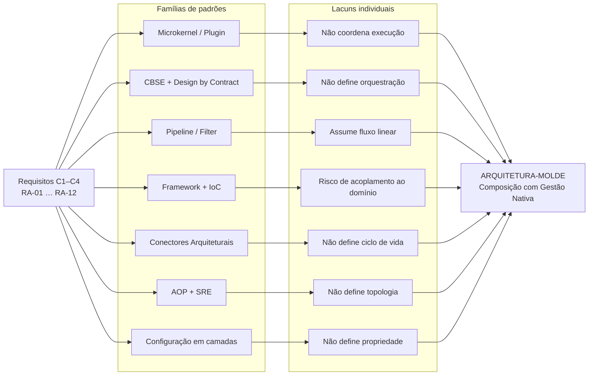

### 2.2. Matriz de capacidade × lacuna

| Família | Fornece | Não fornece | Lacuna fechada por |
|---|---|---|---|
| Microkernel / Plugin [R08][R18] | Extensão sem alteração do núcleo | Coordenação de execução | Pipeline + Framework |
| CBSE [R12] + DbC [R13] | Unidades de composição com contrato | Política de execução | Framework + IoC |
| Pipeline / Filter [R03] | Fluxo coordenado de transformação | Ramificação, paralelismo, eventos | Conectores + DAG |
| Framework / IoC [R09][R10] | Esqueleto estável com hot spots | Independência do domínio | Hexagonal + Parnas |
| Conectores [R15][R16] | Semântica de comunicação | Ciclo de vida do componente | Lifecycle Manager |
| AOP [R21] + SRE [R28] | Preocupação transversal involvente | Definição da topologia de negócio | Orquestração do DEV |
| Configuração em camadas [R25][R26][R27] | Propriedade e precedência | Mecânica de composição | Parser + Registro |

**Conclusão da análise [S]:** nenhuma família isolada satisfaz C1–C4. A satisfação simultânea exige separar **quem executa** (orquestração, variável), **quem supervisiona** (gestão, invariante) e **quem implementa** (componente, intercambiável).

---

## 3. Referencial teórico

### 3.1. Bases da disciplina de arquitetura

#### 3.1.1. Arquitetura como organização de elementos e relações

Shaw e Garlan consolidam a ideia de que arquitetura não é o código, mas a **estrutura de componentes, suas conexões e os restricionamentos sobre sua composição**. Isso autoriza tratar o molde como um artefato distinto dos componentes que ele conecta. [R03][R04]

A ISO/IEC/IEEE 42010 define arquitetura em termos de **sistema, stakeholders, preocupações e vistas**. O molde é apresentado neste documento por vistas separadas (seção 5), porque stakeholders diferentes precisam de garantias diferentes: o arquiteto precisa de coerência de contratos; o DEV de composição precisa de liberdade topológica; a operação precisa de visibilidade uniforme. [R06][R07]

#### 3.1.2. Ocultamento de informação

Parnas (1972) estabelece que a decomposição correta de um sistema deve isolar **decisões prováveis de mudar**, não etapas de processamento. No MCA, as decisões prováveis de mudar são: qual API fornece o DOU, qual grafo persiste, qual LLM resume, qual executor agenda. O domínio (URN, nível hierárquico, vigência, parentesco) é comparativamente estável. [R01]

Parnas (1979) acrescenta o critério de **extensão e contração**: um projeto é bom quando uma nova necessidade pode ser atendida adicionando um módulo, e uma necessidade obsoleta pode ser removida sem cascata de alterações. É exatamente o comportamento exigido para plugar o Ro-DOU hoje e um extrator alternativo amanhã. [R02]

> **Consequência para o molde [S]:** a fronteira de estabilização não é "entrada vs. saída", mas **domínio estável vs. decisão de ferramenta instável**.

#### 3.1.3. Dependência comportamental

Liskov e Wing formalizam que um substituto deve preservar o comportamento contratado, não apenas a assinatura. Um adaptador Neo4j só é substituível por um adaptador PostgreSQL se ambos preservarem as **pré-condições, pós-condições e invariantes** da porta. [R14]

Isso tem efeito prático direto no MCA: trocar o grafo por um relacional não é uma troca de driver; é uma troca que só é legítima se a porta continuar garantindo consulta temporal por URN e traversal de parentesco.

### 3.2. Extensibilidade: Microkernel, Framework e Linhas de Produto

#### 3.2.1. Microkernel / Plugin

O padrão Microkernel do POSA separa uma funcionalidade mínima e estável do núcleo de funcionalidades estendidas carregadas dinamicamente. O núcleo oferece **pontos de extensão**; os plugins os implementam. [R08]

Fowler formaliza o mesmo mecanismo como o padrão **Plugin**: "uma classe que estende uma aplicação abstrata plugging em uma função específica". [R18]

| Elemento do padrão | Correspondência no molde [S] |
|---|---|
| Sistema básico | Registry + Lifecycle Manager + Gestão |
| Ponto de extensão | `FontePort`, `ProcessadorPort`, `DestinoPort`, `InvocavelPort` |
| Plugin | Componente concreto (Ro-DOU, Senado, NCM, LLM) |
| Registro | Descoberta e validação de componentes |
| Isolamento | Contrato + invólucro de gestão |

**Limite:** Microkernel não especifica **em que ordem** os plugins executam nem **como os dados fluem** entre eles. Essa lacuna é fechada por Pipeline e por Framework.

#### 3.2.2. Framework e Inversão de Controle

Fayad e Schmidt definem frameworks como **aplicações semicompletas** que fornecem arquitetura genérica e funcionalidade de um domínio, sobre as quais aplicações são construídas por extensão e composição. [R09]

A mecânica central é a Inversão de Controle, cuja formulação clássica está em Johnson e Foote: o princípio de Hollywood — *"don't call us, we'll call you"*. [R10] No padrão **Template Method** de Gamma et al., o esqueleto do algoritmo pertence à superclasse e os passos variáveis são delegados a subclasses. [R11]

No molde, a inversão ocorre em três eixos:

1. **Ciclo de vida:** o DEV implementa `inicializar`, `executar`, `encerrar`; o framework decide **quando** chamá-los.
2. **Observabilidade:** o DEV não chama logger nem métricas; o framework coleta **ao redor** da invocação.
3. **Topologia:** o framework não conhece o DAG de negócio; o DEV o declara e o framework o materializa.

**Limite:** frameworks tendem a impor seu próprio modelo de domínio. A salvaguarda é a fronteira hexagonal (seção 3.3.3).

#### 3.2.3. Linhas de produto e variabilidade

Pohl, Böckle e van der Linden formalizam a distinção entre **assets core** (compartilhados, controlados centralmente) e **assets de aplicação** (variantes, controlados localmente), bem como entre *hot spots* (pontos de variabilidade) e decisões de variabilidade binding-time. [R19] Bosch apresenta a arquitetura como produto de um processo de evolução de linha de produto. [R20]

Esta é a fundamentação mais direta para a separação **Core DAGs × App DAGs**:

| Conceito de SPL | Correspondência no molde [S] | Binding-time |
|---|---|---|
| Core asset | `framework/core/dags/` | Compile / release |
| Application asset | `config/compositions/` | Deploy / runtime |
| Hot spot | Porta de componente + ponto de conexão | Build da composição |
| Variabilidade obrigatória | Escolha do componente | Configuração |
| Variabilidade opcional | Escolha do conector e do backend | Configuração |
| Restrição de variabilidade | Núcleo imutável; IDs disjuntos | Carregamento |

### 3.3. Composição: CBSE, Contratos e Hexagonalidade

#### 3.3.1. Componente como unidade de composição

Szyperski, Gruntz e Murer definem componente como:

> *"uma unidade de composição com interfaces especificadas contratualmente e dependências de contexto explícitas; pode ser implantada independentemente e está sujeita à composição por terceiros."* [R12]

A estrutura canônica de um componente é:

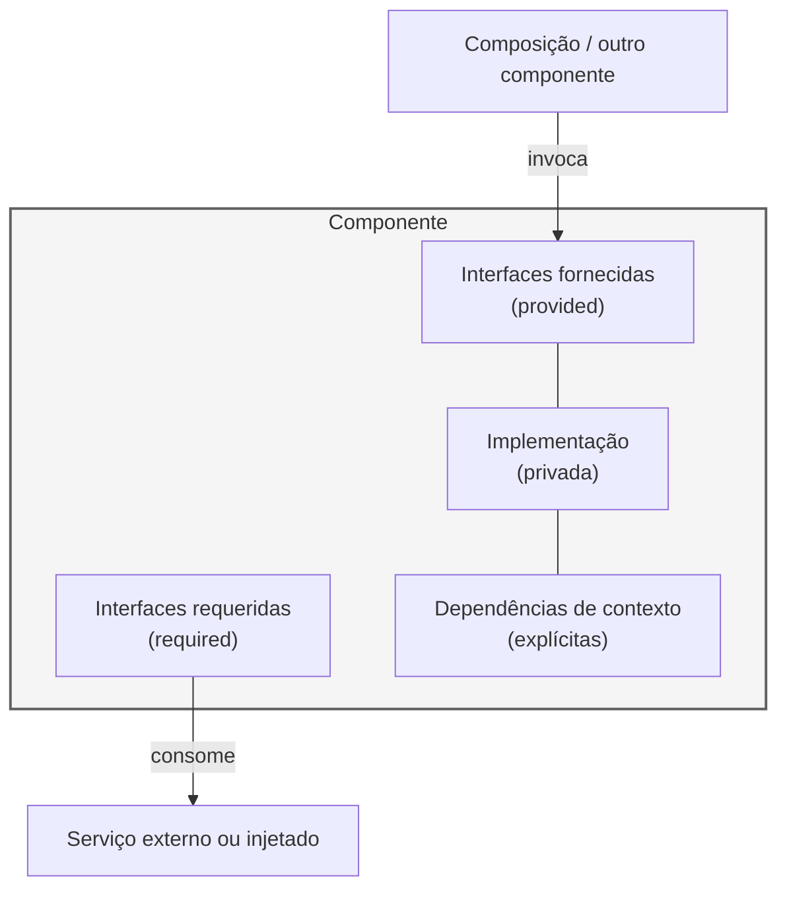

**Aplicação [S]:** o Ro-DOU, visto como componente, **fornece** `FontePort.buscar()` e **requer** credenciais INLABS, uma conectividade PostgreSQL e, opcionalmente, um provedor LLM. Essas dependências tornam-se explícitas no manifesto do componente em vez de estarem embutidas em chamadas globais.

#### 3.3.2. Design by Contract

Meyer formaliza contrato como a combinação de **pré-condição** (obrigação do cliente), **pós-condição** (obrigação do fornecedor) e **invariante** (condição mantida ao longo da execução). [R13]

No molde, contratos de componente são expressos como:

| Elemento | Exemplo em `FontePort` |
|---|---|
| Pré-condição | `config` contém termos e intervalo temporal válidos |
| Pós-condição | Resultado contém lote bruto **com proveniência e timestamp** |
| Invariante | Falha nunca retorna lote parcialmente marcado como íntegro |
| Falha de contrato | Exceção tipada do núcleo, nunca retorno silencioso |

#### 3.3.3. Arquitetura Hexagonal como disciplina de dependência

A Arquitetura Hexagonal (Ports & Adapters) organiza o sistema em um interior de domínio e um exterior de adaptadores, com dependência apontando **sempre para dentro**. [E] O repositório MCA já adota essa organização: `src/domain/`, `src/adapters/driving/{senado,ncm,rodou}/`, `src/adapters/driven/`, `src/processors/`. [E]

**Precisão importante [S]:** existe uma diferença entre o **orquestrador** e a **raiz de composição**:

- O **orquestrador** depende apenas de portas. Ele nunca importa `neo4j`, `airflow` ou um SDK de LLM.
- A **raiz de composição** (`bootstrap` + `config/compositions/`) é o único lugar que conhece classes concretas e as injeta no orquestrador.

Confundir esses dois papéis é a forma mais comum de reintroduzir acoplamento em sistemas hexagonais.

### 3.4. Coordenação: Pipeline, Conectores e Integração

#### 3.4.1. Pipeline e Filter

Garlan e Shaw descrevem Pipeline/Filter como um padrão em que cada processo transforma um fluxo de entrada em saída, comunicando-se por canais. As propriedades decorrentes são independência dos filtros, reuso e possibilidade de análise funcional do fluxo. [R03][R04]

No MCA, a cadeia `fetch → process → store` explicitada em `src/core/README.md` é literalmente um pipeline. [E]

**Limite:** o padrão clássico assume fluxo linear. Vigilância normativa exige:

- **Paralelismo** (Senado e NCM podem ser coletados simultaneamente);
- **Branching** (descarte automático vs. candidatura);
- **Gate humano** (aprovação antes da integração ao Solo);
- **Eventos** (webhook de entrada, notificação de saída).

Essas extensões são fornecidas pela teoria de conectores e pelos padrões de integração.

#### 3.4.2. Conectores arquiteturais

Medvidović e Taylor formalizam o conector como **elemento arquiteturais de primeira classe**, distinto dos componentes que conecta. Allen e Garlan fornecem uma base formal para conexão via portas e papéis. [R15][R16]

**Consequência [S]:** "como o dado sai do Ro-DOU e entra no n8n" não é um detalhe do Ro-DOU nem do n8n; é um **conector independente**, substituível e testável isoladamente.

| Classe de conector | Semântica | Exemplo no projeto |
|---|---|---|
| Chamada procedural | Síncrona, com retorno | Chamada local a `ProcessadorPort` |
| Requisição-resposta | Síncrona, sobre rede | HTTP para API do Senado |
| Mensageria / evento | Assíncrona, desacoplada | Webhook HTTP → n8n |
| Fluxo de dados | Streaming / lote | XML INLABS → `article_raw` |
| Persistência | Consulta e escrita | Bolt / Cypher → Neo4j |
| Tradução | Adaptação de formato | Raw Ro-DOU → candidato LRMoo |

#### 3.4.3. Padrões de Integração Empresarial

Hohpe e Woolf catalogam os padrões de mensageria que tornam a coordenação assíncrona projetável: *Message Channel*, *Message Router*, *Message Translator*, *Message Store*, *Recipient List*, *Scatter-Gather*, *Claim Check*. [R17]

Aplicação direta ao MCA [S]:

| Padrão EIP | Uso no molde |
|---|---|
| Message Translator | Conversão do payload Raw do Ro-DOU em candidato LRMoo |
| Message Router | Seleção de critério COMEX C1–C6 |
| Message Store | `article_raw` no PostgreSQL como cache durável |
| Scatter-Gather | Coleta paralela em Senado, NCM e DOU |
| Claim Check | Passar referência ao lote em `article_raw`, não o texto integral entre estágios |
| Message Channel | Webhook HTTP como fronteira entre Ro-DOU e n8n |

O **Claim Check** é particularmente relevante: `full_text` pode ser extenso. Transportá-lo integralmente entre estágios acopla desempenho e memória; transportar um identificador e resolver sob demanda preserva a autonomia dos componentes.

#### 3.4.4. Workflows como DAGs

A literatura de workflows científicos consolidou o DAG como modelo de coordenação com dependências explícitas, paralelismo derivado e recuperação por estágio. [R43] A validação de aciclicidade é um problema clássico de ordenação topológica. [R44]

**Aplicação [S]:** o parser de DAGs do molde deve rejeitar grafos cíclicos **antes** de qualquer execução. Um ciclo de negócio (reanálise após curadoria) é representado como duas execuções distintas ligadas por evento, preservando a aciclicidade de cada execução.

### 3.5. Transversalidade: Gestão como preocupação transversal

#### 3.5.1. AOP e a noção de involucre

Kiczales et al. introduzem a programação orientada a aspectos para tratar **preocupações transversais** — funcionalidades que atravessam múltiplas模块化 do sistema sem pertencer a nenhuma delas. [R21]

A distinção formulada neste projeto entre Gestão e Orquestração é um caso canônico de preocupação transversal:

> **Gestão é uma preocupação transversal ao conjunto de componentes. Orquestração é uma preocupação estrutural de uma composição específica.**

O mecanismo de aplicação pode ser um **invólucro** (decorator / wrapper), uma **interceptação** (middleware) ou um **aspecto**. O molde adota o invólucro por ser explícito, testável e independente de instrumentação de bytecode ou metaclasses. [S]

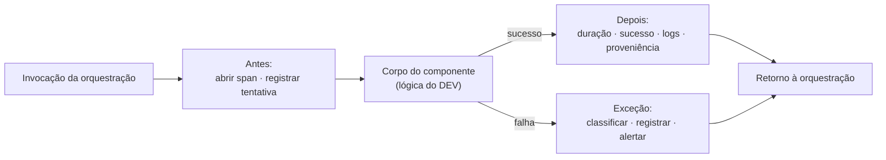

#### 3.5.2. Observabilidade como disciplina de operação

A literatura de SRE estabelece que sistemas em produção devem ser operados com base em sinais observáveis, e que monitoramento white-box é preferível a black-box quando o internals do sistema é conhecido. [R28] Dapper formaliza o tracing distribuído como amostragem de rastreios ao longo de cadeias de invocação. [R29] O OpenTelemetry consolidou métricas, traces e logs como três sinais correlacionáveis. [R30]

**Aplicação [S]:** a Gestão do molde coleta os três sinais **na fronteira do componente**, de modo que a correlação exista mesmo quando o componente interno não é instrumentado.

### 3.6. Proteção, configuração e implantação

#### 3.6.1. Menor privilégio e mediação completa

Saltzer e Schroeder estabelecem os princípios de **menor privilégio**, **mediação completa** e **isolamento**. [R24]

A imutabilidade do core em relação ao DEV não é uma convenção social; é uma aplicação do princípio de menor privilégio:

| Sujeito | Privilégio sobre `framework/core/` | Privilégio sobre `config/compositions/` |
|---|---|---|
| Mantenedor do núcleo | Leitura e escrita | Leitura |
| DEV de composição | Leitura **apenas** | Leitura e escrita |
| Execução em runtime | Leitura; montagem `:ro` | Leitura; execução |
| Operação | Leitura; configuração de ambiente | Leitura; acionamento |

A **mediação completa** aparece no parser: toda DAG, de qualquer origem, passa pelo mesmo validador. Não existe caminho de carregamento que contorne a verificação.

#### 3.6.2. Infraestrutura como Código e Entrega Contínua

Humble e Farley estabelecem que configuração deve ser tratada com o mesmo rigor que código: versionamento, teste, revisão e implantação automatizada. [R25] Morris formaliza a infraestrutura como código e a distinção entre componentes mutáveis e imutáveis. [R26] Weckesser e Cleasby formalizam o GitOps como reconciliação declarativa de estado a partir de um repositório. [R27]

**Aplicação [S]:** Core DAGs e App DAGs são **código versionado**, não configuração manual em produção. A diferença entre elas é de **propriedade e ciclo de release**, não de natureza.

#### 3.6.3. Configuração em camadas

A separação entre configuração de framework e configuração de aplicação é prática consolidada em ecossistemas como Spring Boot e Django. O princípio geral é: **cada camada tem um dono e uma frequência de mudança própria**.

| Camada | Dono | Frequência | Artefatos | Mutabilidade pelo DEV |
|---|---|---|---|---|
| Núcleo | Mantenedor do framework | Por release | Core DAGs, portas, invólucro de gestão | Não |
| Composição | DEV da aplicação | Por iteração | App DAGs, componentes, `app.env` | Sim |
| Ambiente | Operação | Por deploy / runtime | Variáveis, segredos, overrides | Sim (parâmetros operacionais) |

---

## 4. Definição do molde

### 4.1. Nome e definição formal

> **Denominação [S]:** *Arquitetura-Molde de Composição com Gestão Nativa* — em inglês, *Component Composition Framework with Native Management*.

**Definição.** Uma arquitetura-molde é uma estrutura de software composta por um **núcleo imutável** que oferece contratos de componente, um mecanismo de composição declarativa, um ciclo de vida governado e uma camada de gestão transversal; sobre essa estrutura, um desenvolvedor compõe **grafos de execução** mediante a seleção de componentes e conectores, sem alterar o núcleo.

### 4.2. Formulação da distinção Gestão × Orquestração

Esta é a contribuição central do molde e merece formalização.

**Definição de componente.** Seja um componente $c$ representado pela quádrupla:

$$c = (P,\ R,\ I,\ D)$$

onde $P$ é o conjunto de interfaces fornecidas, $R$ o conjunto de interfaces requeridas, $I$ a implementação privada e $D$ o conjunto de dependências de contexto. [R12]

**Definição de Gestão.** Seja $\mathcal{C}$ o conjunto de componentes registrados. A Gestão é uma função **total** sobre $\mathcal{C}$:

$$G : \mathcal{C} \rightarrow \langle M, L, T, A, K \rangle$$

onde $M$ são métricas, $L$ logs, $T$ traces, $A$ alertas e $K$ comandos de controle.

**Propriedade fundamental — invariância sob substituição:**

$$\forall c = (P, R, I, D),\ \forall I' :\quad \text{se}\ \ contract(P, R, D)\ \text{é preservado},\ \text{então}\ G(c_{I}) = G(c_{I'})$$

Ou seja: **trocar a implementação interna de um componente não altera a definição da sua gestão.**

**Definição de Orquestração.** A Orquestração é uma estrutura sobre um subconjunto de componentes e uma topologia:

$$O = (V,\ E,\ \Phi,\ \Psi)$$

onde $V \subseteq \mathcal{C}$ é o conjunto de estágios, $E \subseteq V \times V$ é o conjunto de dependências, $\Phi : E \rightarrow \text{Conectores}$ atribui um conector a cada aresta e $\Psi : V \rightarrow \text{Política}$ atribui agendamento, condições e políticas de repetição.

**Propriedade fundamental — variância sob substituição:**

A definição de $O$ **pode mudar** quando $I$ muda, porque $\Phi$ depende do protocolo efetivo da ferramenta.

| Dimensão | Gestão $G$ | Orquestração $O$ |
|---|---|---|
| Natureza | Função total sobre componentes | Estrutura sobre um grafo |
| Propriedade | Núcleo do framework | DEV da composição |
| Dependência de ferramenta | **Nenhuma** | **Sim** |
| Unidade de interesse | Ciclo de vida (vertical) | Topologia (horizontal) |
| Artefato | Core DAGs + invólucro | App DAGs + conectores |
| Alteração por iteração de negócio | Não | Sim |
| Semântica | "Como este componente está se comportando?" | "Em que ordem e por qual canal?" |

**Corolário [S]:** um componente que exija código especial de monitoramento **dentro** de sua implementação viola a invariância de $G$ e, portanto, não está em conformidade com o molde.

### 4.3. Axiomas do molde

| ID | Axioma | Consequência operacional | Fundamentação |
|---|---|---|---|
| AX-01 | Adaptadores dependem de contratos; contratos nunca dependem de adaptadores | `src/domain/` não importa SDKs | [R01][R02] |
| AX-02 | Todo componente registrado é gerido | Não existe componente não monitorado | [R21] |
| AX-03 | A gestão é invariante sob substituição de implementação | Trocar Neo4j não altera coleta de métricas | [R12][R14] |
| AX-04 | O núcleo não conhece nem impõe a topologia de negócio | Orquestrador é injetável | [R09][R10] |
| AX-05 | Core DAGs são artefatos de release; App DAGs são artefatos de composição | Ciclos de mudança distintos | [R19][R26] |
| AX-06 | Os espaços de nomes de Core e App DAGs são disjuntos | Colisão é erro de carregamento | [R24] |
| AX-07 | Todo resultado carrega proveniência | `execução`, `componente`, `versão`, `timestamp` | [E] |
| AX-08 | Violação de contrato nunca é silenciosa | Falha explícita no carregamento ou na execução | [R13] |
| AX-09 | `legacy/` nunca é importado em runtime | Legado é referência, não dependência | [E] |
| AX-10 | O domínio não conhece infraestrutura | Testes unitários sem containers | [R01][R34] |

### 4.4. Classes de artefato

Um erro de projeto comum é tratar todos os elementos de um sistema existente como "componentes". O molde distingue **cinco classes**, cada uma com tratamento próprio. [S]

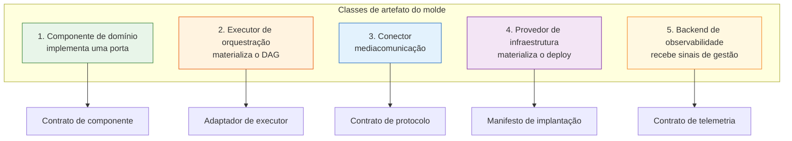

**Aplicação ao Ro-DOU [E][S]:**

| Artefato do Ro-DOU | Classe | Justificativa |
|---|---|---|
| `DOUHook` / busca INLABS | 1 — Componente | Produz lote bruto mediante contrato |
| `MatchEngine` / filtros C1–C6 | 1 — Componente | Transforma lote segundo regra |
| Processador LLM | 1 — Componente | Enriquece lote |
| Adaptador Neo4j | 1 — Componente | Persiste lote |
| Apache Airflow 3 | 2 — Executor | Agenda e executa; não contém regra de negócio |
| DAG Generator (YAML → Python) | 2 — Executor | Traduz declaração em plano executável |
| Apprise | 3 — Conector | Traduz resultado em canal de notificação |
| Webhook HTTP → n8n | 3 — Conector | Fronteira de comunicação entre sistemas |
| Docker Compose / Kubernetes / Helm | 4 — Infraestrutura | Materializa o ambiente |
| OpenSearch | 1 ou 5 | Componente de busca **ou** backend, conforme uso |

> **Insight derivado [S]:** o Ro-DOU não é um componente; é um **ecossistema de artefatos de cinco classes diferentes**. É essa decomposição que permite usá-lo dentro do molde sem que o molde se torne o Ro-DOU.

### 4.5. Contrato de componente

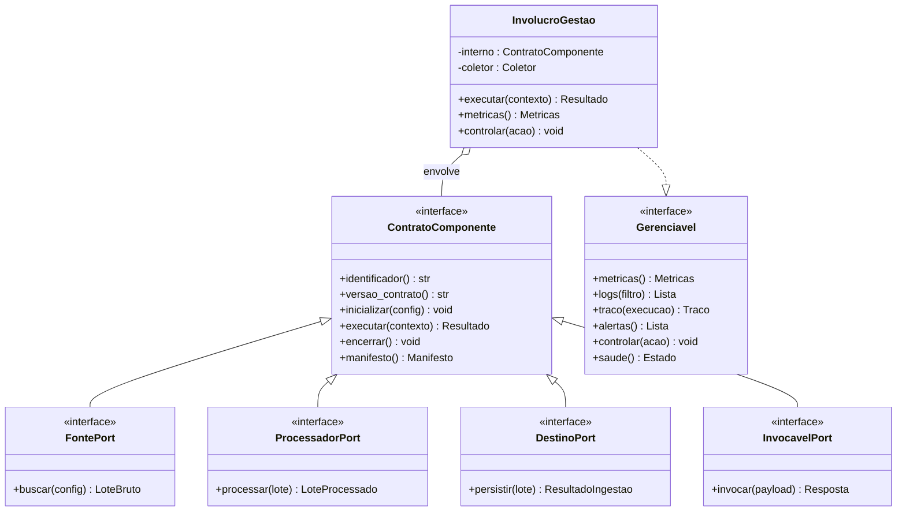

**Divisão de trabalho imposta pelo contrato:**

| Responsabilidade | DEV do componente | Framework |
|---|---|---|
| Declarar identidade e versão do contrato | Sim | Valida |
| Implementar `inicializar` / `executar` / `encerrar` | Sim | Invoca |
| Validar configuração de entrada | Declara schema | Valida |
| Escrever logs | **Não** | Sim |
| Coletar métricas | **Não** | Sim |
| Abrir e fechar spans | **Não** | Sim |
| Implementar retry | **Não** | Sim |
| Decidir quando executar | **Não** | Orquestração do DEV |
| Implementar transformação de negócio | Sim | Não |

### 4.6. Ciclo de vida governado

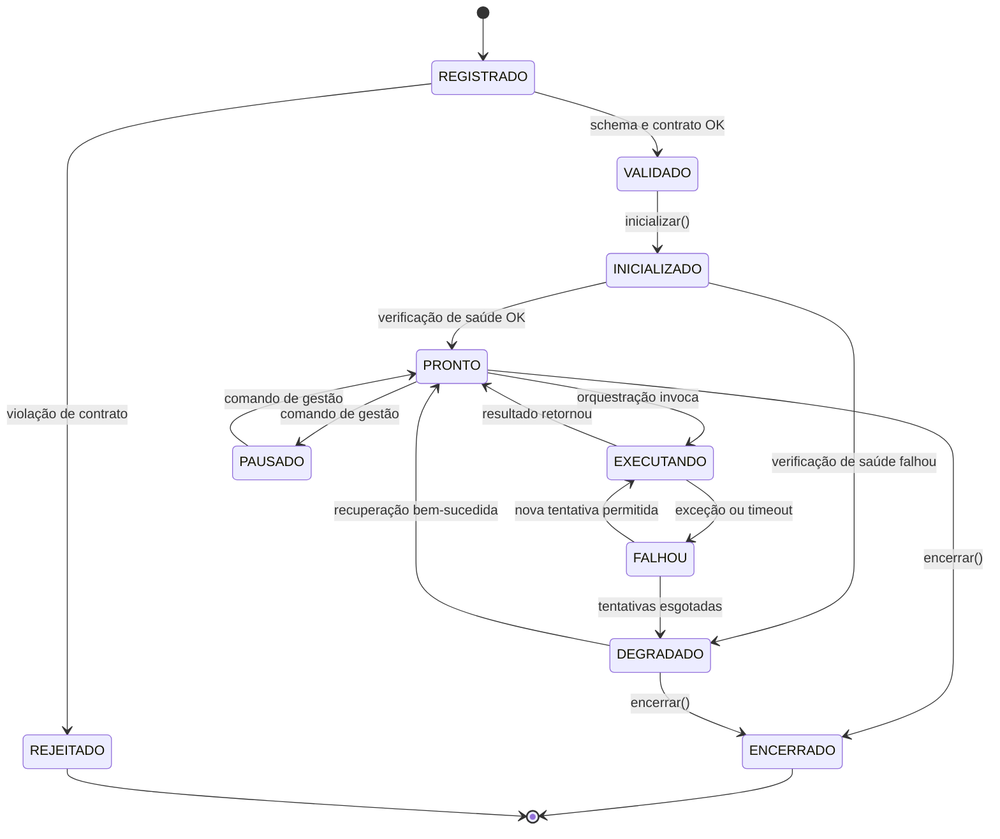

**Nota:** transições `REGISTRADO → REJEITADO` e `FALHOU → DEGRADADO` são as únicas que geram alertas de severidade máxima. Todas as demais são registradas como eventos de ciclo de vida. [S]

### 4.7. Core DAGs × App DAGs

| Dimensão | Core DAG | App DAG |
|---|---|---|
| Diretório | `framework/core/dags/` | `config/compositions/` |
| Propriedade | Núcleo do framework | DEV da composição |
| Campo `immutable` | `true` — obrigatório | `false` — obrigatório |
| Montagem em container | `:ro` | `:rw` |
| Ciclo de mudança | Release do framework | Iteração da aplicação |
| Escopo | Todos os componentes registrados | Componentes da composição |
| Finalidade | Medir, monitorar, controlar | Definir fluxo de negócio |
| Sobrescrita por App | **Proibida** | Permitida dentro do próprio espaço |
| Colisão de ID | Erro de carregamento | Erro de carregamento |

**Regras de configuração [S]:**

| Regra | Enunciado |
|---|---|
| CFG-01 | Uma App DAG nunca pode sobrescrever uma Core DAG, nem por ID, nem por nome de tarefa. |
| CFG-02 | Parâmetros do núcleo são classificados como `frozen` ou `overridable`. Apenas `overridable` aceita sobrescrita. |
| CFG-03 | Precedência operacional: ambiente > composição > núcleo. |
| CFG-04 | Segredos nunca residem em YAML versionado; são injetados em runtime. |
| CFG-05 | Toda DAG passa pelo mesmo parser e validador, independentemente da origem. |
| CFG-06 | Falha de validação interrompe o carregamento; não há fallback silencioso. |

---

## 5. Vistas arquiteturais

As vistas seguem a disciplina de ISO/IEC/IEEE 42010: cada uma responde a uma preocupação distinta de um stakeholder distinto. [R06][R07]

### 5.1. Vista de contexto

**Preocupação:** quais fronteiras externas o sistema atravessa.

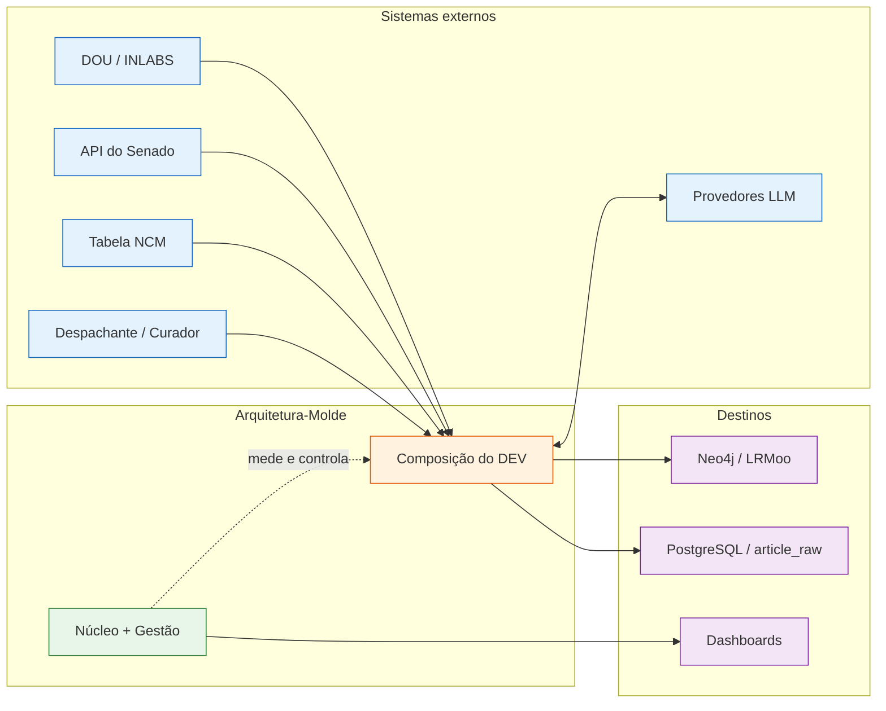

### 5.2. Vista lógica de dependências

**Preocupação:** o que pode importar o que.
**Semântica das setas:** dependência estática (importação), **não** fluxo de execução.

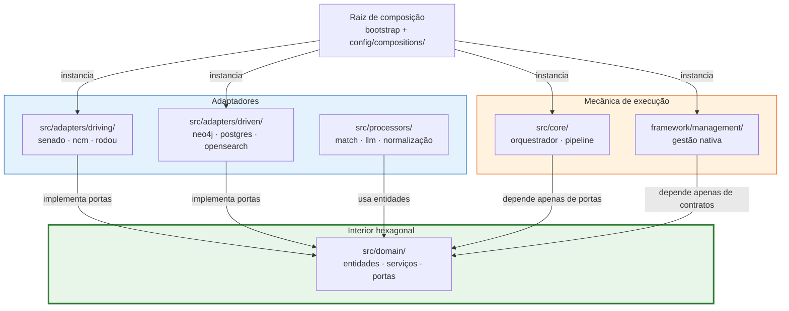

> **Verificação AX-01:** não existe aresta de `DOM` para `OUTER` nem para `RUN`. A única aresta que conhece classes concretas sai de `BOOT`.

### 5.3. Vista de orquestração — DAG de negócio

**Preocupação:** em que ordem os estágios executam e onde existem gates.
**Base documental [E]:** fluxo FASE 0 → FASE 1 → FASE 2 e pré-filtros do `SPEC_SOLO_MCA.md`.

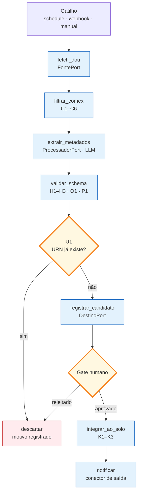

**Observação:** o gate humano **não é um loop no DAG**. A rejeição encerra a execução; uma decisão posterior de reanálise dispara uma **nova execução** com referência à anterior. Isso preserva a aciclicidade (seção 3.4.4).

### 5.4. Vista de gestão transversal

**Preocupação:** como a observabilidade existe sem侵入 ao componente.

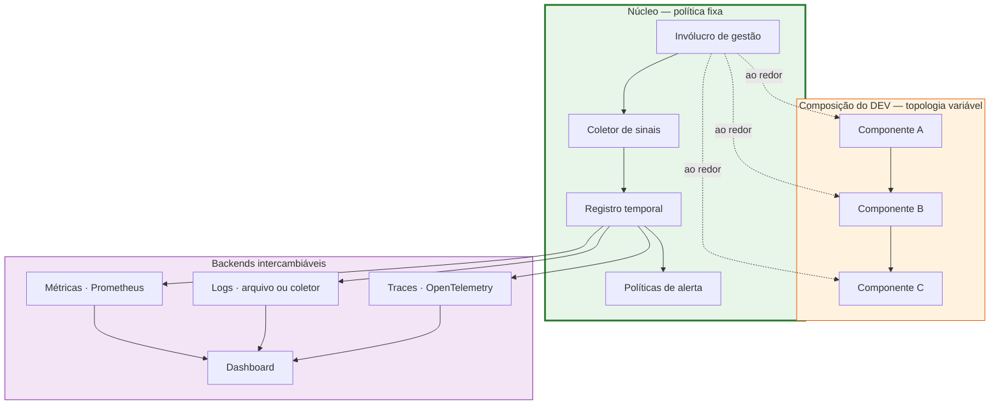

### 5.5. Vista de configuração em camadas

**Preocupação:** quem pode alterar o quê, e o que acontece em caso de conflito.

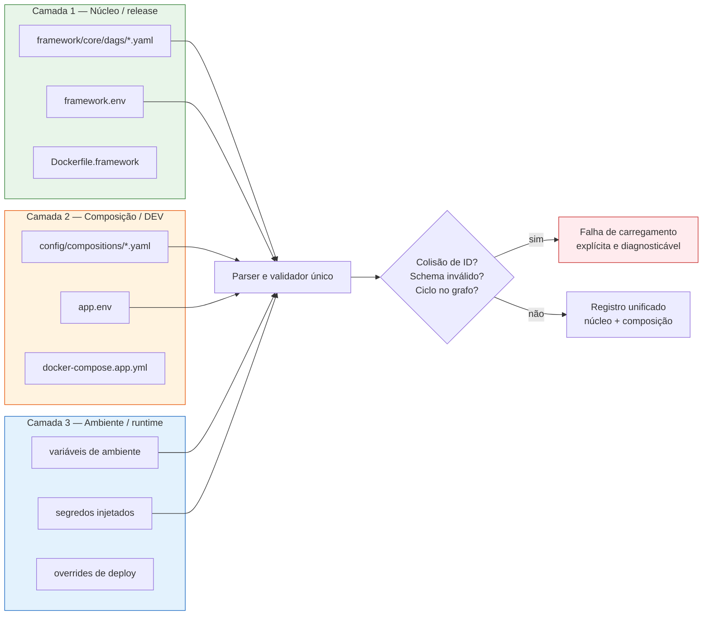

### 5.6. Vista de implantação

**Preocupação:** como o mesmo molde se materializa em ambientes distintos.

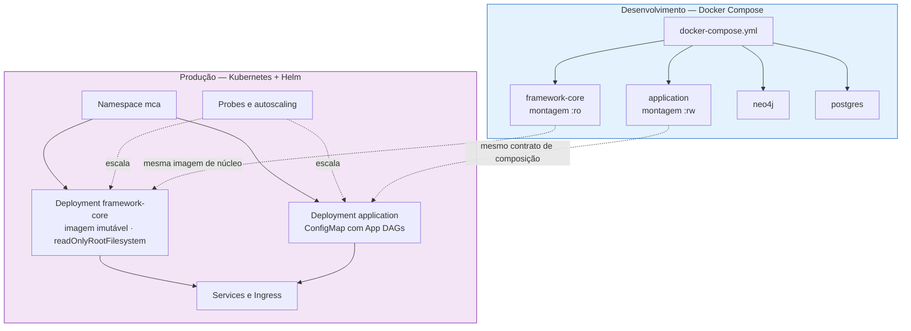

### 5.7. Sequência de carregamento

**Preocupação:** o que acontece entre o processo iniciar e a primeira execução.

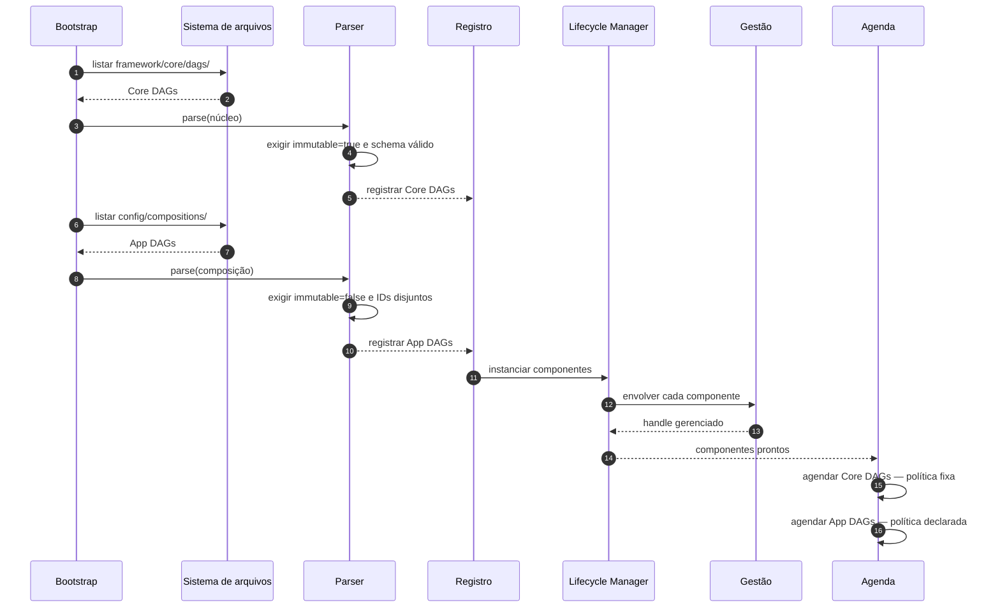

### 5.8. Sequência de execução com gestão involvente

**Preocupação:** onde exatamente os sinais são coletados.

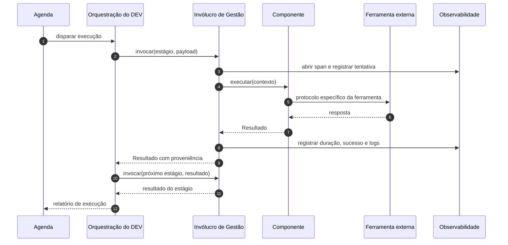

> **Ponto crítico:** a etapa 4 é a única em que código do DEV executa. Todas as demais etapas de observabilidade pertencem ao núcleo. Isso materializa o corolário da seção 4.2.

### 5.9. Vista de informação — modelo LRMoo

**Preocupação:** qual é o vocabulário comum que os componentes trocam.
**Base documental [E]:** `erDiagram` e entidades do `SPEC_SOLO_MCA.md`.

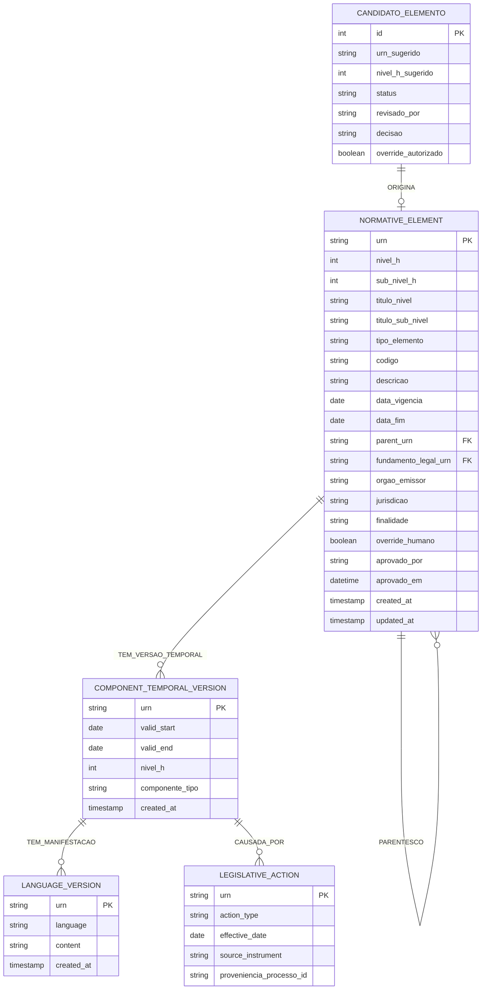

**Notas de representação:**

- `fundamento_legal_urn` é um **array de URNs** na especificação original; foi simplificado para `string` nesta vista por limitação de notação do diagrama.
- `NORMATIVE_ELEMENT → NORMATIVE_ELEMENT` representa `parent_urn`, a aresta de parentesco hierárquico.
- `override_humano`, `aprovado_por` e `aprovado_em` materializam o gate de curadoria da vista 5.3.
- A separação entre `NORMATIVE_ELEMENT` (Work), `COMPONENT_TEMPORAL_VERSION` (Expression) e `LANGUAGE_VERSION` (Manifestation) segue o IFLA LRM e sua codificação orientada a objetos LRMoo. [R37]

### 5.10. Vista de migração — legado para molde

**Preocupação:** de onde vêm os componentes e o que acontece com o código existente.
**Base documental [E]:** `LEGACY_MAP.md`, `legacy/README.md` e a árvore `src/` do gitingest.

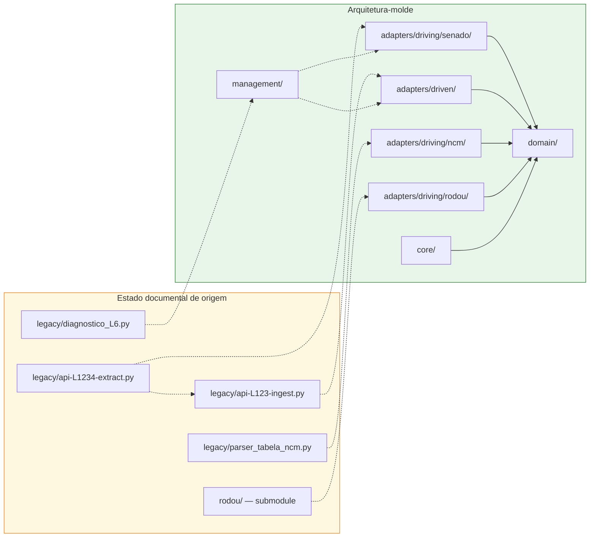

**Legenda:** setas tracejadas entre `LEG` e `NEW` representam **referência de refatoração**, nunca dependência de runtime. A aresta tracejada interna `L1 -.-> L2` representa o acoplamento existente no legado que a refatoração deve romper.

**Contrato de refatoração [E]:** o `LEGACY_MAP.md` estabelece, para cada arquivo de origem, o destino na nova arquitetura e o que deve ser **preservado integralmente**. O molde respeita esse contrato: a fronteira muda, a semântica do que foi preservado não muda.

---

## 6. Ro-DOU como fornecedor de componentes

### 6.1. Evidência documental

A tabela de componentes do `SPEC_SOLO_MCA.md` [E] lista os elementos do Ro-DOU e sua relevância para o Solo MCA. Reproduzida abaixo com a **reclassificação segundo as cinco classes do molde** (seção 4.4):

| Camada original | Componente | Tecnologia | Relevância Solo MCA [E] | Classe no molde [S] |
|---|---|---|---|---|
| Fontes | API DOU | REST API | Alta (L2–L8) | 1 — Componente (`FontePort`) |
| Fontes | INLABS | XML em lote + PostgreSQL | Crítica — texto completo | 1 — Componente (`FontePort`) |
| Fontes | Querido Diário | API OKBR | Baixa — fora de escopo federal | 1 — Componente (não instalado) |
| Orquestração | Apache Airflow 3 | Python + DAGs | Alta — trigger diário | 2 — Executor |
| Orquestração | DAG Generator | YAML → Python | Alta — termos COMEX | 2 — Executor |
| Storage | PostgreSQL | SQL | Alta — cache de publicações | 1 — Componente (`DestinoPort`) |
| Storage | OpenSearch | Lucene | Média — opcional | 1 ou 5 — conforme uso |
| IA | LLM Provider | OpenAI / Gemini / Claude | Alta — extração de metadados | 1 — Componente (`ProcessadorPort`) |
| Notificação | Apprise | Multi-canal | Crítica — webhook → n8n | 3 — Conector |
| Deploy | Docker Compose | Containers | Alta — setup inicial | 4 — Infraestrutura |
| Deploy | Kubernetes + Helm | Cluster | Alta — deploy final | 4 — Infraestrutura |

### 6.2. O que torna o molde genérico

Três decisões impedem que o molde se torne uma reencarnação do Ro-DOU:

**D1 — O executor é intercambiável.**
O núcleo não importa Airflow. Ele importa um contrato de executor. Airflow, n8n, um escalonador embutido ou uma chamada direta em Python são materializações equivalentes desse contrato. A App DAG declara **o quê**; o executor decide **como agendar**.

**D2 — O vocabulário de saída é do domínio, não da fonte.**
O Ro-DOU produz `id`, `section`, `title`, `href`, `abstract`, `date`, `hierarchyStr`, `arttype`, `pubtype`, `full_text`, `matches`, `is_exact_match`, `relevant_terms` [E]. Esses campos **não** são o contrato do molde. Eles são traduzidos, por um conector de tradução, para o vocabulário LRMoo (`urn`, `nivel_h`, `orgao_emissor`, `data_vigencia`, `fundamento_legal_urn`). [E][R37]

| Campo Raw do Ro-DOU [E] | Papel na tradução | Destino no domínio |
|---|---|---|
| `id` | Deduplicação de extração — **não é URN** | Proveniência |
| `section` | Metadado de publicação | `metadados_publicacao.secao` |
| `title` | Insumo de extração | `tipo_elemento`, `codigo`, `ano` |
| `href` | Proveniência | `metadados_publicacao.url` |
| `abstract` | Fallback de descrição | `descricao` |
| `date` / `display_date_sortable` | Ancoragem temporal | `data_vigencia` |
| `hierarchyStr` | Normalização de emissor | `orgao_emissor` |
| `arttype` | Mapeamento de tipo | `tipo_elemento` |
| `pubtype` | Classificação hierárquica | `nivel_h` |
| `full_text` | Insumo do processador LLM | `fundamento_legal_urn` sugerido |
| `matches` / `relevant_terms` | Classificação de relevância | Critério COMEX C1–C6 |

**D3 — A gestão não conhece COMEX.**
As Core DAGs medem *execuções, duração, taxa de falha e saúde*. Elas não sabem o que é NCM, CAMEX ou classificação fiscal. Uma composição que use o molde para monitorar normas municipais, licitações ou jurisprudência recebe **exatamente a mesma gestão**, sem alteração de núcleo.

### 6.3. Duas composições, um molde

Esta é a demonstração de generalidade do molde [S]:

| Aspecto | Composição A — Extração L1–L5 | Composição B — Vigilância L6–L8 |
|---|---|---|
| Fontes | Senado, Tabela NCM | INLABS / Ro-DOU |
| Processadores | Normalizador hierárquico | LLM + MatchEngine C1–C6 |
| Destino | Neo4j | Neo4j |
| Gate humano | Não exigido | Exigido |
| Executor | Agenda semanal | Agenda diária útil |
| **Core DAGs** | **Idênticas** | **Idênticas** |
| **Gestão** | **Idêntica** | **Idêntica** |
| **Núcleo alterado** | **Nenhum** | **Nenhum** |

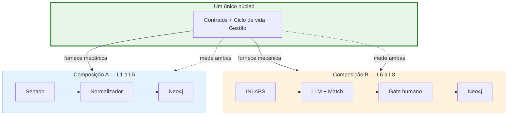

---

## 7. Atributos de qualidade

Os cenários seguem a forma *estímulo → artefato → resposta → medida* de Bass, Clements e Kazman. [R05][R32] A taxonomia de qualidade referencia ISO/IEC 25010. [R33]

| ID | Atributo | Estímulo | Resposta esperada | Medida / critério | Padrão responsável |
|---|---|---|---|---|---|
| QA-01 | Modificabilidade | Substituir o motor de grafo | Domínio intacto | Zero arquivos alterados em `src/domain/` | Parnas; Hexagonal |
| QA-02 | Testabilidade | Testar um processador isoladamente | Execução sem containers | Teste unitário sem dependência de infraestrutura | CBSE; DbC |
| QA-03 | Observabilidade | Componente falha pela primeira vez | Sinal registrado sem código novo | Métrica, log e trace presentes na primeira falha | AOP; SRE |
| QA-04 | Confiabilidade | Falha transitória de API | Repetição segundo política | Tentativas e resultados registrados pelo núcleo | Framework; EIP |
| QA-05 | Integridade | DEV tenta modificar Core DAG | Modificação recusada | Montagem `:ro` + validação de identidade | Menor privilégio |
| QA-06 | Portabilidade | Migração Compose → Kubernetes | Mesmo contrato de composição | App DAG inalterada; apenas manifesto de deploy muda | IaC; SPL |
| QA-07 | Rastreabilidade | Inspecionar um nó do Solo | Cadeia completa de proveniência | URN → execução → componente → versão → curador | DbC; evidência [E] |
| QA-08 | Desempenho | Duas fontes independentes disponíveis | Execução paralela | Paralelismo derivado do DAG, não codificado | Pipeline; Scatter-Gather |
| QA-09 | Recuperabilidade | Reexecutar uma execução falha | Estado final idêntico | Idempotência verificada pela deduplicação U1 | EIP; DbC |
| QA-10 | Evoluibilidade | Nova versão de uma porta | Coexistência de versões | Componentes antigos continuam carregando | SPL; Liskov-Wing |

### 7.1. Pirâmide de testes como consequência arquitetural

O repositório documenta a pirâmide **70% unitários / 20% integração / 10% E2E**. [E] Essa distribuição só é alcançável se o domínio for isolado:

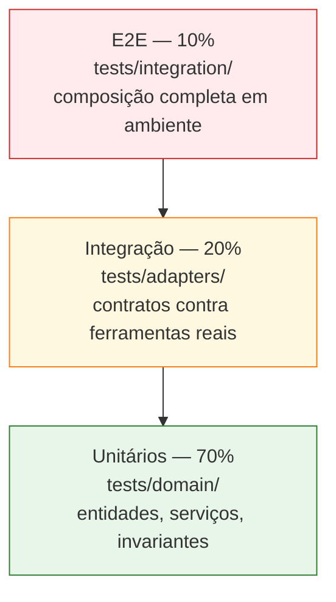

**Derivação [S]:** a camada de gestão permite uma quarta categoria de teste — **teste de conformidade do molde** (seção 9) — que verifica as garantias transversais independentemente de qualquer componente específico.

---

## 8. Decisões arquiteturais

Cada decisão segue o formato *contexto → decisão → consequências → fundamentação*. [R07]

### ADR-001 — Separar Gestão de Orquestração

| Campo | Conteúdo |
|---|---|
| **Status** | Aceita |
| **Contexto** | Sistemas de composição tendem a misturar lógica de fluxo com lógica de monitoramento, tornando ambos inseparáveis e não reutilizáveis. |
| **Decisão** | Definir Gestão como função total e invariante sobre componentes, implementada no núcleo. Definir Orquestração como estrutura variável sobre um grafo, implementada pelo DEV. |
| **Consequências positivas** | Reuso de gestão; independência de ferramenta; responsabilidade clara. |
| **Consequências negativas** | O núcleo precisa de um contrato de componente suficientemente expressivo; componentes fora do contrato exigem adaptação. |
| **Fundamentação** | [R21][R12][R28] |
| **Vista** | 5.4, 5.8 |

### ADR-002 — Núcleo imutável em relação ao DEV

| Campo | Conteúdo |
|---|---|
| **Status** | Aceita |
| **Contexto** | Se o DEV pode alterar a lógica de gestão, a garantia de observabilidade uniforme deixa de ser uma garantia do sistema e passa a ser uma convenção de equipe. |
| **Decisão** | Separação física (`framework/core/dags/` × `config/compositions/`), montagem read-only, campo `immutable` obrigatório e validação de namespaces disjuntos. |
| **Consequências positivas** | Garantia verificável; evolução controlada; auditoria de mudanças. |
| **Consequências negativas** | Alterações legítimas no núcleo exigem release; atrito em estágios iniciais do projeto. |
| **Fundamentação** | [R24][R19][R26] |
| **Vista** | 5.5, 5.6 |

### ADR-003 — DAGs como configuração declarativa em YAML

| Campo | Conteúdo |
|---|---|
| **Status** | Aceita |
| **Contexto** | A orquestração precisa ser mutável pelo DEV sem recompilar o núcleo. Evidência [E]: o Ro-DOU já usa DAG Generator com YAML. |
| **Decisão** | Adotar YAML como linguagem de declaração de composição, com parser único, schema explícito e validação pré-execução. |
| **Consequências positivas** | Reuso do modelo mental existente; versionamento; revisão por pares; binding-time em deploy. |
| **Consequências negativas** | YAML não é tipado; a tipagem precisa ser imposta pelo validador. Erros semânticos só aparecem em carregamento se o schema for fraco. |
| **Fundamentação** | [R25][R19][R43] |
| **Vista** | 5.5, 5.7 |

### ADR-004 — Hexagonalidade como contrato de dependência

| Campo | Conteúdo |
|---|---|
| **Status** | Aceita |
| **Contexto** | Evidência [E]: o repositório MCA já está organizado em `domain/`, `adapters/driving/`, `adapters/driven/`, `processors/`. |
| **Decisão** | Preservar essa organização. O orquestrador depende apenas de portas. Apenas a raiz de composição instancia classes concretas. |
| **Consequências positivas** | Testabilidade; substituibilidade; alinhamento com o código existente. |
| **Consequências negativas** | Necessidade de disciplina de revisão para impedir imports transversos. |
| **Fundamentação** | [R01][R02][R12][R34] |
| **Vista** | 5.2 |

### ADR-005 — Executor de orquestração injetável

| Campo | Conteúdo |
|---|---|
| **Status** | Aceita |
| **Contexto** | O projeto referencia Airflow 3 para o Ro-DOU e n8n para o Solo MCA. [E] Um molde acoplado a um deles deixaria de ser genérico. |
| **Decisão** | Definir contrato de executor e fornecer materializações independentes. A App DAG não menciona Airflow nem n8n; menciona estágios, dependências e conectores. |
| **Consequências positivas** | Portabilidade entre ambientes; liberdade do DEV; teste local sem cluster. |
| **Consequências negativas** | Menor denominador comum: recursos próprios de um executor só são acessíveis por extensão explícita. |
| **Fundamentação** | [R09][R15][R17] |
| **Vista** | 5.3, 5.6 |

### ADR-006 — Gestão por invólucro, não por herança

| Campo | Conteúdo |
|---|---|
| **Status** | Aceita |
| **Contexto** | Herança obrigatória acopla o componente ao framework e impede o uso de bibliotecas de terceiros sem reescrita. |
| **Decisão** | O framework envolve o componente em um `InvolucroGestao`. O componente implementa apenas o contrato de negócio e não herda classe base do framework. |
| **Consequências positivas** | Componentes de terceiros são utilizáveis sem modificação; gestão é verdadeiramente transversal. |
| **Consequências negativas** | Detalhes internos do componente não são observáveis; métricas de negócio específicas exigem emissão explícita via contexto. |
| **Fundamentação** | [R21][R12][R11] |
| **Vista** | 5.4, 5.8 |

### ADR-007 — Proveniência e curadoria humana como partes do contrato

| Campo | Conteúdo |
|---|---|
| **Status** | Aceita |
| **Contexto** | Evidência [E]: o modelo contém `override_humano`, `aprovado_por`, `aprovado_em`, `proveniencia_processo_id` e um fluxo explícito de candidatura e aprovação. |
| **Decisão** | Todo resultado de execução carrega proveniência. A integração ao grafo definitivo exige gate quando a composição assim declarar. O gate é um estágio de negócio, não uma funcionalidade do núcleo. |
| **Consequências positivas** | Auditoria; conformidade com o fluxo documental; responsabilidade humana preservada. |
| **Consequências negativas** | Latência de integração; necessidade de modelar reexecução por evento. |
| **Fundamentação** | [E][R13][R37] |
| **Vista** | 5.3, 5.9 |

### ADR-008 — Legado como referência, nunca como dependência

| Campo | Conteúdo |
|---|---|
| **Status** | Aceita |
| **Contexto** | Evidência [E]: `legacy/README.md` proíbe modificar arquivos e proíbe importá-los no projeto novo. `LEGACY_MAP.md` define o contrato de refatoração. |
| **Decisão** | Preservar `legacy/` como fonte de verdade comportamental. Toda reimplementação deve ser validada contra o comportamento original preservado no mapa. |
| **Consequências positivas** | Regressão detectável; conhecimento original preservado; migração incremental. |
| **Consequências negativas** | Duplicação temporária de código; necessidade de disciplina para não importar por conveniência. |
| **Fundamentação** | [E][R25] |
| **Vista** | 5.10 |

### ADR-009 — LRMoo como vocabulário comum, não como imposição

| Campo | Conteúdo |
|---|---|
| **Status** | Aceita |
| **Contexto** | O domínio MCA requer representação temporal e hierárquica de normas. [E][R37] |
| **Decisão** | O núcleo é agnóstico quanto ao vocabulário. O projeto MCA injeta LRMoo como seu vocabulário por meio das entidades de domínio e dos conectores de tradução. |
| **Consequências positivas** | Generalidade do molde; alinhamento com modelo bibliográfico consolidado. |
| **Consequências negativas** | Camada adicional de tradução; curva de aprendizagem do modelo. |
| **Fundamentação** | [R37][R38][R39] |
| **Vista** | 5.9 |

### ADR-010 — Falha de carregamento explícita

| Campo | Conteúdo |
|---|---|
| **Status** | Aceita |
| **Contexto** | Configuração inválida que é ignorada silenciosamente produz sistemas que parecem saudáveis e não executam o esperado. |
| **Decisão** | Colisão de ID, schema inválido, ciclo no grafo, componente sem contrato ou violação de imutabilidade interrompem o carregamento com diagnóstico tipado. |
| **Consequências positivas** | Falhas detectadas antes da produção; comportamento determinístico. |
| **Consequências negativas** | Deploy pode falhar por configuração; exige validação em CI. |
| **Fundamentação** | [R13][R24][R25] |
| **Vista** | 5.5, 5.7 |

---

## 9. Critérios de conformidade do molde

Um sistema só pode ser dito **conforme ao molde** se satisfizer todos os critérios abaixo. Estes critérios são definicionais: derivam dos axiomas da seção 4.3 e não dependem de componente específico.

| ID | Critério | Verificação | Axioma |
|---|---|---|---|
| CF-01 | Substituir o destino não altera o domínio | Diferencial de arquivos em `src/domain/` após troca | AX-01 |
| CF-02 | Todo componente possui gestão sem código próprio de telemetria | Inspecionar componente: ausência de chamadas a logger/métricas | AX-02, AX-03 |
| CF-03 | Gestão é invariante sob troca de implementação | Comparar sinais coletados antes e depois da troca | AX-03 |
| CF-04 | App DAG com `immutable: true` é rejeitada | Teste de carregamento | AX-05 |
| CF-05 | Core DAG com `immutable: false` é rejeitada | Teste de carregamento | AX-05 |
| CF-06 | Colisão de ID entre Core e App é rejeitada | Teste de carregamento | AX-06 |
| CF-07 | Núcleo é montado read-only em runtime | Inspecionar manifesto de implantação | AX-05, AX-06 |
| CF-08 | Componente sem ciclo de vida completo é rejeitado | Teste de contrato | AX-08 |
| CF-09 | Resultado sem proveniência é rejeitado | Teste de contrato | AX-07 |
| CF-10 | `legacy/` não aparece em nenhum import de runtime | Análise estática de imports | AX-09 |
| CF-11 | `src/domain/` não importa infraestrutura | Análise estática de imports | AX-01, AX-10 |
| CF-12 | Reexecução de uma execução é idempotente | Executar duas vezes; comparar estado final | AX-07, AX-08 |
| CF-13 | Ciclo no grafo é rejeitado antes da execução | Teste de validação topológica | AX-08 |
| CF-14 | Falha em um componente não corrompe estado de outros | Teste de falha isolada | AX-02 |

**Nota sobre CF-02:** a emissão de **métricas de negócio** pelo componente é permitida e desejável. O que é proibido é o componente ser responsável pela **mecânica** de coleta, transporte e correlação. A distinção é entre *emitir um sinal* e *implementar observabilidade*.

---

## 10. Trade-offs e limites

| Trade-off | Lado escolhido | Custo aceito | Referencial |
|---|---|---|---|
| Contratos explícitos vs. flexibilidade ad hoc | Contratos | Componentes fora do padrão exigem adaptador | [R12][R13] |
| YAML declarativo vs. tipagem de linguagem | YAML com validador | Necessidade de schema rigoroso e testes de carregamento | [R19][R25] |
| Gestão universal vs. métricas específicas | Universal + emissão livre | Métricas de negócio continuam sendo responsabilidade do DEV | [R21][R28] |
| Núcleo imutável vs. velocidade de iteração | Imutável | Mudanças legítimas no núcleo passam por release | [R19][R24] |
| IoC vs. debugabilidade | IoC | Stack traces atravessam camadas do framework; exige traces correlacionados | [R09][R29] |
| DAG acíclico vs. processos iterativos | DAG + eventos | Laços de negócio viram múltiplas execuções ligadas por proveniência | [R43][R44] |
| Múltiplos executores vs. recursos nativos | Contrato comum | Recursos exclusivos de um executor exigem extensão explícita | [R15][R17] |
| LRMoo vs. simplicidade | LRMoo no domínio, agnóstico no núcleo | Camada de tradução e curva de aprendizagem | [R37] |
| Invólucro vs. introspecção interna | Invólucro | Detalhes internos só são visíveis via emissão explícita | [R21] |

### 10.1. Não-decisões deliberadas

O molde **não decide**, por design:

- Qual executor de workflow será usado em produção.
- Qual provedor LLM será usado.
- Qual motor de grafo ou relacional persistirá o Solo.
- Qual backend de métricas, logs ou traces será adotado.
- Quais critérios de relevância de negócio serão aplicados.
- Quais invariantes de domínio serão validados.

Essas escolhas pertencem à **composição** ou ao **domínio**, jamais ao núcleo. É essa não-decisão que constitui a generalidade do molde.

---

## 11. Glossário

| Termo | Definição no contexto deste documento |
|---|---|
| **Arquitetura-molde** | Estrutura genérica de software que define contratos, mecânica de execução e gestão, independente dos componentes que acomoda. |
| **Componente** | Unidade de composição com interfaces fornecidas, interfaces requeridas, implementação privada e dependências explícitas. [R12] |
| **Porta (Port)** | Contrato abstrato que o domínio expõe ou consome. |
| **Adaptador** | Implementação concreta de uma porta, acoplada a uma ferramenta específica. |
| **Conector** | Elemento arquitetural de primeira classe que media a comunicação entre componentes. [R15] |
| **Executor** | Materialização do mecanismo que agenda e dispara estágios de uma composição. |
| **Orquestração** | Definição de topologia, dependências, conectores e políticas de uma composição específica. Responsabilidade do DEV. |
| **Gestão** | Função transversal e invariante de medição, monitoramento e controle de componentes. Responsabilidade do núcleo. |
| **Core DAG** | DAG de gestão, artefato do núcleo, imutável pelo DEV. |
| **App DAG** | DAG de orquestração, artefato da composição, mutável pelo DEV. |
| **Invólucro de gestão** | Decorator que envolve um componente e coleta sinais ao redor de sua invocação. |
| **Raiz de composição** | Único ponto do sistema que conhece e instancia classes concretas. |
| **Hot spot** | Ponto de variabilidade onde a composição injeta comportamento. [R19] |
| **Proveniência** | Conjunto de identificadores que permite reconstruir a origem de um resultado: execução, componente, versão, timestamp e curador. |
| **LRMoo** | Codificação orientada a objetos do IFLA Library Reference Model, distinguindo Work, Expression e Manifestation. [R37] |
| **Gate humano** | Estágio de composição que suspende a integração até decisão de um curador. |
| **Claim Check** | Padrão de integração que transporta referência a um dado volumoso em vez do dado inteiro. [R17] |

---

## 12. Referências bibliográficas

### 12.1. Fundamentos da arquitetura de software

**[R01]** PARNAS, David L. "On the criteria to be used in decomposing systems into modules." *Communications of the ACM*, v. 15, n. 12, p. 1053–1058, 1972. DOI: [10.1145/361598.361623](https://doi.org/10.1145/361598.361623).
> Uso: estabilização de decisões prováveis de mudar; fundamentação da fronteira domínio/adaptador.

**[R02]** PARNAS, David L. "Designing software for ease of extension and contraction." *IEEE Transactions on Software Engineering*, v. SE-5, n. 3, p. 128–138, 1979. DOI: [10.1109/TSE.1979.234196](https://doi.org/10.1109/TSE.1979.234196).
> Uso: critério de extensão e contração; plugabilidade sem cascata de alterações.

**[R03]** GARLAN, David; SHAW, Mary. "An Introduction to Software Architecture." In: AMBRIOLA, Vincenzo; TORTORA, Giuseppe (Eds.). *Advances in Software Engineering and Knowledge Engineering*, v. 2. Singapore: World Scientific, 1994. p. 1–39. Também como relatório técnico CMU-CS-94-166, Carnegie Mellon University.
> Uso: taxonomia de estilos; Pipeline/Filter; arquitetura como estrutura de componentes e conexões.

**[R04]** SHAW, Mary; GARLAN, David. *Software Architecture: Perspectives on an Emerging Discipline*. Upper Saddle River: Prentice Hall, 1996. ISBN: 978-0-13-126629-9.
> Uso: sistemas de pipes e filtros; conectores como elemento de projeto.

**[R05]** BASS, Len; CLEMENTS, Paul; KAZMAN, Rick. *Software Architecture in Practice*. 3. ed. Boston: Addison-Wesley, 2013. ISBN: 978-0-321-81573-6.
> Uso: atributos de qualidade; cenários estímulo-resposta; trade-off analysis.

**[R06]** ISO/IEC/IEEE. **ISO/IEC/IEEE 42010:2022** — *Systems and software engineering — Architecture description*. Genebra: ISO, 2022. Substitui a edição de 2011.
> Uso: definição de arquitetura, stakeholder, preocupação, vista e ponto de vista.

**[R07]** CLEMENTS, Paul; BACHMANN, Felix; BASS, Len; GARLAN, David; IVERS, James; LITTLE, Reed; NORD, Robert; STAFFORD, Judith. *Documenting Software Architectures: Views and Beyond*. 2. ed. Boston: Addison-Wesley, 2010. ISBN: 978-0-321-55268-6.
> Uso: estrutura de vistas do documento; formato de decisões arquiteturais.

**[R32]** KAZMAN, Rick; KLEIN, Mark; CLEMENTS, Paul. *ATAM: Method for Architecture Evaluation*. Pittsburgh: Carnegie Mellon Software Engineering Institute, 2000. Relatório CMU/SEI-2000-TR-004.
> Uso: método de avaliação de arquitetura por cenários de qualidade.

**[R33]** ISO/IEC. **ISO/IEC 25010:2011** — *Systems and software engineering — Systems and software Quality Requirements and Evaluation (SQuaRE) — System and software quality models*. Genebra: ISO, 2011.
> Uso: taxonomia de atributos de qualidade na seção 7.

**[R44]** KNUTH, Donald E. *The Art of Computer Programming, Volume 1: Fundamental Algorithms*. 3. ed. Reading: Addison-Wesley, 1997. ISBN: 978-0-201-89683-1.
> Uso: ordenação topológica e validação de aciclicidade de DAGs.

### 12.2. Extensibilidade, frameworks e linhas de produto

**[R08]** BUSCHMANN, Frank; MEUNIER, Regine; ROHNERT, Hans; SOMMERLAD, Peter; STAL, Michael. *Pattern-Oriented Software Architecture, Volume 1: A System of Patterns*. Chichester: Wiley, 1996. ISBN: 978-0-471-95869-7.
> Uso: padrão Microkernel; separação núcleo/extensão; pontos de extensão.

**[R09]** FAYAD, M. E.; SCHMIDT, Douglas C. "Object-oriented application frameworks." *Communications of the ACM*, v. 40, n. 10, p. 32–38, 1997. DOI: [10.1145/262793.262800](https://doi.org/10.1145/262793.262800).
> Uso: definição de framework como aplicação semicompleta; hot spots e frozen spots.

**[R10]** JOHNSON, Ralph E.; FOOTE, Brian. "Designing Reusable Classes." *Journal of Object-Oriented Programming*, v. 1, n. 2, p. 22–35, 1988.
> Uso: origem da Inversão de Controle e do princípio de Hollywood.

**[R11]** GAMMA, Erich; HELM, Richard; JOHNSON, Ralph; VLISSIDES, John. *Design Patterns: Elements of Reusable Object-Oriented Software*. Reading: Addison-Wesley, 1994. ISBN: 978-0-201-63361-0.
> Uso: Template Method; Adapter; Decorator; Strategy.

**[R18]** FOWLER, Martin. *Patterns of Enterprise Application Architecture*. Boston: Addison-Wesley, 2002. ISBN: 978-0-321-12742-6.
> Uso: padrão Plugin; Dependency Injection; Service Layer; Gateway.

**[R19]** POHL, Klaus; BÖCKLE, Günter; VAN DER LINDEN, Frank J. *Software Product Line Engineering: Foundations, Principles and Techniques*. Berlin: Springer, 2005. ISBN: 978-3-540-24307-1.
> Uso: core assets vs. application assets; variabilidade; binding-time. Fundamentação direta de Core DAGs × App DAGs.

**[R20]** BOSCH, Jan. *Design and Use of Software Architectures: Adopting and Evolving a Product-Line Approach*. Boston: Addison-Wesley, 2000. ISBN: 978-0-201-70234-3.
> Uso: arquitetura como ativo evolutivo de linha de produto.

**[R22]** RICHARDS, Mark; FORD, Neal. *Fundamentals of Software Architecture: An Engineering Approach*. Sebastopol: O'Reilly, 2020. ISBN: 978-1-492-05613-6.
> Uso: estilos arquiteturais; trade-offs; pensamento de arquitetura como disciplina de engenharia.

**[R23]** NEWMAN, Sam. *Building Microservices: Designing Fine-Grained Systems*. 2. ed. Sebastopol: O'Reilly, 2021. ISBN: 978-1-492-09869-3.
> Uso: limites de serviço; acoplamento operacional; evolução independente.

### 12.3. Composição e contratos

**[R12]** SZYPERSKI, Clemens; GRUNTZ, Dominik; MURER, Stephan. *Component Software: Beyond Object-Oriented Programming*. 2. ed. Harlow: Addison-Wesley / ACM Press, 2002. ISBN: 978-0-201-74572-2.
> Uso: definição formal de componente; interfaces fornecidas e requeridas; composição por terceiros.

**[R13]** MEYER, Bertrand. *Object-Oriented Software Construction*. 2. ed. Upper Saddle River: Prentice Hall, 1997. ISBN: 978-0-13-629155-3.
> Uso: Design by Contract; pré-condições, pós-condições e invariantes.

**[R14]** LISKOV, Barbara; WING, Jeannette M. "A behavioral notion of subtyping." *ACM Transactions on Programming Languages and Systems*, v. 16, n. 6, p. 1811–1841, 1994. DOI: [10.1145/197320.197383](https://doi.org/10.1145/197320.197383).
> Uso: substituição comportamental, não apenas assinatura.

**[R34]** EVANS, Eric. *Domain-Driven Design: Tackling Complexity in the Heart of Software*. Boston: Addison-Wesley, 2003. ISBN: 978-0-321-12521-7.
> Uso: isolamento de domínio; linguagem ubíqua; separação entre modelo e infraestrutura.

### 12.4. Coordenação, conectores e integração

**[R15]** MEDVIDOVIĆ, Nenad; TAYLOR, Richard N. "A formal basis for architectural connectors." *ACM Transactions on Software Engineering and Methodology*, v. 9, n. 3, p. 264–304, 2000. DOI: [10.1145/357569.357574](https://doi.org/10.1145/357569.357574).
> Uso: conector como elemento arquiteturais de primeira classe.

**[R16]** ALLEN, Robert; GARLAN, David. "A formal basis for architectural connection." *ACM Transactions on Software Engineering and Methodology*, v. 6, n. 3, p. 213–249, 1997. DOI: [10.1145/256583.256604](https://doi.org/10.1145/256583.256604).
> Uso: portas, papéis e semântica de conexão.

**[R17]** HOHPE, Gregor; WOOLF, Bob. *Enterprise Integration Patterns: Designing, Building, and Deploying Messaging Solutions*. Boston: Addison-Wesley, 2003. ISBN: 978-0-321-20068-0.
> Uso: Message Translator, Router, Store, Scatter-Gather, Claim Check, Channel.

**[R43]** TAYLOR, Ian J.; DEELMAN, Ewa; GANNON, Dennis; SHIELDS, Matthew (Eds.). *Workflows for e-Science: Scientific Workflows for Grids*. London: Springer, 2014. ISBN: 978-1-4471-4500-0.
> Uso: DAG como modelo de coordenação; dependências, paralelismo e recuperação por estágio.

### 12.5. Transversalidade, operação e observabilidade

**[R21]** KICZALES, Gregor; LAMPING, John; MENDHEKAR, Adel; MAEDA, Chris; LOPES, Cristina; LOINGTIER, Jean-Marc; IRWIN, Jim. "Aspect-oriented programming." In: *ECOOP '97 — Object-Oriented Programming*, LNCS 1241. Berlin: Springer, 1997. p. 220–242.
> Uso: preocupação transversal; aconselhamento ao redor de invocação; fundamentação do invólucro de gestão.

**[R28]** BEYER, Betsy; JONES, Chris; PETOFF, Jennifer; MURPHY, N. R. *Site Reliability Engineering: How Google Runs Production Systems*. Sebastopol: O'Reilly, 2016. ISBN: 978-1-491-92276-2.
> Uso: monitoramento white-box; sinais observáveis; operação de sistemas distribuídos.

**[R29]** SIGELMAN, Benjamin H.; BARROSO, Luiz André; BURROWS, Mike; STEPHENSON, Pat; PLAKAL, Manoj; BEAVER, Daniel; JASPAN, Saul; SHANBHAG, Chimani. *Dapper, a Large-Scale Distributed Systems Tracing Infrastructure*. Mountain View: Google, 2010. Relatório técnico.
> Uso: tracing distribuído; rastreios; amostragem; correlação entre serviços.

**[R30]** OPENTELEMETRY. *OpenTelemetry Specification*. Disponível em: <https://opentelemetry.io/docs/specs/otel/>. Consulta em: 2026.
> Uso: modelagem de métricas, traces e logs como sinais correlacionáveis.

**[R31]** FORSGREN, Nicole; HUMBLE, Jez; KIM, Gene. *Accelerate: The Science of Lean Software and DevOps*. Portland: IT Revolution Press, 2018. ISBN: 978-1-942788-33-1.
> Uso: relação entre arquitetura loosely coupled e desempenho de entrega.

### 12.6. Segurança, configuração e implantação

**[R24]** SALTZER, Jerome H.; SCHROEDER, Michael D. "The protection of information in computer systems." *Proceedings of the IEEE*, v. 63, n. 9, p. 1278–1308, 1975. DOI: [10.1109/PROC.1975.9939](https://doi.org/10.1109/PROC.1975.9939).
> Uso: menor privilégio; mediação completa; isolamento. Fundamentação da imutabilidade do núcleo.

**[R25]** HUMBLE, Jez; FARLEY, David. *Continuous Delivery: Reliable Software Releases through Build, Test, and Deployment Automation*. Boston: Addison-Wesley, 2010. ISBN: 978-0-321-60191-9.
> Uso: configuração como código; versionamento, teste e revisão de DAGs.

**[R26]** MORRIS, Kief. *Infrastructure as Code: Managing Servers in the Cloud*. Sebastopol: O'Reilly, 2016. ISBN: 978-1-491-92424-7.
> Uso: infraestrutura declarativa; componentes imutáveis; repetibilidade de ambiente.

**[R27]** WECKESSER, Maxim; CLEASBY, Kelsey. *GitOps: Operating and Managing Container-Based Applications*. Sebastopol: O'Reilly, 2021. ISBN: 978-1-492-09867-9.
> Uso: reconciliação declarativa de estado; deploy como função de repositório versionado.

**[R45]** KUBERNETES AUTHORS. *Immutable ConfigMaps and Secrets* — KEP-3129. Disponível em: <https://github.com/kubernetes/enhancements/tree/master/keps/sig-api-machinery/3129-immutable-meta-objects>. Consulta em: 2026.
> Uso: precedente de imutabilidade de configuração em nível de plataforma.

### 12.7. Fundamentos do domínio

**[R35]** KELSEN, Hans. *Pure Theory of Law*. Tradução de Max Knight. Berkeley: University of California Press, 1967. Tradução de *Reine Rechtslehre*, 1934.
> Uso: hierarquia normativa e derivação de validade; fundamentação dos invariantes K1–K3.

**[R36]** KELSEN, Hans. *General Theory of Norms*. Tradução de Michael Hartney. Oxford: Clarendon Press, 2006. Obra original de 1979.
> Uso: dinâmica normativa — criação, alteração, revogação e suspensão; fundamentação de `LegislativeAction`.

**[R37]** RIVA, Pat; LE BŒUF, Patrick; ŽUMER, Maja. *IFLA Library Reference Model: A Conceptual Model for Bibliographic Information*. IFLA Series on Bibliographic Control, v. 46. Berlin: De Gruyter Saur, 2017.
> Uso: distinção Work / Expression / Manifestation; base do LRMoo utilizado no Solo.

**[R38]** GRUBER, Thomas R. "A translation approach to portable ontology specifications." *Knowledge Acquisition*, v. 5, n. 2, p. 199–220, 1993. DOI: [10.1006/knac.1993.1008](https://doi.org/10.1006/knac.1993.1008).
> Uso: definição operacional de ontologia; reuso e comprometimento conceitual explícito.

**[R39]** STUDER, Rudi; BENJAMINS, V. Richard; FENSEL, Dieter. "Knowledge engineering: principles and methods." *Data & Knowledge Engineering*, v. 25, n. 1–2, p. 161–197, 1998. DOI: [10.1016/S0169-023X(97)00056-6](https://doi.org/10.1016/S0169-023X(97)00056-6).
> Uso: engenharia de conhecimento como disciplina; compartilhamento e reutilização de ontologias.

**[R40]** LEWIS, Patrick et al. "Retrieval-Augmented Generation for Knowledge-Intensive NLP Tasks." *Advances in Neural Information Processing Systems* (NeurIPS), 2020. arXiv: [2005.11401](https://arxiv.org/abs/2005.11401).
> Uso: recuperação aumentada de geração; fundamentação do uso de LLM como processador sobre fonte recuperada.

**[R41]** EDGE, Darren et al. "From Local to Global: A Graph RAG Approach to Query-Focused Summarization." 2024. arXiv: [2404.16130](https://arxiv.org/abs/2404.16130).
> Uso: Graph RAG; distinção entre recuperação gráfica estruturada e recuperação vetorial.

**[R42]** HOGAN, Aidan et al. "Knowledge Graphs." *ACM Computing Surveys*, v. 54, n. 4, art. 71, 2021. DOI: [10.1145/3447772](https://doi.org/10.1145/3447772).
> Uso: estado da arte em grafos de conhecimento; construção, consulta e_reasoning.

### 12.8. Especificações técnicas e fontes de projeto

**[R46]** THE APACHE SOFTWARE FOUNDATION. *Apache Airflow — Documentation*. Disponível em: <https://airflow.apache.org/docs/>. Consulta em: 2026.
> Uso: modelo de DAG, operador, trigger e executor no executor de referência do projeto.

**[R47]** N8N GMBH. *n8n — Documentation*. Disponível em: <https://docs.n8n.io/>. Consulta em: 2026.
> Uso: modelo de workflow e webhook no segundo executor de referência do projeto.

**[E1]** `SPEC_SOLO_MCA.md`. Especificação do Solo MCA: diagramas ER, arquitetura de referência do Ro-DOU, tabela de componentes e relevância, mapeamento de campos Raw → Solo, fluxo de fases e pré-filtros, stack tecnológico e procedimentos de instalação.
> **Papel neste documento:** fonte primária de evidência sobre o estado do projeto.

**[E2]** `solo_mca_rodou_01102026_1215.txt`. Snapshot de árvore e conteúdo do repositório `innovai-ltda-mca_arquitetura` via gitingest: estrutura `src/`, contratos de refatoração em `LEGACY_MAP.md`, regras de `legacy/`, Dockerfile, estratégia de testes e READMEs de camada.
> **Papel neste documento:** fonte primária de evidência sobre a organização real do código e o contrato de migração.

### 12.9. Nota sobre citação acadêmica

As referências acima foram selecionadas por **consolidação na área**, não por volume. DOIs são fornecidos quando o identificador é estável e amplamente utilizado. Para citação formal em documento acadêmico ou contrato, recomenda-se conferir a edição efetivamente consultada, pois numeração de páginas e edições podem variar entre reimpressões.

A distinção entre **[E]**, **[T]** e **[S]** mantida ao longo do documento permite ao leitor identificar, para cada afirmação, se ela é um fato documental, uma proposição da literatura ou uma decisão de projeto deste documento.

---

## 13. Matriz de traçabilidade

### 13.1. Requisito → mecanismo → vista → referência

| Requisito | Mecano no molde | Axioma / ADR | Vista | Referências |
|---|---|---|---|---|
| RA-01 Independência de domínio | Núcleo agnóstico; vocabulário injetado | AX-01 / ADR-009 | 5.2, 5.9 | [R01][R34][R37] |
| RA-02 Composição heterogênea | Contratos + cinco classes de artefato | AX-01 / ADR-004 | 5.2, 5.3 | [R12][R15] |
| RA-03 Execução coordenada | DAG + Lifecycle Manager | AX-08 / ADR-003 | 5.3, 5.7 | [R03][R43][R44] |
| RA-04 Gestão nativa e total | Invólucro transversal | AX-02, AX-03 / ADR-001, 006 | 5.4, 5.8 | [R21][R28] |
| RA-05 Orquestração delegada | App DAGs + executor injetável | AX-04 / ADR-005 | 5.3, 5.5 | [R09][R10] |
| RA-06 Imutabilidade do núcleo | Diretório separado + `:ro` + `immutable` | AX-05, AX-06 / ADR-002 | 5.5, 5.6 | [R19][R24][R26] |
| RA-07 Substituição de ferramenta | Portas + substituição comportamental | AX-01 / ADR-004 | 5.2 | [R02][R14] |
| RA-08 Observabilidade uniforme | Gestão invariante sob troca de implementação | AX-03 / ADR-006 | 5.4, 5.8 | [R21][R29][R30] |
| RA-09 Configuração em camadas | Parser único + precedência + namespaces disjuntos | AX-06 / ADR-003, 010 | 5.5, 5.7 | [R19][R25][R27] |
| RA-10 Testabilidade | Domínio isolado + contratos mockáveis | AX-10 / ADR-004 | 5.2 | [R01][R13][R34] |
| RA-11 Evolução independente | Core asset × application asset | AX-05 / ADR-002 | 5.5, 5.6 | [R19][R20][R23] |
| RA-12 Proveniência e curadoria | Contrato de resultado + gate humano | AX-07 / ADR-007 | 5.3, 5.9 | [E1][R13][R37] |

### 13.2. Referência → seção de utilização

| Referência | Seções |
|---|---|
| [R01], [R02] | 3.1.2, 3.3.3, 4.3, 7, 8 (ADR-004), 9 |
| [R03], [R04] | 2.2, 3.1.1, 3.4.1 |
| [R05], [R32], [R33] | 7 |
| [R06], [R07] | 3.1.1, 5, 8 |
| [R08], [R18] | 2.2, 3.2.1 |
| [R09], [R10], [R11] | 3.2.2, 4.5, 8 (ADR-005, 006) |
| [R12], [R13], [R14] | 3.3, 4.2, 4.5, 8 (ADR-001, 004, 007) |
| [R15], [R16] | 2.2, 3.4.2, 4.4 |
| [R17] | 3.4.3, 8 (ADR-005) |
| [R19], [R20] | 3.2.3, 4.7, 8 (ADR-002, 003) |
| [R21] | 3.5.1, 4.2, 5.4, 8 (ADR-001, 006) |
| [R24] | 3.6.1, 4.7, 8 (ADR-002, 010) |
| [R25], [R26], [R27] | 3.6.2, 3.6.3, 4.7, 8 (ADR-002, 003) |
| [R28], [R29], [R30] | 3.5.2, 5.4, 5.8 |
| [R35], [R36] | 4.3, 5.9, 8 (ADR-007) |
| [R37], [R38], [R39] | 3.3, 5.9, 8 (ADR-009) |
| [R40], [R41], [R42] | 6.2, 12.7 |
| [R43], [R44] | 3.4.4, 8 (ADR-003), 9 |
| [E1], [E2] | 1, 3.3.3, 5.3, 5.9, 5.10, 6, 8 |

---

## Fechamento

O molde definido neste documento não é uma descrição do Ro-DOU. É uma **estrutura de contratação**: ela estabelece o que qualquer componente deve prometer para ser executado, observado e controlado, e estabelece o que o núcleo promete em troca.

A propriedade que o define é única e verificável:

> **A gestão de um componente não muda quando a ferramenta dentro dele muda.**

Toda decisão, vista, axioma e critério de conformidade deste documento deriva dessa propriedade.

---

*Documento de fundamentação. As decisões aqui formalizadas estão sujeitas a revisão por ADR subsequente; alterações no núcleo exigem nova versão deste documento.*