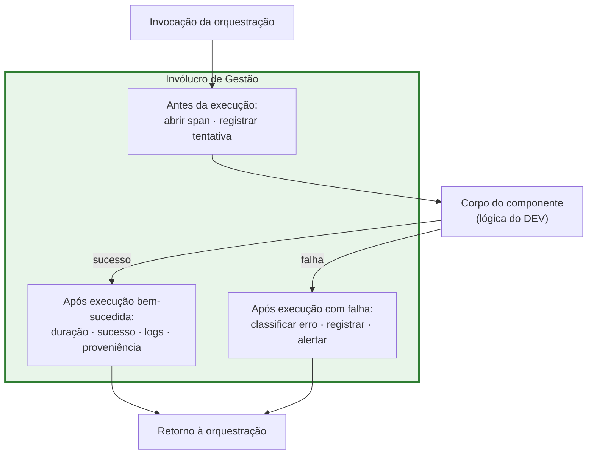
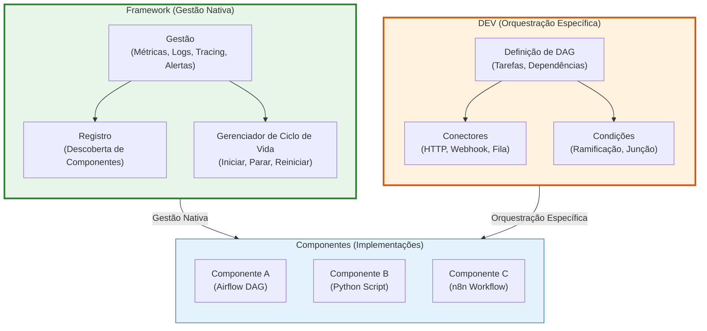
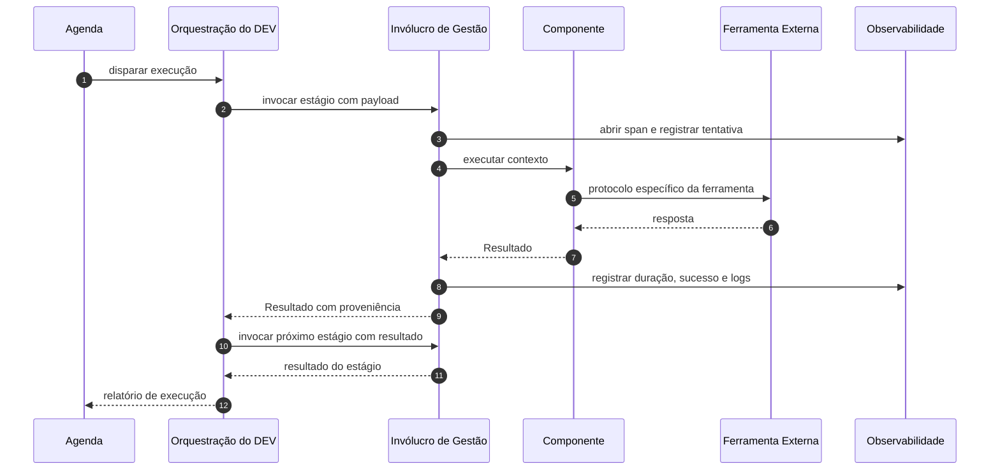

# Arquitetura-Molde v2 — Separação entre Orquestração e Gestão

| Campo | Valor |
|---|---|
| **Documento** | `docs/arquitetura_molde_v2_orquestracao_gestao.md` |
| **Versão** | 2.0 |
| **Data** | 2026-10-13 |
| **Status** | Decisão arquitetural consolidada |
| **Dependência** | `docs/arquitetura_molde_fundamentacao.md` (v1) |
| **Escopo** | Definição formal da separação entre Gestão (nativa do framework) e Orquestração (responsabilidade do DEV) |
| **Fora de escopo** | Implementação de componentes específicos; lógica de negócio COMEX |
| **Público** | Arquitetos, desenvolvedores de framework, desenvolvedores de composição, operação |

---

## Sumário

1. [Introdução e motivação](#1-introdução-e-motivação)
2. [Definições formais](#2-definições-formais)
3. [Gestão — camada nativa do framework](#3-gestão--camada-nativa-do-framework)
4. [Orquestração — camada específica do DEV](#4-orquestração--camada-específica-do-dev)
5. [Separação de responsabilidades](#5-separação-de-responsabilidades)
6. [Exemplos aplicados ao MCA](#6-exemplos-aplicados-ao-mca)
7. [Critérios de conformidade](#7-critérios-de-conformidade)
8. [Trade-offs e limites](#8-trade-offs-e-limites)
9. [Referências bibliográficas](#9-referências-bibliográficas)

---

## 1. Introdução e motivação

### 1.1. O problema

A literatura de engenharia de software costuma tratar a coordenação de componentes como um único conceito — "orquestração". Essa unificação, embora conveniente em sistemas homogêneos, produz dois efeitos colaterais graves em sistemas compostos por ferramentas heterogêneas:

1. **Acoplamento entre fluxo de negócio e observabilidade.** A lógica de "como os componentes se comunicam" mistura-se com a lógica de "como cada componente é medido". Trocar uma ferramenta exige reescrever o monitoramento.

2. **Duplicação de esforço.** Cada nova composição reinventa métricas, logs e alertas, porque o sistema não oferece uma camada transversal padronizada.

O projeto MCA, ao acomodar componentes de naturezas distintas — Airflow, n8n, Neo4j, LLMs, APIs governamentais —, expõe esse problema em sua forma mais aguda.

### 1.2. A solução

Este documento formaliza uma separação que já estava implícita no documento de fundamentação (v1), mas que merece tratamento próprio por ser a contribuição mais original do molde:

> **Gestão** e **Orquestração** são duas responsabilidades distintas, com proprietários distintos, ciclos de mudança distintos e mecanismos de implementação distintos.

A distinção não é meramente organizacional. Ela tem consequências diretas sobre a arquitetura, a testabilidade, a observabilidade e a evolução do sistema.

### 1.3. Analogia ilustrativa

Considere um aeroporto internacional:

- A **Gestão** é o sistema de controle de tráfego aéreo, as torres de comunicação, os radares, os protocolos de emergência. Ela existe independentemente de qual companhia aérea opera qual voo. Sua função é garantir que toda aeronave seja rastreada, comunicada e assistida — não importa se é um Boeing da companhia A ou um Airbus da companhia B.

- A **Orquestração** é o plano de voo de cada companhia. Ela define de onde sai, para onde vai, em que ordem faz escalas, quais aeronaves usa. Cada companhia tem seu próprio plano, adaptado às suas rotas, frota e estratégia comercial.

A torre de controle não sabe qual é a rota da companhia A. A companhia A não precisa construir sua própria torre. Essa separação é o que permite ao aeroporto crescer sem que cada companhia precise reinventar a infraestrutura de controle.

No MCA, o framework é a torre. O DEV é a companhia. O componente é a aeronave.

---

## 2. Definições formais

### 2.1. Componente

Seja um componente $c$ representado pela quádrupla:

$$c = (P, R, I, D)$$

onde:

- $P$ é o conjunto de **interfaces fornecidas** (o que o componente oferece);
- $R$ é o conjunto de **interfaces requeridas** (o que o componente consome);
- $I$ é a **implementação privada** (a lógica interna);
- $D$ é o conjunto de **dependências de contexto** (configuração, infraestrutura, credenciais).

Essa definição segue Szyperski, Gruntz e Murer (2002) [R01].

### 2.2. Gestão

A **Gestão** é uma função total e invariante sobre o conjunto de componentes registrados $\mathcal{C}$:

$$G : \mathcal{C} \rightarrow \langle M, L, T, A, K \rangle$$

onde:

- $M$ são as **métricas** coletadas (execuções, duração, taxa de sucesso, taxa de erro);
- $L$ são os **logs** estruturados produzidos;
- $T$ são os **traces** distribuídos gerados;
- $A$ são os **alertas** disparados quando políticas são violadas;
- $K$ são os **comandos de controle** disponíveis (iniciar, parar, reiniciar, pausar).

**Propriedade fundamental — invariância sob substituição:**

$$\forall c = (P, R, I, D),\ \forall I' :\quad \text{se}\ \ contract(P, R, D)\ \text{é preservado},\ \text{então}\ G(c_{I}) = G(c_{I'})$$

Em linguagem natural: **trocar a implementação interna de um componente não altera a definição da sua gestão**. A gestão é cega à ferramenta.

### 2.3. Orquestração

A **Orquestração** é uma estrutura sobre um subconjunto de componentes e uma topologia:

$$O = (V, E, \Phi, \Psi)$$

onde:

- $V \subseteq \mathcal{C}$ é o conjunto de **estágios** (componentes selecionados);
- $E \subseteq V \times V$ é o conjunto de **dependências** entre estágios;
- $\Phi : E \rightarrow \text{Conectores}$ atribui um **conector** a cada aresta;
- $\Psi : V \rightarrow \text{Política}$ atribui **políticas** de agendamento, condições e repetição.

**Propriedade fundamental — variância sob substituição:**

A definição de $O$ **pode mudar** quando $I$ muda, porque $\Phi$ depende do protocolo efetivo da ferramenta. Trocar Neo4j por PostgreSQL pode exigir um conector diferente.

### 2.4. Tabela comparativa

| Dimensão | Gestão $G$ | Orquestração $O$ |
|---|---|---|
| **Natureza** | Função total sobre componentes | Estrutura sobre um grafo |
| **Propriedade** | Núcleo do framework | DEV da composição |
| **Dependência de ferramenta** | Nenhuma | Sim |
| **Unidade de interesse** | Ciclo de vida (vertical) | Topologia (horizontal) |
| **Artefato** | Core DAGs + invólucro | App DAGs + conectores |
| **Alteração por iteração de negócio** | Não | Sim |
| **Semântica** | "Como este componente está se comportando?" | "Em que ordem e por qual canal?" |
| **Mudança de escopo** | Transversal a todas as composições | Específica de uma composição |

---

## 3. Gestão — camada nativa do framework

### 3.1. Princípios

A Gestão obedece a quatro princípios fundamentais:

1. **Independência de ferramenta.** A gestão funciona igual para Airflow, Python, n8n, Neo4j, LLMs ou qualquer outra tecnologia. Ela não conhece nem depende da ferramenta interna do componente.

2. **Transversalidade.** A gestão atravessa todos os componentes do framework. Não existe componente registrado que escape à gestão.

3. **Natividade.** A gestão é implementada pelo framework, não pelo DEV. O DEV não precisa escrever código de métricas, logs ou alertas.

4. **Uniformidade.** A interface de gestão é a mesma para todos os componentes. Um despachante que consulta métricas de um componente não precisa aprender uma interface diferente para outro.

### 3.2. O que a Gestão faz

A Gestão oferece cinco capacidades, todas acessíveis por uma interface única:

#### 3.2.1. Métricas

```python
class GestaoComponente:
    def get_metricas(self) -> MetricasComponente:
        """
        Retorna métricas padronizadas do componente.
        Independente de ser Airflow, Python, n8n, etc.
        """
        return MetricasComponente(
            execution_count=self._get_execution_count(),
            success_rate=self._get_success_rate(),
            average_duration=self._get_average_duration(),
            error_rate=self._get_error_rate(),
            last_execution=self._get_last_execution(),
            status=self._get_status(),
        )
```

As métricas coletadas incluem:

- `execution_count` — número total de execuções;
- `success_rate` — proporção de execuções bem-sucedidas;
- `average_duration` — duração média em segundos;
- `error_rate` — proporção de execuções com erro;
- `last_execution` — timestamp da última execução;
- `status` — estado atual (PRONTO, EXECUTANDO, DEGRADADO, PARADO).

#### 3.2.2. Logs

```python
def get_logs(self, level: str = "INFO", limit: int = 100) -> List[LogEntry]:
    """
    Retorna logs padronizados do componente.
    Formato uniforme independente da ferramenta interna.
    """
    return self._get_logs_filtered(level, limit)
```

Os logs são estruturados em formato JSON, com campos padronizados:

- `timestamp` — momento do evento;
- `level` — severidade (DEBUG, INFO, WARNING, ERROR, CRITICAL);
- `component_id` — identificador do componente;
- `execution_id` — identificador da execução;
- `message` — mensagem legível;
- `context` — dicionário com informações adicionais.

#### 3.2.3. Tracing

```python
def get_trace(self, execution_id: str) -> TraceData:
    """
    Retorna tracing padronizado de uma execução.
    Mostra o caminho do dado através do componente.
    """
    return self._get_trace_data(execution_id)
```

O tracing permite reconstruir o fluxo de uma execução específica, identificando:

- Quais estágios foram executados;
- Em que ordem;
- Quanto tempo cada estágio levou;
- Quais conectores foram usados;
- Onde ocorreram falhas.

#### 3.2.4. Alertas

```python
def get_alertas(self) -> List[Alerta]:
    """
    Retorna alertas padronizados do componente.
    Exemplo: taxa de erro maior que cinco por cento, duração maior que dez minutos.
    """
    return self._get_alertas_ativos()
```

Os alertas são gerados automaticamente quando políticas pré-definidas são violadas. Exemplos:

- Taxa de erro superior a cinco por cento;
- Duração média superior a dez minutos;
- Componente em estado DEGRADADO por mais de cinco minutos;
- Falha consecutiva em três execuções.

#### 3.2.5. Controle

```python
def start(self) -> None:
    """Inicia o componente."""
    ...

def stop(self) -> None:
    """Para o componente."""
    ...

def restart(self) -> None:
    """Reinicia o componente."""
    ...

def pause(self) -> None:
    """Pausa o componente (se suportado)."""
    ...

def resume(self) -> None:
    """Retoma o componente (se suportado)."""
    ...
```

Os comandos de controle permitem operar o componente sem conhecer sua implementação interna.

### 3.3. Exemplo: gestão de diferentes componentes

```python
# Componente A: Airflow DAG
airflow_component = Framework.create_component(
    type="airflow_dag",
    config={
        "dag_id": "solo_mca_c2_classificacao",
        "schedule": "0 8 * * *",
    }
)

# Componente B: Python Script
python_component = Framework.create_component(
    type="python_script",
    config={
        "script": "src/processors/llm_processor.py",
        "entrypoint": "main",
    }
)

# Componente C: n8n Workflow
n8n_component = Framework.create_component(
    type="n8n_workflow",
    config={
        "workflow_id": "solo-mca-dou-webhook",
        "webhook_url": "https://n8n.example.com/webhook/...",
    }
)

# Gestão uniforme (mesma interface, diferentes ferramentas)

# Métricas (independente da ferramenta)
print(airflow_component.get_metricas())
# MetricasComponente(execution_count=45, success_rate=0.98, ...)

print(python_component.get_metricas())
# MetricasComponente(execution_count=120, success_rate=0.95, ...)

print(n8n_component.get_metricas())
# MetricasComponente(execution_count=89, success_rate=0.99, ...)

# Logs (formato uniforme)
logs = airflow_component.get_logs(level="ERROR", limit=10)
# [LogEntry(timestamp=..., level="ERROR", message="...", context={...})]

# Controle (mesmos comandos)
airflow_component.pause()
python_component.restart()
n8n_component.stop()
```

### 3.4. Mecanismo de implementação: invólucro

A gestão é implementada por um **invólucro** (decorator) que envolve cada componente registrado. O invólucro intercepta todas as chamadas ao componente e coleta sinais ao redor da execução.



O componente não sabe que está sendo envolvido. Ele implementa apenas o contrato de negócio. A gestão é adicionada pelo framework, de forma transparente.

### 3.5. Backends intercambiáveis

A gestão é independente do backend de observabilidade. O framework oferece adaptadores para diferentes backends:

| Backend | Métricas | Logs | Traces |
|---|---|---|---|
| Prometheus + Grafana | Sim | Sim (via Loki) | Sim (via Tempo) |
| DataDog | Sim | Sim | Sim |
| OpenTelemetry | Sim | Sim | Sim |
| InMemory (testes) | Sim | Sim | Sim |
| Arquivo JSON | Não | Sim | Não |

A troca de backend não exige alteração nos componentes nem na orquestração.

---

## 4. Orquestração — camada específica do DEV

### 4.1. Princípios

A Orquestração obedece a quatro princípios distintos:

1. **Especificidade.** A orquestração depende das ferramentas que cada componente usa. Diferentes ferramentas exigem diferentes conectores.

2. **Flexibilidade.** O DEV define como os componentes se comunicam. O framework não impõe uma topologia fixa.

3. **Variabilidade.** Diferentes composições podem ter diferentes orquestrações. O framework acomoda múltiplas composições simultaneamente.

4. **Responsabilidade do DEV.** A orquestração é implementada pelo DEV, não pelo framework. O framework oferece os mecanismos, mas o DEV define a topologia.

### 4.2. O que a Orquestração faz

A Orquestração define quatro aspectos da composição:

#### 4.2.1. Seleção de componentes

O DEV escolhe quais componentes farão parte da composição:

```python
class OrquestracaoComposicao:
    def __init__(self, framework: Framework):
        self.framework = framework
        self.componentes = {}
        self.dag = self._definir_dag()

    def _definir_dag(self) -> DAG:
        dag = DAG(name="solo_mca_pipeline")

        # Componente A: Airflow DAG (busca no DOU)
        dou_fetcher = self.framework.create_component(
            type="airflow_dag",
            config={"dag_id": "solo_mca_c2_classificacao"}
        )

        # Componente B: Python Script (processa com LLM)
        llm_processor = self.framework.create_component(
            type="python_script",
            config={"script": "src/processors/llm_processor.py"}
        )

        # Componente C: n8n Workflow (envia para Solo)
        solo_ingestor = self.framework.create_component(
            type="n8n_workflow",
            config={"workflow_id": "solo-mca-dou-webhook"}
        )

        return dag
```

#### 4.2.2. Definição de dependências

O DEV define em que ordem os componentes executam:

```python
# DEV define dependências (orquestração)
dag.set_dependencies(
    upstream="fetch_dou",
    downstream="process_llm",
    connector=HTTPConnector(
        url="http://localhost:8000/process",
        method="POST"
    )
)

dag.set_dependencies(
    upstream="process_llm",
    downstream="ingest_solo",
    connector=WebhookConnector(
        url="https://n8n.example.com/webhook/solo",
        method="POST"
    )
)
```

#### 4.2.3. Escolha de conectores

O DEV escolhe como os componentes se comunicam:

| Conector | Protocolo | Uso típico |
|---|---|---|
| `HTTPConnector` | HTTP/HTTPS | Chamadas síncronas entre serviços |
| `WebhookConnector` | HTTP POST assíncrono | Notificações entre sistemas |
| `QueueConnector` | AMQP, Redis, Kafka | Mensageria assíncrona |
| `DatabaseConnector` | SQL, Bolt, GraphQL | Persistência direta |
| `FileConnector` | Sistema de arquivos | Troca via arquivos |
| `EventConnector` | Eventos publicados | Comunicação por eventos |

#### 4.2.4. Definição de políticas

O DEV define políticas de execução:

```python
dag.set_policy(
    task="fetch_dou",
    schedule="0 8 * * MON-FRI",  # 8h da manhã, dias úteis
    retry_policy=RetryPolicy(
        max_attempts=3,
        backoff="exponential",
        initial_delay=60
    ),
    timeout=3600  # uma hora
)
```

### 4.3. Exemplo: diferentes orquestrações para mesmos componentes

A flexibilidade da orquestração permite que o DEV defina topologias distintas usando os mesmos componentes.

#### 4.3.1. Composição sequencial

```python
class ComposicaoSequencial(OrquestracaoComposicao):
    def _definir_dag(self) -> DAG:
        dag = DAG(name="pipeline_sequencial")

        # Mesmos componentes
        fetcher = self.framework.create_component(type="airflow_dag", ...)
        processor = self.framework.create_component(type="python_script", ...)
        ingestor = self.framework.create_component(type="n8n_workflow", ...)

        # DEV define: sequencial (A -> B -> C)
        dag.add_task(fetcher, task_id="A")
        dag.add_task(processor, task_id="B")
        dag.add_task(ingestor, task_id="C")

        dag.set_dependencies(upstream="A", downstream="B", connector=...)
        dag.set_dependencies(upstream="B", downstream="C", connector=...)

        return dag
```

#### 4.3.2. Composição paralela

```python
class ComposicaoParalela(OrquestracaoComposicao):
    def _definir_dag(self) -> DAG:
        dag = DAG(name="pipeline_paralelo")

        # Mesmos componentes
        fetcher = self.framework.create_component(type="airflow_dag", ...)
        processor = self.framework.create_component(type="python_script", ...)
        ingestor = self.framework.create_component(type="n8n_workflow", ...)

        # DEV define: paralelo (A -> [B, C])
        dag.add_task(fetcher, task_id="A")
        dag.add_task(processor, task_id="B")
        dag.add_task(ingestor, task_id="C")

        dag.set_dependencies(upstream="A", downstream="B", connector=...)
        dag.set_dependencies(upstream="A", downstream="C", connector=...)
        # B e C executam em paralelo

        return dag
```

#### 4.3.3. Composição condicional

```python
class ComposicaoCondicional(OrquestracaoComposicao):
    def _definir_dag(self) -> DAG:
        dag = DAG(name="pipeline_condicional")

        # Mesmos componentes
        fetcher = self.framework.create_component(type="airflow_dag", ...)
        processor = self.framework.create_component(type="python_script", ...)
        ingestor = self.framework.create_component(type="n8n_workflow", ...)

        # DEV define: condicional (A -> se X então B senão C)
        dag.add_task(fetcher, task_id="A")
        dag.add_task(processor, task_id="B")
        dag.add_task(ingestor, task_id="C")

        dag.add_condition(
            task="A",
            condition=lambda result: result.items_count > 10,
            true_branch="B",
            false_branch="C"
        )

        return dag
```

### 4.4. Configuração declarativa

A orquestração pode ser definida declarativamente em YAML, sem escrever código Python:

```yaml
# application/dags/rodou_solo_pipeline.yaml
dag:
  id: rodou_solo_pipeline
  description: "Pipeline Ro-DOU para Solo MCA"
  schedule: "0 8 * * MON-FRI"
  owner: dev_team

components:
  - id: rodou_fetcher
    type: ro_dou.hook.DOUHook
    config:
      dag_id: solo_mca_c2_classificacao
      sources: [INLABS]
      terms:
        - "NCM AND (classificacao OR alteracao)"
      department:
        - "Secretaria da Receita Federal"
        - "CAMEX"

  - id: llm_processor
    type: mca.llm.LLMProcessor
    config:
      provider: openai
      model: gpt-4
      temperature: 0.2

  - id: solo_ingestor
    type: mca.neo4j.Neo4jAdapter
    config:
      uri: bolt://neo4j:7687
      user: neo4j
      password: ${NEO4J_PASSWORD}

pipeline:
  stages:
    - id: fetch_dou
      component: rodou_fetcher
      output: raw_publications

    - id: process_with_llm
      component: llm_processor
      input: raw_publications
      output: enriched_publications
      depends_on: [fetch_dou]

    - id: ingest_to_solo
      component: solo_ingestor
      input: enriched_publications
      output: ingestion_result
      depends_on: [process_with_llm]

connectors:
  - source: fetch_dou
    target: process_with_llm
    type: synchronous
    protocol: http
    config:
      url: http://localhost:8000/process
      method: POST
      timeout_seconds: 30

  - source: process_with_llm
    target: ingest_to_solo
    type: synchronous
    protocol: bolt
    config:
      uri: bolt://neo4j:7687
      timeout_seconds: 60
```

### 4.5. Executores intercambiáveis

A orquestração é independente do executor. O framework oferece adaptadores para diferentes executores:

| Executor | Uso típico | Vantagens |
|---|---|---|
| Apache Airflow | Pipelines complexos com agendamento | Robusto, maduro, ecossistema rico |
| n8n | Workflows visuais com integrações | Fácil de usar, muitas integrações prontas |
| Prefect | Pipelines Python nativos | Simples, bom para times Python |
| Dagster | Pipelines com foco em dados | Observabilidade nativa, testes |
| Executor embutido | Pipelines simples sem cluster | Leve, sem dependências externas |

A troca de executor não exige alteração na definição da composição. O YAML permanece o mesmo; apenas o adaptador muda.

---

## 5. Separação de responsabilidades

### 5.1. Diagrama de camadas



### 5.2. Framework (Gestão)

```python
# Framework é instanciado uma vez
framework = Framework()

# Dashboard unificado (gestão nativa)
dashboard = framework.get_dashboard()

# Métricas de todos os componentes (independente da ferramenta)
for component in dashboard.components:
    print(f"{component.name}: {component.get_metricas()}")
    # Saída:
    # dou_fetcher: MetricasComponente(execution_count=45, success_rate=0.98, ...)
    # llm_processor: MetricasComponente(execution_count=120, success_rate=0.95, ...)
    # solo_ingestor: MetricasComponente(execution_count=89, success_rate=0.99, ...)
```

### 5.3. DEV (Orquestração)

```python
# DEV instancia a composição específica
dev = DevComposicao(framework)
orquestracao = dev.construir_pipeline()

# Executa o pipeline orquestrado
result = orquestracao.executar()

# Framework automaticamente coleta métricas de todos os componentes
# DEV não precisa se preocupar com isso
```

### 5.4. Separação clara em código

```python
# Gestão (Framework) — Nativa, Transversal, Independente de Ferramenta

# Métricas (framework coleta automaticamente)
metrics = framework.get_dashboard().metrics
# {
#     "dou_fetcher": {"execution_count": 45, "success_rate": 0.98},
#     "llm_processor": {"execution_count": 120, "success_rate": 0.95},
#     "solo_ingestor": {"execution_count": 89, "success_rate": 0.99}
# }

# Logs (framework coleta automaticamente)
logs = framework.get_dashboard().logs
# [
#     LogEntry(component="dou_fetcher", level="INFO", message="..."),
#     LogEntry(component="llm_processor", level="ERROR", message="..."),
#     ...
# ]

# Alertas (framework gera automaticamente)
alerts = framework.get_dashboard().alerts
# [
#     Alerta(component="llm_processor", type="HIGH_ERROR_RATE", value=0.05),
#     ...
# ]

# Orquestração (DEV) — Específica, Dependente de Ferramenta

# DEV define como componentes se comunicam
orquestracao.dag.set_dependencies(
    upstream="dou_fetcher",
    downstream="llm_processor",
    connector=HTTPConnector(
        url="http://localhost:8000/process",
        method="POST",
        headers={"Content-Type": "application/json"}
    )
)

# DEV define fluxo de execução
orquestracao.dag.set_dependencies(
    upstream="llm_processor",
    downstream="solo_ingestor",
    connector=WebhookConnector(
        url="https://n8n.example.com/webhook/solo",
        method="POST",
        retry_policy=RetryPolicy(max_attempts=3, backoff="exponential")
    )
)
```

### 5.5. Fluxo de execução



**Ponto crítico:** a etapa 4 é a única em que código do DEV executa. Todas as demais etapas de observabilidade pertencem ao núcleo. Isso materializa a invariância da gestão.

---

## 6. Exemplos aplicados ao MCA

### 6.1. Composição A — Vigilância DOU (L6 a L8)

```yaml
# application/dags/vigilancia_dou.yaml
dag:
  id: vigilancia_dou
  description: "Vigilância diária de publicações DOU para o Solo MCA"
  schedule: "0 8 * * MON-FRI"
  owner: dev_team

components:
  - id: dou_fetcher
    type: ro_dou.hook.DOUHook
    config:
      dag_id: solo_mca_c2_classificacao
      sources: [INLABS]
      terms:
        - "NCM AND (classificacao OR alteracao)"
      department:
        - "Secretaria da Receita Federal"
        - "CAMEX"
        - "GECEX"
      use_summary: true
      full_text: true

  - id: llm_processor
    type: mca.llm.LLMProcessor
    config:
      provider: openai
      model: gpt-4
      temperature: 0.2
      max_tokens: 300
      custom_prompt: |
        Você é um especialista em comércio exterior brasileiro.
        Resuma a publicação em uma única frase objetiva.

  - id: solo_ingestor
    type: mca.neo4j.Neo4jAdapter
    config:
      uri: bolt://neo4j:7687
      user: neo4j
      password: ${NEO4J_PASSWORD}
      database: solo_mca

pipeline:
  stages:
    - id: fetch_dou
      component: dou_fetcher
      output: raw_publications

    - id: process_with_llm
      component: llm_processor
      input: raw_publications
      output: enriched_publications
      depends_on: [fetch_dou]

    - id: ingest_to_solo
      component: solo_ingestor
      input: enriched_publications
      output: ingestion_result
      depends_on: [process_with_llm]

connectors:
  - source: fetch_dou
    target: process_with_llm
    type: synchronous
    protocol: http
    config:
      url: http://localhost:8000/process
      method: POST
      timeout_seconds: 30

  - source: process_with_llm
    target: ingest_to_solo
    type: synchronous
    protocol: bolt
    config:
      uri: bolt://neo4j:7687
      timeout_seconds: 60

notifications:
  on_success:
    - type: webhook
      url: https://n8n.example.com/webhook/solo-success
    - type: log
      level: INFO

  on_failure:
    - type: webhook
      url: https://n8n.example.com/webhook/solo-failure
    - type: alert
      channel: pipeline_alerts
      severity: HIGH
```

### 6.2. Composição B — Ingestão Senado e NCM (L1 a L5)

```yaml
# application/dags/senado_ncm_ingestion.yaml
dag:
  id: senado_ncm_ingestion
  description: "Ingestão de normas do Senado (L1 a L4) e NCM (L5)"
  schedule: "0 2 * * SUN"
  owner: dev_team
  tags: [senado, ncm, levels_1_to_5]

components:
  - id: senado_fetcher
    type: mca.senado.SenadoAdapter
    config:
      normas:
        - tipo: EMC
          numero: 33
          ano: 2001
        - tipo: DLG
          numero: 135
          ano: 2019
        - tipo: LC
          numero: 87
          ano: 1996
      rate_limit: 10
      max_retries: 3

  - id: ncm_fetcher
    type: mca.ncm.NCMAdapter
    config:
      json_path: /data/ncm/Tabela_NCM_Vigente.json
      hierarchical_parsing: true

  - id: neo4j_ingestor
    type: mca.neo4j.Neo4jAdapter
    config:
      uri: bolt://neo4j:7687
      user: neo4j
      password: ${NEO4J_PASSWORD}
      batch_size: 100

pipeline:
  stages:
    - id: fetch_senado
      component: senado_fetcher
      output: senado_normas

    - id: fetch_ncm
      component: ncm_fetcher
      output: ncm_items
      parallel_with: [fetch_senado]

    - id: merge_results
      type: processor.merge
      inputs: [senado_normas, ncm_items]
      output: all_normas
      depends_on: [fetch_senado, fetch_ncm]

    - id: ingest_all
      component: neo4j_ingestor
      input: all_normas
      output: ingestion_stats
      depends_on: [merge_results]

notifications:
  on_success:
    - type: log
      level: INFO
      message: "Ingestão concluída com sucesso"

  on_failure:
    - type: alert
      channel: ingestion_alerts
      severity: HIGH
```

### 6.3. O que permanece idêntico entre as duas composições

Apesar de serem composições completamente diferentes — com componentes distintos, topologias distintas, conectores distintos e políticas distintas —, ambas recebem **exatamente a mesma gestão**:

| Aspecto | Composição A | Composição B |
|---|---|---|
| Fontes | INLABS (DOU) | Senado + Tabela NCM |
| Processadores | LLM | Normalizador hierárquico |
| Destino | Neo4j | Neo4j |
| Gate humano | Exigido | Não exigido |
| Executor | Agenda diária útil | Agenda semanal |
| **Core DAGs** | **Idênticas** | **Idênticas** |
| **Gestão** | **Idêntica** | **Idêntica** |
| **Núcleo alterado** | **Nenhum** | **Nenhum** |

Essa é a demonstração prática da invariância da gestão sob substituição de implementação.

### 6.4. Dashboard unificado

O framework oferece um dashboard unificado que agrega informações de todas as composições:

```python
dashboard = framework.get_dashboard()

# Visão geral
print(f"Total de composições: {len(dashboard.compositions)}")
print(f"Total de componentes: {len(dashboard.components)}")
print(f"Execuções nas últimas 24h: {dashboard.total_executions_24h}")

# Por composição
for composition in dashboard.compositions:
    print(f"\nComposição: {composition.name}")
    print(f"  Componentes: {len(composition.components)}")
    print(f"  Execuções hoje: {composition.executions_today}")
    print(f"  Taxa de sucesso: {composition.success_rate:.2%}")

# Por componente
for component in dashboard.components:
    print(f"\nComponente: {component.name}")
    print(f"  Tipo: {component.type}")
    print(f"  Status: {component.status}")
    print(f"  Execuções: {component.get_metricas().execution_count}")
    print(f"  Taxa de sucesso: {component.get_metricas().success_rate:.2%}")
    print(f"  Duração média: {component.get_metricas().average_duration:.2f}s")

# Alertas ativos
print(f"\nAlertas ativos: {len(dashboard.active_alerts)}")
for alert in dashboard.active_alerts:
    print(f"  [{alert.severity}] {alert.component}: {alert.message}")
```

---

## 7. Critérios de conformidade

Um sistema só pode ser dito **conforme à separação Gestão/Orquestração** se satisfizer todos os critérios abaixo.

### 7.1. Critérios de Gestão

| ID | Critério | Verificação |
|---|---|---|
| CG-01 | Todo componente registrado possui gestão sem código próprio de telemetria | Inspecionar componente: ausência de chamadas a logger/métricas |
| CG-02 | A gestão é invariante sob troca de implementação | Comparar sinais coletados antes e depois da troca |
| CG-03 | A interface de gestão é uniforme para todos os componentes | Verificar que todos os componentes expõem os mesmos métodos |
| CG-04 | A gestão é independente do backend de observabilidade | Trocar backend sem alterar componentes |
| CG-05 | A gestão é transparente para o componente | Componente não sabe que está sendo envolvido |

### 7.2. Critérios de Orquestração

| ID | Critério | Verificação |
|---|---|---|
| CO-01 | A orquestração é definida pelo DEV, não pelo framework | Verificar que o framework não impõe topologia fixa |
| CO-02 | A orquestração pode ser definida declarativamente (YAML) | Verificar que não exige código Python para topologias simples |
| CO-03 | A orquestração é independente do executor | Trocar executor sem alterar definição da composição |
| CO-04 | Diferentes composições podem coexistir | Verificar que o framework suporta múltiplas composições |
| CO-05 | A orquestração conhece as ferramentas dos componentes | Verificar que conectores são específicos de ferramenta |

### 7.3. Critérios de separação

| ID | Critério | Verificação |
|---|---|---|
| CS-01 | Gestão e orquestração estão em módulos distintos | Verificar estrutura de diretórios |
| CS-02 | Gestão não depende de orquestração | Análise estática de imports |
| CS-03 | Orquestração depende de gestão (para registrar componentes) | Análise estática de imports |
| CS-04 | Componentes não conhecem nem gestão nem orquestração | Análise estática de imports |
| CS-05 | Trocar orquestração não exige alterar gestão | Teste de substituição |
| CS-06 | Trocar gestão não exige alterar orquestração | Teste de substituição |

### 7.4. Nota sobre métricas de negócio

A emissão de **métricas de negócio** pelo componente é permitida e desejável. O que é proibido é o componente ser responsável pela **mecânica** de coleta, transporte e correlação. A distinção é entre *emitir um sinal* e *implementar observabilidade*.

Exemplo permitido:

```python
class MeuComponente:
    def executar(self, contexto):
        # Lógica de negócio
        resultado = processar(contexto)

        # Emissão de métrica de negócio (permitido)
        contexto.emitir_metrica("itens_processados", len(resultado))

        return resultado
```

Exemplo proibido:

```python
class MeuComponente:
    def executar(self, contexto):
        # Lógica de negócio
        resultado = processar(contexto)

        # Implementação de observabilidade (proibido)
        with open("metricas.json", "a") as f:
            f.write(f'{{"itens": {len(resultado)}}}\n')

        return resultado
```

---

## 8. Trade-offs e limites

### 8.1. Vantagens da separação

| Vantagem | Descrição |
|---|---|
| **Reuso de gestão** | Uma única implementação de gestão serve a todas as composições |
| **Consistência** | Métricas, logs e alertas uniformes em todo o sistema |
| **Observabilidade** | Dashboard unificado de todos os componentes |
| **Independência** | Framework evolui sem impactar composições |
| **Flexibilidade** | DEV define topologias livres, adaptadas ao domínio |
| **Especificidade** | Conectores adaptados às ferramentas usadas |
| **Controle** | DEV define fluxo de dados e integração |
| **Liberdade** | Diferentes composições têm diferentes orquestrações |
| **Separação de responsabilidades** | Cada camada tem responsabilidade clara |
| **Baixo acoplamento** | Componentes independentes da orquestração |
| **Alta coesão** | Cada camada foca em sua responsabilidade |
| **Escalabilidade** | Pode adicionar componentes sem alterar gestão |

### 8.2. Custos da separação

| Custo | Descrição | Mitigação |
|---|---|---|
| **Complexidade do núcleo** | O framework precisa de um contrato de componente expressivo | Documentação clara e exemplos |
| **Curva de aprendizagem** | DEV precisa entender a distinção | Tutoriais e guias de migração |
| **Overhead do invólucro** | Cada chamada passa pelo invólucro de gestão | Invólucro leve, sem reflexão pesada |
| **Dupla configuração** | Gestão e orquestração têm configurações separadas | Ferramentas de validação cruzada |
| **Debug distribuído** | Erros podem estar em gestão ou orquestração | Traces correlacionados |

### 8.3. Quando a separação não se aplica

A separação pode ser relaxada em cenários específicos:

1. **Protótipos rápidos.** Em estágios iniciais, pode ser aceitável misturar gestão e orquestração para acelerar iteração. A migração para a separação deve ser planejada.

2. **Componentes monolíticos.** Se um componente é tão complexo que sua gestão interna é parte essencial de sua lógica, pode ser necessário expor métricas internas. Nesse caso, o componente emite métricas via contexto, mas a mecânica de coleta continua sendo do framework.

3. **Sistemas legados.** Componentes legados que já implementam sua própria observabilidade podem ser envolvidos por um adaptador que traduz seus sinais para o formato do framework.

### 8.4. Anti-padrões a evitar

| Anti-padrão | Descrição | Problema |
|---|---|---|
| **Componente auto-observável** | Componente implementa sua própria coleta de métricas | Duplicação, inconsistência |
| **Framework orquestrador** | Framework impõe topologia fixa | Perda de flexibilidade |
| **DEV gestor** | DEV escreve código de gestão em cada composição | Duplicação, inconsistência |
| **Gestão dependente de ferramenta** | Gestão conhece detalhes da ferramenta interna | Perda de invariância |
| **Orquestração transversal** | Orquestração coleta métricas de todos os componentes | Violação de responsabilidade |

---

## 9. Referências bibliográficas

### 9.1. Fundamentos da separação de responsabilidades

**[R01]** SZYPERSKI, Clemens; GRUNTZ, Dominik; MURER, Stephan. *Component Software: Beyond Object-Oriented Programming*. 2. ed. Harlow: Addison-Wesley / ACM Press, 2002. ISBN: 978-0-201-74572-2.
> Uso: definição formal de componente como unidade de composição.

**[R02]** PARNAS, David L. "On the criteria to be used in decomposing systems into modules." *Communications of the ACM*, v. 15, n. 12, p. 1053-1058, 1972. DOI: [10.1145/361598.361623](https://doi.org/10.1145/361598.361623).
> Uso: princípio de ocultamento de informação; estabilização de decisões prováveis de mudar.

**[R03]** STEVENS, W. P.; MYERS, G. J.; CONSTANTINE, L. L. "Structured Design." *IBM Systems Journal*, v. 13, n. 2, p. 115-139, 1974. DOI: [10.1147/sj.132.0115](https://doi.org/10.1147/sj.132.0115).
> Uso: acoplamento e coesão; fundamentação da separação de camadas.

### 9.2. Transversalidade e aspectos

**[R04]** KICZALES, Gregor; LAMPING, John; MENDHEKAR, Adel; MAEDA, Chris; LOPES, Cristina; LOINGTIER, Jean-Marc; IRWIN, Jim. "Aspect-oriented programming." In: *ECOOP '97 — Object-Oriented Programming*, LNCS 1241. Berlin: Springer, 1997. p. 220-242.
> Uso: preocupação transversal; fundamentação do invólucro de gestão.

**[R05]** MEZINI, Mira; LIEBERHERR, Karl J. "Adaptive coupling." In: *ACM SIGSOFT International Symposium on Foundations of Software Engineering (FSE)*, 2001. p. 141-151.
> Uso: acoplamento adaptativo; separação entre o que é observado e como é observado.

### 9.3. Observabilidade e operação

**[R06]** BEYER, Betsy; JONES, Chris; PETOFF, Jennifer; MURPHY, N. R. *Site Reliability Engineering: How Google Runs Production Systems*. Sebastopol: O'Reilly, 2016. ISBN: 978-1-491-92276-2.
> Uso: monitoramento white-box; sinais observáveis; operação de sistemas distribuídos.

**[R07]** SIGELMAN, Benjamin H.; BARROSO, Luiz André; BURROWS, Mike; STEPHENSON, Pat; PLAKAL, Manoj; BEAVER, Daniel; JASPAN, Saul; SHANBHAG, Chimani. *Dapper, a Large-Scale Distributed Systems Tracing Infrastructure*. Mountain View: Google, 2010. Relatório técnico.
> Uso: tracing distribuído; rastreios; amostragem; correlação entre serviços.

**[R08]** OPENTELEMETRY. *OpenTelemetry Specification*. Disponível em: <https://opentelemetry.io/docs/specs/otel/>. Consulta em: 2026.
> Uso: modelagem de métricas, traces e logs como sinais correlacionáveis.

### 9.4. Orquestração e coordenação

**[R09]** GARLAN, David; SHAW, Mary. "An Introduction to Software Architecture." In: AMBRIOLA, Vincenzo; TORTORA, Giuseppe (Eds.). *Advances in Software Engineering and Knowledge Engineering*, v. 2. Singapore: World Scientific, 1994. p. 1-39.
> Uso: Pipeline/Filter; coordenação de componentes.

**[R10]** HOHPE, Gregor; WOOLF, Bob. *Enterprise Integration Patterns: Designing, Building, and Deploying Messaging Solutions*. Boston: Addison-Wesley, 2003. ISBN: 978-0-321-20068-0.
> Uso: padrões de integração; conectores; mensageria.

**[R11]** EWERHART, Kai. *Workflow Patterns: The Essence of Workflows*. Berlin: Springer, 2006. ISBN: 978-3-540-34364-3.
> Uso: padrões de orquestração; fluxos de trabalho.

### 9.5. Frameworks e inversão de controle

**[R12]** FAYAD, M. E.; SCHMIDT, Douglas C. "Object-oriented application frameworks." *Communications of the ACM*, v. 40, n. 10, p. 32-38, 1997. DOI: [10.1145/262793.262800](https://doi.org/10.1145/262793.262800).
> Uso: definição de framework; hot spots e frozen spots.

**[R13]** JOHNSON, Ralph E.; FOOTE, Brian. "Designing Reusable Classes." *Journal of Object-Oriented Programming*, v. 1, n. 2, p. 22-35, 1988.
> Uso: origem da Inversão de Controle; princípio de Hollywood.

**[R14]** FOWLER, Martin. *Patterns of Enterprise Application Architecture*. Boston: Addison-Wesley, 2002. ISBN: 978-0-321-12742-6.
> Uso: Dependency Injection; Service Layer; padrões de aplicação.

### 9.6. Linhas de produto e variabilidade

**[R15]** POHL, Klaus; BÖCKLE, Günter; VAN DER LINDEN, Frank J. *Software Product Line Engineering: Foundations, Principles and Techniques*. Berlin: Springer, 2005. ISBN: 978-3-540-24307-1.
> Uso: core assets vs. application assets; variabilidade; binding-time.

**[R16]** BOSCH, Jan. *Design and Use of Software Architectures: Adopting and Evolving a Product-Line Approach*. Boston: Addison-Wesley, 2000. ISBN: 978-0-201-70234-0.
> Uso: arquitetura como ativo evolutivo de linha de produto.

### 9.7. Arquitetura e avaliação

**[R17]** BASS, Len; CLEMENTS, Paul; KAZMAN, Rick. *Software Architecture in Practice*. 3. ed. Boston: Addison-Wesley, 2013. ISBN: 978-0-321-81573-6.
> Uso: atributos de qualidade; cenários estímulo-resposta; trade-off analysis.

**[R18]** CLEMENTS, Paul; BACHMANN, Felix; BASS, Len; GARLAN, David; IVERS, James; LITTLE, Reed; NORD, Robert; STAFFORD, Judith. *Documenting Software Architectures: Views and Beyond*. 2. ed. Boston: Addison-Wesley, 2010. ISBN: 978-0-321-55268-6.
> Uso: estrutura de vistas; formato de decisões arquiteturais.

**[R19]** RICHARDS, Mark; FORD, Neal. *Fundamentals of Software Architecture: An Engineering Approach*. Sebastopol: O'Reilly, 2020. ISBN: 978-1-492-05613-6.
> Uso: estilos arquiteturais; trade-offs; pensamento de arquitetura como disciplina de engenharia.

### 9.8. Segurança e princípio do menor privilégio

**[R20]** SALTZER, Jerome H.; SCHROEDER, Michael D. "The protection of information in computer systems." *Proceedings of the IEEE*, v. 63, n. 9, p. 1278-1308, 1975. DOI: [10.1109/PROC.1975.9939](https://doi.org/10.1109/PROC.1975.9939).
> Uso: menor privilégio; mediação completa; isolamento.

### 9.9. Configuração e implantação

**[R21]** HUMBLE, Jez; FARLEY, David. *Continuous Delivery: Reliable Software Releases through Build, Test, and Deployment Automation*. Boston: Addison-Wesley, 2010. ISBN: 978-0-321-60191-9.
> Uso: configuração como código; versionamento, teste e revisão de DAGs.

**[R22]** MORRIS, Kief. *Infrastructure as Code: Managing Servers in the Cloud*. Sebastopol: O'Reilly, 2016. ISBN: 978-1-491-92424-7.
> Uso: infraestrutura declarativa; componentes imutáveis; repetibilidade de ambiente.

**[R23]** WECKESSER, Maxim; CLEASBY, Kelsey. *GitOps: Operating and Managing Container-Based Applications*. Sebastopol: O'Reilly, 2021. ISBN: 978-1-492-09867-9.
> Uso: reconciliação declarativa de estado; deploy como função de repositório versionado.

---

## Fechamento

A separação entre Gestão e Orquestração não é uma convenção organizacional. É uma decisão arquitetural com consequências verificáveis sobre a estrutura do sistema, a testabilidade, a observabilidade e a evolução do software.

A propriedade que a define é única e verificável:

> **A gestão de um componente não muda quando a ferramenta dentro dele muda. A orquestração de uma composição muda quando as ferramentas dos componentes mudam.**

Toda decisão, critério de conformidade e exemplo deste documento deriva dessa propriedade.

---

*Documento de decisão arquitetural. As decisões aqui formalizadas estão sujeitas a revisão por ADR subsequente; alterações no núcleo exigem nova versão deste documento.*