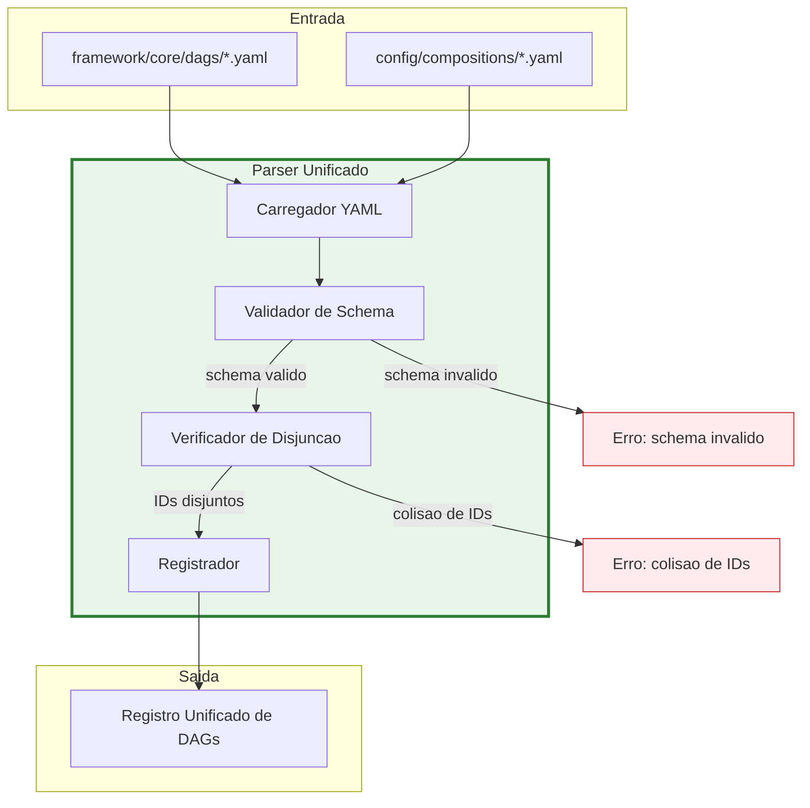
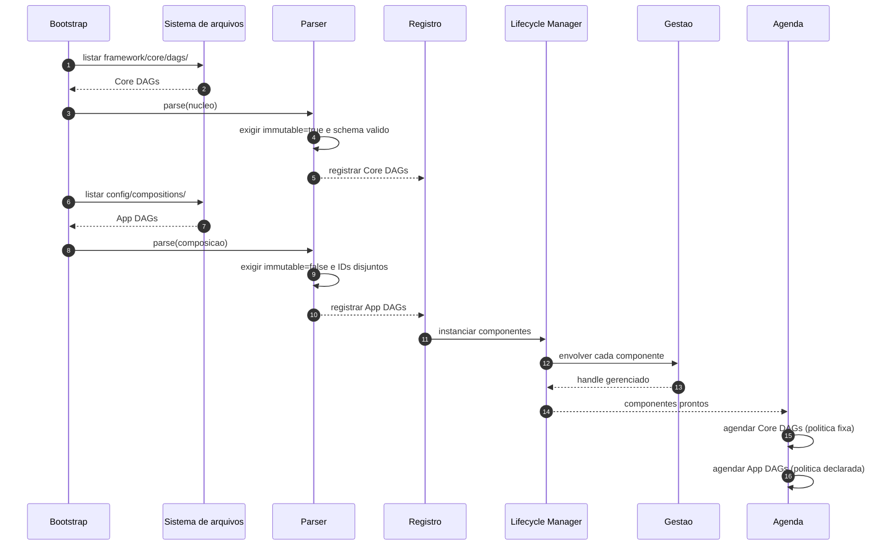
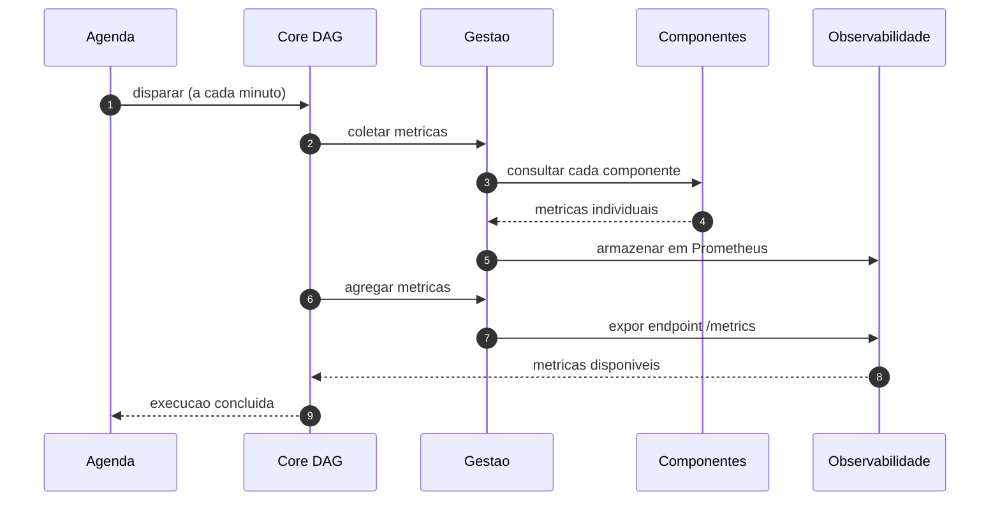
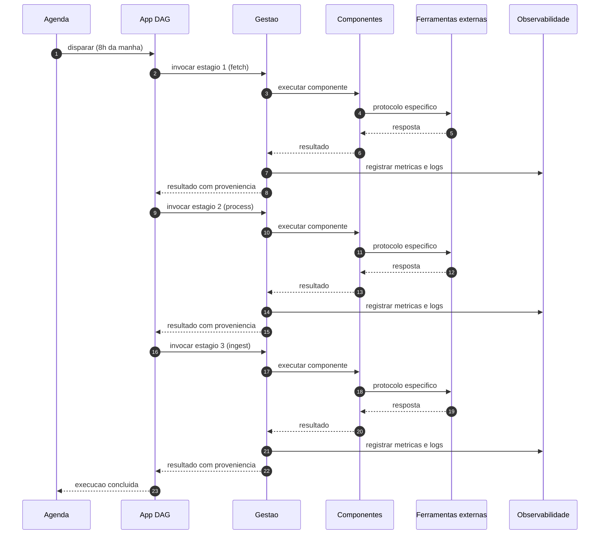

# Arquitetura-Molde v3 — Separação entre Core DAGs e App DAGs

| Campo | Valor |
|---|---|
| **Documento** | `docs/arquitetura_molde_v3_dags_separacao.md` |
| **Versão** | 3.0 |
| **Data** | 2026-10-13 |
| **Status** | Decisão arquitetural consolidada |
| **Dependência** | `docs/arquitetura_molde_fundamentacao.md` (v1); `docs/arquitetura_molde_v2_orquestracao_gestao.md` (v2) |
| **Escopo** | Definição formal da separação entre Core DAGs (Gestão, núcleo) e App DAGs (Orquestração, DEV), incluindo estrutura de diretórios, parser, validação e integração com infraestrutura |
| **Fora de escopo** | Implementação de componentes específicos; lógica de negócio COMEX |
| **Público** | Arquitetos, desenvolvedores de framework, desenvolvedores de composição, operação, DevOps |

---

## Sumário

1. [Introdução e motivação](#1-introdução-e-motivação)
2. [Fundamentação teórica](#2-fundamentação-teórica)
3. [Definições formais](#3-definições-formais)
4. [Estrutura de diretórios](#4-estrutura-de-diretórios)
5. [Core DAGs — artefatos do núcleo](#5-core-dags--artefatos-do-núcleo)
6. [App DAGs — artefatos da composição](#6-app-dags--artefatos-da-composição)
7. [Parser e validação unificados](#7-parser-e-validação-unificados)
8. [Integração com infraestrutura](#8-integração-com-infraestrutura)
9. [Fluxo de carregamento e execução](#9-fluxo-de-carregamento-e-execução)
10. [Exemplos aplicados ao MCA](#10-exemplos-aplicados-ao-mca)
11. [Critérios de conformidade](#11-critérios-de-conformidade)
12. [Trade-offs e limites](#12-trade-offs-e-limites)
13. [Referências bibliográficas](#13-referências-bibliográficas)
14. [Matriz de traçabilidade](#14-matriz-de-traçabilidade)

---

## 1. Introdução e motivação

### 1.1. O problema

O documento v2 estabeleceu a separação entre **Gestão** (nativa do framework) e **Orquestração** (responsabilidade do DEV). Essa separação, embora conceitualmente clara, exige um mecanismo concreto de materialização em artefatos versionados. Sem esse mecanismo, a separação permanece abstrata e vulnerável a violações acidentais ou intencionais.

O problema específico é: **como garantir que os artefatos de Gestão não sejam alterados pelo DEV, e que os artefatos de Orquestração possam evoluir livremente sem comprometer o núcleo?**

A resposta requer três decisões interligadas:

1. **Separação física** dos artefatos em diretórios distintos.
2. **Separação lógica** por meio de metadados de imutabilidade.
3. **Separação operacional** por meio de mecanismos de montagem e deploy.

### 1.2. A solução

Este documento formaliza a separação entre **Core DAGs** e **App DAGs**:

> **Core DAGs** são artefatos do núcleo, imutáveis pelo DEV, responsáveis por implementar a Gestão nativa. **App DAGs** são artefatos da composição, mutáveis pelo DEV, responsáveis por implementar a Orquestração específica.

A distinção não é meramente organizacional. Ela tem consequências diretas sobre:

- **Propriedade**: quem pode alterar cada artefato.
- **Ciclo de mudança**: com que frequência cada artefato evolui.
- **Montagem**: como os artefatos são disponibilizados em runtime.
- **Validação**: como o parser garante a integridade do sistema.
- **Deploy**: como os artefatos são versionados e implantados.

### 1.3. Analogia ilustrativa

Considere um sistema operacional moderno:

- O **kernel** (núcleo) é imutável para o usuário comum. Ele é montado como parte do sistema de arquivos raiz, em modo somente leitura. Alterá-lo exige privilégios de administrador e um processo de release formal.

- As **aplicações do usuário** são mutáveis. Elas residem em diretórios próprios, podem ser instaladas, removidas e atualizadas independentemente do kernel.

- O **sistema de arquivos** impõe a separação física: o kernel não pode ser sobrescrito por uma aplicação, mesmo que esta tenha o mesmo nome de um arquivo do kernel.

No MCA, o framework é o kernel. O DEV é o usuário. As Core DAGs são arquivos do kernel. As App DAGs são aplicações do usuário. O parser é o sistema de arquivos que impõe a separação.

### 1.4. Relação com os documentos anteriores

Este documento concretiza os axiomas estabelecidos nos documentos v1 e v2:

- **AX-05** (v1): "Core DAGs são artefatos de release; App DAGs são artefatos de composição."
- **AX-06** (v1): "Os espaços de nomes de Core e App DAGs são disjuntos."
- **ADR-002** (v1): "Núcleo imutável em relação ao DEV."
- **ADR-003** (v1): "DAGs como configuração declarativa em YAML."

A separação Core DAGs × App DAGs é a materialização física desses axiomas.

---

## 2. Fundamentação teórica

### 2.1. Padrão de Configuração em Camadas

**Fonte:** Fowler (2002) [R01].

**Conceito:** separar configuração em camadas baseadas em quem as controla e com que frequência mudam. Configuração de framework deve ser imutável para desenvolvedores de aplicação, enquanto configuração de aplicação deve ser flexível.

**Princípios:**

1. **Imutabilidade relativa**: o que é framework não pode ser alterado pelo DEV.
2. **Extensibilidade controlada**: o DEV estende, não modifica o core.
3. **Separação de responsabilidades**: cada camada tem seu dono.
4. **Composição hierárquica**: configurações se sobrepõem em camadas com precedência definida.

**Aplicabilidade ao problema:**

- Core DAGs são imutáveis (controle do framework).
- App DAGs são flexíveis (controle do DEV).
- Permite evolução independente.
- Facilita versionamento e rollback.

**Exemplos reais:**

- **Spring Boot**: `application.properties` (app) versus `spring-boot-defaults.properties` (framework).
- **Django**: `settings.py` (app) versus `django/conf/global_settings.py` (framework).
- **Kubernetes**: ConfigMaps do sistema versus ConfigMaps da aplicação.
- **Airflow**: `airflow.cfg` (framework) versus `dags/` (usuário).

### 2.2. Padrão de Infraestrutura Imutável

**Fonte:** Morris (2016) [R02].

**Conceito:** uma vez que um componente é implantado, ele é imutável. Mudanças são feitas criando novos componentes, não modificando os existentes.

**Aplicação à arquitetura:**

- **Core DAGs**: são "infraestrutura" — imutáveis após deploy.
- **App DAGs**: são "aplicação" — mutáveis pelo DEV.
- **Separação física**: diretórios diferentes reforçam a imutabilidade.

**Exemplos reais:**

- **Container images**: camadas imutáveis empilhadas.
- **Kubernetes ConfigMaps imutáveis**: KEP-3129 [R03].
- **GitOps**: estado do cluster derivado de repositório versionado [R04].

### 2.3. Padrão de Pontos de Extensão

**Fonte:** Gamma et al. (1994) [R05]; Fayad e Schmidt (1997) [R06].

**Conceito:** frameworks definem pontos de extensão (hot spots) onde aplicações podem injetar comportamento customizado. Frozen spots são as partes invariantes do framework.

**Mapeamento:**

- **Frozen spots**: Core DAGs (gestão nativa do framework).
- **Hot spots**: App DAGs (orquestração específica do DEV).
- **Mecanismo de extensão**: parser de YAML que carrega ambas.

### 2.4. Configuração como Código

**Fonte:** Humble e Farley (2010) [R07].

**Conceito:** tratar configuração com o mesmo rigor que código: versionamento, teste, revisão e pipelines de deploy.

**Aplicação:**

- Core DAGs e App DAGs são código (YAML versionável).
- Podem ser testados, revisados e implantados.
- Facilita colaboração e auditoria.

### 2.5. Engenharia de Linhas de Produto

**Fonte:** Pohl, Böckle e van der Linden (2005) [R08].

**Conceito:** separação entre assets core (compartilhados, controlados centralmente) e assets de aplicação (variantes, controlados localmente), bem como entre hot spots (pontos de variabilidade) e decisões de variabilidade binding-time.

**Mapeamento direto:**

| Conceito de SPL | Correspondência no molde | Binding-time |
|---|---|---|
| Core asset | `framework/core/dags/` | Compile / release |
| Application asset | `config/compositions/` | Deploy / runtime |
| Hot spot | Porta de componente + ponto de conexão | Build da composição |
| Variabilidade obrigatória | Escolha do componente | Configuração |
| Variabilidade opcional | Escolha do conector e do backend | Configuração |
| Restrição de variabilidade | Núcleo imutável; IDs disjuntos | Carregamento |

### 2.6. Princípio do Menor Privilégio

**Fonte:** Saltzer e Schroeder (1975) [R09].

**Conceito:** um sujeito deve ter apenas os privilégios necessários para realizar suas funções.

**Aplicação à separação:**

| Sujeito | Privilégio sobre Core DAGs | Privilégio sobre App DAGs |
|---|---|---|
| Mantenedor do framework | Leitura e escrita | Leitura |
| DEV de composição | Leitura apenas | Leitura e escrita |
| Execução em runtime | Leitura; montagem read-only | Leitura; execução |
| Operação | Leitura; configuração de ambiente | Leitura; acionamento |

A imutabilidade do core em relação ao DEV não é uma convenção social; é uma aplicação do princípio de menor privilégio.

### 2.7. Síntese teórica

A separação Core DAGs × App DAGs é fundamentada na combinação de seis padrões consolidados:

1. **Configuração em camadas** — separação por propriedade e frequência de mudança.
2. **Infraestrutura imutável** — core não muda após deploy.
3. **Pontos de extensão** — hot spots para customização.
4. **Configuração como código** — YAML versionável.
5. **Linhas de produto** — assets core versus assets de aplicação.
6. **Menor privilégio** — controle de acesso por sujeito.

Essa combinação garante que a separação entre Gestão e Orquestração (v2) seja materializada de forma verificável e operacional.

---

## 3. Definições formais

### 3.1. DAG

Seja uma DAG $D$ representada pela quádrupla:

$$D = (I, S, T, M)$$

onde:

- $I$ é o **identificador** único da DAG.
- $S$ é o conjunto de **estágios** (tarefas).
- $T$ é o conjunto de **transições** entre estágios.
- $M$ é o conjunto de **metadados** (proprietário, imutabilidade, descrição).

### 3.2. Core DAG

Uma **Core DAG** é uma DAG $D_c$ tal que:

$$D_c = (I_c, S_c, T_c, M_c)$$

onde $M_c$ contém o par $(\text{owner} = \text{framework}, \text{immutable} = \text{true})$.

**Propriedades:**

- $I_c \in \mathcal{I}_{\text{core}}$, onde $\mathcal{I}_{\text{core}}$ é o espaço de nomes reservado ao núcleo.
- $S_c$ implementa funcionalidades de Gestão (métricas, logs, alertas, ciclo de vida).
- $T_c$ define dependências entre estágios de Gestão.
- $D_c$ reside em `framework/core/dags/`.
- $D_c$ é montada em modo read-only em runtime.

### 3.3. App DAG

Uma **App DAG** é uma DAG $D_a$ tal que:

$$D_a = (I_a, S_a, T_a, M_a)$$

onde $M_a$ contém o par $(\text{owner} = \text{dev}, \text{immutable} = \text{false})$.

**Propriedades:**

- $I_a \in \mathcal{I}_{\text{app}}$, onde $\mathcal{I}_{\text{app}}$ é o espaço de nomes da composição.
- $S_a$ implementa funcionalidades de Orquestração (fluxo de negócio).
- $T_a$ define dependências entre estágios de negócio.
- $D_a$ reside em `config/compositions/`.
- $D_a$ é montada em modo read-write em runtime.

### 3.4. Disjunção de espaços de nomes

**Axioma fundamental:**

$$\mathcal{I}_{\text{core}} \cap \mathcal{I}_{\text{app}} = \emptyset$$

Ou seja: **não existe DAG com identificador presente em ambos os espaços**.

**Consequência operacional:** se uma App DAG tenta usar um identificador já reservado por uma Core DAG, o carregamento falha com erro explícito.

### 3.5. Função de carregamento

Seja $\mathcal{D}$ o conjunto de todas as DAGs carregadas:

$$\mathcal{D} = \mathcal{D}_{\text{core}} \cup \mathcal{D}_{\text{app}}$$

onde:

- $\mathcal{D}_{\text{core}}$ é o conjunto de Core DAGs carregadas de `framework/core/dags/`.
- $\mathcal{D}_{\text{app}}$ é o conjunto de App DAGs carregadas de `config/compositions/`.

**Propriedade de consistência:**

$$\forall D_c \in \mathcal{D}_{\text{core}}, \forall D_a \in \mathcal{D}_{\text{app}}: I_c \neq I_a$$

### 3.6. Tabela comparativa

| Dimensão | Core DAG | App DAG |
|---|---|---|
| **Diretório** | `framework/core/dags/` | `config/compositions/` |
| **Propriedade** | Núcleo do framework | DEV da composição |
| **Campo `immutable`** | `true` — obrigatório | `false` — obrigatório |
| **Montagem em container** | `:ro` (read-only) | `:rw` (read-write) |
| **Ciclo de mudança** | Release do framework | Iteração da aplicação |
| **Escopo** | Todos os componentes registrados | Componentes da composição |
| **Finalidade** | Medir, monitorar, controlar | Definir fluxo de negócio |
| **Sobrescrita por App** | Proibida | Permitida dentro do próprio espaço |
| **Colisão de ID** | Erro de carregamento | Erro de carregamento |
| **Semântica** | "Como o framework supervisiona?" | "Como o negócio flui?" |

---

## 4. Estrutura de diretórios

### 4.1. Visão geral

```
mca-framework/
|
|-- framework/                    # NUCLEO (imutavel pelo DEV)
|   |-- core/
|   |   |-- dags/                 # Core DAGs (Gestao)
|   |   |   |-- metrics_collection.yaml
|   |   |   |-- health_check.yaml
|   |   |   |-- component_lifecycle.yaml
|   |   |   |-- alerting.yaml
|   |   |-- ports.py              # Interfaces (Portas)
|   |   |-- entities.py           # Entidades de dominio
|   |   |-- exceptions.py         # Excecoes padronizadas
|   |   |-- contracts.py          # Contratos de dados
|   |
|   |-- management/               # Camada de Gestao (nativa)
|   |   |-- metrics/              # Coleta de metricas
|   |   |-- logging/              # Logs estruturados
|   |   |-- tracing/              # Tracing distribuido
|   |   |-- alerting/             # Sistema de alertas
|   |   |-- dashboard/            # Dashboards unificados
|   |
|   |-- execution/                # Engine de Execucao
|   |   |-- parser.py             # Parser de DAGs YAML
|   |   |-- orchestrator.py       # Orquestrador de componentes
|   |   |-- connectors.py         # Conectores entre componentes
|   |   |-- lifecycle.py          # Gerenciamento de ciclo de vida
|   |
|   |-- infrastructure/           # Infraestrutura base
|       |-- Dockerfile.framework  # Dockerfile do framework
|       |-- docker-compose.framework.yml
|       |-- config/
|           |-- framework.env     # Variaveis do framework
|           |-- logging.yaml      # Configuracao de logs
|
|-- config/                       # COMPOSICAO (controlado pelo DEV)
|   |-- compositions/             # App DAGs (Orquestracao)
|   |   |-- rodou_solo_pipeline.yaml
|   |   |-- senado_ncm_ingestion.yaml
|   |   |-- comex_monitoring.yaml
|   |
|   |-- components/               # Componentes especificos
|   |   |-- rodou_adapter.py
|   |   |-- senado_adapter.py
|   |   |-- ncm_adapter.py
|   |   |-- neo4j_adapter.py
|   |
|   |-- app.env                   # Variaveis da aplicacao
|   |-- docker-compose.app.yml    # Composicao especifica
|   |-- secrets.yaml              # Segredos (nao versionado)
|
|-- deployment/                   # DEPLOY (infraestrutura)
|   |-- docker-compose.yml        # Composicao final
|   |-- Dockerfile                # Dockerfile final
|   |-- kubernetes/               # Manifestos K8s
|   |   |-- namespace.yaml
|   |   |-- deployment.yaml
|   |   |-- service.yaml
|   |   |-- configmap.yaml
|   |-- helm/                     # Helm charts
|       |-- Chart.yaml
|       |-- values.yaml
|       |-- templates/
|
|-- tests/                        # TESTES
|   |-- framework/                # Testes do framework
|   |   |-- test_core_dags.py
|   |   |-- test_management.py
|   |   |-- test_execution.py
|   |
|   |-- application/              # Testes da aplicacao
|       |-- test_app_dags.py
|       |-- test_components.py
|       |-- test_integration.py
|
|-- docs/                         # DOCUMENTACAO
|
|-- config.yaml                   # Configuracao raiz
|-- .gitignore
|-- README.md
|-- requirements.txt
```

### 4.2. Regras de propriedade

| Diretório | Propriedade | Mutabilidade | Permissão de escrita |
|---|---|---|---|
| `framework/` | Framework | Imutável | Apenas mantenedores do framework |
| `config/compositions/` | DEV | Mutável | Qualquer DEV do projeto |
| `config/components/` | DEV | Mutável | Qualquer DEV do projeto |
| `deployment/` | DevOps | Mutável (controlado) | Via pipelines de CI/CD |
| `tests/` | DEV | Mutável | Qualquer DEV do projeto |
| `docs/` | Framework + DEV | Mutável | Conforme escopo do documento |

### 4.3. Justificativa da estrutura

A estrutura proposta difere da estrutura original do repositório (documentada em `solo_mca_rodou_01102026_1215.txt`) em três aspectos:

1. **Separação explícita entre `framework/` e `config/`**: a estrutura original tinha `src/` unificado. A nova estrutura separa o núcleo imutável (`framework/`) da composição mutável (`config/`).

2. **Movimentação de `compositions/`**: na estrutura original, `config/compositions/` existia mas estava vazia. Na nova estrutura, ela é o diretório principal das App DAGs.

3. **Consolidação de `src/` em `framework/`**: os subdiretórios `src/core/`, `src/domain/`, `src/adapters/`, `src/processors/`, `src/utils/` são reorganizados em `framework/core/`, `framework/management/`, `framework/execution/`.

**Nota de migração**: a transição da estrutura original para a nova estrutura deve ser feita de forma incremental, preservando o contrato de refatoração definido em `LEGACY_MAP.md`.

---

## 5. Core DAGs — artefatos do núcleo

### 5.1. Definição

Core DAGs são DAGs que implementam funcionalidades transversais do framework, responsáveis por medir, monitorar e controlar componentes independentemente da ferramenta interna.

### 5.2. Características

- **Localização**: `framework/core/dags/`.
- **Propriedade**: Framework (imutável pelo DEV).
- **Execução**: Automática e transparente.
- **Escopo**: Todos os componentes registrados.
- **Finalidade**: Observabilidade e controle.
- **Campo `immutable`**: Obrigatoriamente `true`.

### 5.3. Core DAGs de referência

O framework oferece quatro Core DAGs de referência, cada uma responsável por um aspecto da Gestão:

#### 5.3.1. metrics_collection.yaml

**Finalidade**: coletar métricas padronizadas de todos os componentes.

```yaml
# framework/core/dags/metrics_collection.yaml
dag:
  id: core_metrics_collection
  description: "Coleta metricas padronizadas de todos os componentes"
  schedule: "*/1 * * * *"  # A cada minuto
  owner: framework
  immutable: true  # Nao pode ser alterado pelo DEV

tasks:
  - id: collect_component_metrics
    type: management.metrics.collect
    config:
      metrics_to_collect:
        - execution_count
        - success_rate
        - average_duration
        - error_rate
        - last_execution_timestamp
      aggregation_window: 60  # segundos
      storage_backend: prometheus

  - id: aggregate_metrics
    type: management.metrics.aggregate
    depends_on: [collect_component_metrics]
    config:
      aggregation_functions:
        - avg
        - sum
        - min
        - max
        - percentile_95
      group_by: [component_id, metric_type]

  - id: expose_metrics_endpoint
    type: management.metrics.expose
    depends_on: [aggregate_metrics]
    config:
      endpoint: "/metrics"
      format: prometheus
      port: 9090

notifications:
  on_failure:
    - type: log
      level: ERROR
    - type: alert
      channel: framework_alerts
```

#### 5.3.2. health_check.yaml

**Finalidade**: verificar saúde de todos os componentes registrados.

```yaml
# framework/core/dags/health_check.yaml
dag:
  id: core_health_check
  description: "Verifica saude de todos os componentes registrados"
  schedule: "*/5 * * * *"  # A cada 5 minutos
  owner: framework
  immutable: true

tasks:
  - id: check_component_connectivity
    type: management.health.check_connectivity
    config:
      timeout_seconds: 10
      retry_attempts: 3
      retry_delay_seconds: 2

  - id: check_component_resources
    type: management.health.check_resources
    depends_on: [check_component_connectivity]
    config:
      thresholds:
        cpu_percent: 80
        memory_percent: 85
        disk_percent: 90
        open_files: 1000

  - id: check_component_dependencies
    type: management.health.check_dependencies
    depends_on: [check_component_connectivity]
    config:
      check_external_dependencies: true
      check_database_connections: true
      check_api_endpoints: true

  - id: generate_health_report
    type: management.health.generate_report
    depends_on:
      - check_component_resources
      - check_component_dependencies
    config:
      report_format: json
      include_details: true
      store_in: health_check_history

notifications:
  on_failure:
    - type: alert
      channel: critical_alerts
      severity: CRITICAL
  on_warning:
    - type: alert
      channel: warning_alerts
      severity: WARNING
```

#### 5.3.3. component_lifecycle.yaml

**Finalidade**: gerenciar ciclo de vida de componentes (iniciar, parar, reiniciar).

```yaml
# framework/core/dags/component_lifecycle.yaml
dag:
  id: core_component_lifecycle
  description: "Gerencia ciclo de vida de componentes"
  schedule: null  # Acionado por eventos
  owner: framework
  immutable: true

triggers:
  - event: component.start_requested
    task: start_component
  - event: component.stop_requested
    task: stop_component
  - event: component.restart_requested
    task: restart_component

tasks:
  - id: start_component
    type: management.lifecycle.start
    config:
      graceful_timeout_seconds: 30
      health_check_after_start: true
      health_check_timeout_seconds: 60

  - id: stop_component
    type: management.lifecycle.stop
    config:
      graceful_timeout_seconds: 30
      force_stop_after_timeout: true
      cleanup_temp_files: true

  - id: restart_component
    type: management.lifecycle.restart
    config:
      stop_first: true
      start_after_stop: true
      preserve_state: false

notifications:
  on_success:
    - type: log
      level: INFO
  on_failure:
    - type: alert
      channel: framework_alerts
```

#### 5.3.4. alerting.yaml

**Finalidade**: sistema de alertas do framework.

```yaml
# framework/core/dags/alerting.yaml
dag:
  id: core_alerting
  description: "Sistema de alertas do framework"
  schedule: "*/2 * * * *"  # A cada 2 minutos
  owner: framework
  immutable: true

tasks:
  - id: evaluate_alert_rules
    type: management.alerting.evaluate_rules
    config:
      rules:
        - name: high_error_rate
          condition: "error_rate > 0.05"
          severity: HIGH
          channels: [email, slack]
        - name: high_latency
          condition: "average_duration > 300"
          severity: MEDIUM
          channels: [slack]
        - name: component_down
          condition: "status == 'DOWN'"
          severity: CRITICAL
          channels: [email, slack, pagerduty]

notifications:
  on_alert:
    - type: log
      level: WARNING
```

### 5.4. Extensibilidade das Core DAGs

As Core DAGs de referência podem ser estendidas pelo mantenedor do framework, mas não pelo DEV. Novas Core DAGs podem ser adicionadas em releases futuros do framework, desde que:

1. Respeitem o espaço de nomes $\mathcal{I}_{\text{core}}$.
2. Tenham `immutable: true`.
3. Implementem funcionalidades de Gestão.
4. Sejam documentadas nos documentos de release.

---

## 6. App DAGs — artefatos da composição

### 6.1. Definição

App DAGs são DAGs que definem como componentes específicos se comunicam em um fluxo de trabalho, dependendo das ferramentas que cada componente utiliza.

### 6.2. Características

- **Localização**: `config/compositions/`.
- **Propriedade**: DEV (mutável).
- **Execução**: Sob demanda ou agendada.
- **Escopo**: Componentes específicos da aplicação.
- **Finalidade**: Orquestração de fluxo de dados.
- **Campo `immutable`**: Obrigatoriamente `false` (ou ausente).

### 6.3. App DAGs de referência

O projeto MCA oferece três App DAGs de referência, cada uma responsável por um fluxo de negócio específico:

#### 6.3.1. rodou_solo_pipeline.yaml

**Finalidade**: pipeline Ro-DOU para o Solo MCA (critério C2 — Classificação).

```yaml
# config/compositions/rodou_solo_pipeline.yaml
dag:
  id: rodou_solo_pipeline
  description: "Pipeline Ro-DOU para Solo MCA (C2 Classificacao)"
  schedule: "0 8 * * MON-FRI"  # 8h da manha, dias uteis
  owner: dev_team
  immutable: false
  tags: [solo_mca, comex, classificacao]

components:
  - id: rodou_fetcher
    type: ro_dou.hook.DOUHook
    config:
      dag_id: solo_mca_c2_classificacao
      sources: [INLABS]
      terms:
        - "NCM AND (classificacao OR alteracao)"
        - "Sistema Harmonizado AND mercadoria"
      department:
        - "Secretaria da Receita Federal"
        - "CAMEX"
        - "GECEX"
      use_summary: true
      full_text: true

  - id: llm_processor
    type: mca.llm.LLMProcessor
    config:
      provider: openai
      model: gpt-4
      temperature: 0.2
      max_tokens: 300
      custom_prompt: |
        Voce e um especialista em comercio exterior brasileiro.
        Resuma a publicacao em uma unica frase objetiva.

  - id: solo_ingestor
    type: mca.neo4j.Neo4jAdapter
    config:
      uri: bolt://neo4j:7687
      user: neo4j
      password: ${NEO4J_PASSWORD}
      database: solo_mca

pipeline:
  stages:
    - id: fetch_dou
      component: rodou_fetcher
      output: raw_publications

    - id: process_with_llm
      component: llm_processor
      input: raw_publications
      output: enriched_publications
      depends_on: [fetch_dou]

    - id: ingest_to_solo
      component: solo_ingestor
      input: enriched_publications
      output: ingestion_result
      depends_on: [process_with_llm]

connectors:
  - source: fetch_dou
    target: process_with_llm
    type: synchronous
    protocol: http
    config:
      url: http://localhost:8000/process
      method: POST
      timeout_seconds: 30

  - source: process_with_llm
    target: ingest_to_solo
    type: synchronous
    protocol: bolt
    config:
      uri: bolt://neo4j:7687
      timeout_seconds: 60

notifications:
  on_success:
    - type: webhook
      url: https://n8n.example.com/webhook/solo-success
    - type: log
      level: INFO

  on_failure:
    - type: webhook
      url: https://n8n.example.com/webhook/solo-failure
    - type: alert
      channel: pipeline_alerts
      severity: HIGH
```

#### 6.3.2. senado_ncm_ingestion.yaml

**Finalidade**: ingestão de normas do Senado (L1 a L4) e NCM (L5).

```yaml
# config/compositions/senado_ncm_ingestion.yaml
dag:
  id: senado_ncm_ingestion
  description: "Ingestao de normas do Senado (L1-L4) + NCM (L5)"
  schedule: "0 2 * * SUN"  # 2h da manha, domingos
  owner: dev_team
  immutable: false
  tags: [senado, ncm, levels_1_to_5]

components:
  - id: senado_fetcher
    type: mca.senado.SenadoAdapter
    config:
      normas:
        - tipo: EMC
          numero: 33
          ano: 2001
        - tipo: DLG
          numero: 135
          ano: 2019
        - tipo: LC
          numero: 87
          ano: 1996
      rate_limit: 10  # req/s
      max_retries: 3

  - id: ncm_fetcher
    type: mca.ncm.NCMAdapter
    config:
      json_path: /data/ncm/Tabela_NCM_Vigente.json
      hierarchical_parsing: true

  - id: neo4j_ingestor
    type: mca.neo4j.Neo4jAdapter
    config:
      uri: bolt://neo4j:7687
      user: neo4j
      password: ${NEO4J_PASSWORD}
      batch_size: 100

pipeline:
  stages:
    - id: fetch_senado
      component: senado_fetcher
      output: senado_normas

    - id: fetch_ncm
      component: ncm_fetcher
      output: ncm_items
      parallel_with: [fetch_senado]  # Executa em paralelo

    - id: merge_results
      type: processor.merge
      inputs: [senado_normas, ncm_items]
      output: all_normas
      depends_on: [fetch_senado, fetch_ncm]

    - id: ingest_all
      component: neo4j_ingestor
      input: all_normas
      output: ingestion_stats
      depends_on: [merge_results]

notifications:
  on_success:
    - type: log
      level: INFO
      message: "Ingestao concluida com sucesso"

  on_failure:
    - type: alert
      channel: ingestion_alerts
      severity: HIGH
```

#### 6.3.3. comex_monitoring.yaml

**Finalidade**: monitoramento diário de publicações COMEX (C1 a C6).

```yaml
# config/compositions/comex_monitoring.yaml
dag:
  id: comex_monitoring
  description: "Monitoramento diario de publicacoes COMEX (C1-C6)"
  schedule: "0 8 * * *"  # 8h da manha, todos os dias
  owner: dev_team
  immutable: false
  tags: [comex, monitoring, daily]

components:
  - id: comex_fetcher
    type: ro_dou.hook.DOUHook
    config:
      terms:
        - "NCM"
        - "classificacao fiscal"
        - "tributos"
      department:
        - "RFB"
        - "CAMEX"

pipeline:
  stages:
    - id: fetch_comex
      component: comex_fetcher
      output: comex_publications

notifications:
  on_success:
    - type: log
      level: INFO
```

### 6.4. Relação com o Ro-DOU

As App DAGs do MCA são **distintas** das DAGs do Ro-DOU, embora compartilhem similaridades conceituais:

| Aspecto | DAGs do Ro-DOU | App DAGs do MCA |
|---|---|---|
| **Localização** | `dag_confs/` (dentro do Ro-DOU) | `config/compositions/` (fora do Ro-DOU) |
| **Propriedade** | Equipe do Ro-DOU | DEV do MCA |
| **Executor** | Apache Airflow 3 | Executor injetável (Airflow, n8n, embutido) |
| **Finalidade** | Monitorar DOU | Orquestrar fluxo de negócio |
| **Componentes** | DOUHook, MatchEngine, LLM, Apprise | Componentes do MCA (que podem incluir Ro-DOU) |

**Ponto crítico**: o Ro-DOU pode ser usado **como componente** dentro de uma App DAG do MCA, mas as DAGs do Ro-DOU não são App DAGs do MCA. Elas pertencem a espaços de nomes distintos.

### 6.5. Extensibilidade das App DAGs

O DEV pode criar novas App DAGs livremente, desde que:

1. Respeitem o espaço de nomes $\mathcal{I}_{\text{app}}$.
2. Tenham `immutable: false` (ou ausente).
3. Implementem funcionalidades de Orquestração.
4. Não colidam com identificadores de Core DAGs.
5. Sejam testadas antes de serem implantadas.

---

## 7. Parser e validação unificados

### 7.1. Arquitetura do parser

O parser é responsável por carregar, validar e registrar todas as DAGs (Core e App) em um registro unificado. Ele é o mecanismo que garante a consistência do sistema.



### 7.2. Implementação do parser

```python
# framework/execution/parser.py

from typing import Dict, List, Any
from pathlib import Path
import yaml
from dataclasses import dataclass


@dataclass
class DAGDefinition:
    """Representa uma DAG parseada de YAML."""
    id: str
    description: str
    schedule: str
    owner: str
    immutable: bool
    tasks: List[Dict[str, Any]]
    components: List[Dict[str, Any]]
    pipeline: Dict[str, Any]
    connectors: List[Dict[str, Any]]
    notifications: Dict[str, Any]


class DAGParser:
    """
    Parser de DAGs YAML.
    Carrega Core DAGs (imutaveis) e App DAGs (mutaveis).
    """

    def __init__(self, framework_dags_dir: str, app_dags_dir: str):
        self.framework_dags_dir = Path(framework_dags_dir)
        self.app_dags_dir = Path(app_dags_dir)

        self.core_dags: Dict[str, DAGDefinition] = {}
        self.app_dags: Dict[str, DAGDefinition] = {}

    def parse_all(self) -> Dict[str, DAGDefinition]:
        """
        Parseia todas as DAGs (Core + App).
        Retorna dicionario unificado.
        """
        # 1. Parsear Core DAGs (imutaveis)
        self._parse_core_dags()

        # 2. Parsear App DAGs (mutaveis)
        self._parse_app_dags()

        # 3. Validar conflitos
        self._validate_no_conflicts()

        # 4. Retornar unificado
        return {**self.core_dags, **self.app_dags}

    def _parse_core_dags(self):
        """Parseia Core DAGs do diretorio do framework."""
        for yaml_file in self.framework_dags_dir.glob("*.yaml"):
            dag = self._parse_yaml_file(yaml_file)

            # Core DAGs devem ser marcadas como imutaveis
            if not dag.immutable:
                raise ValueError(
                    f"Core DAG {dag.id} deve ter immutable=true"
                )

            self.core_dags[dag.id] = dag

    def _parse_app_dags(self):
        """Parseia App DAGs do diretorio da aplicacao."""
        for yaml_file in self.app_dags_dir.glob("*.yaml"):
            dag = self._parse_yaml_file(yaml_file)

            # App DAGs nao podem ser imutaveis
            if dag.immutable:
                raise ValueError(
                    f"App DAG {dag.id} nao pode ter immutable=true"
                )

            # App DAGs nao podem sobrescrever Core DAGs
            if dag.id in self.core_dags:
                raise ValueError(
                    f"App DAG {dag.id} nao pode sobrescrever Core DAG"
                )

            self.app_dags[dag.id] = dag

    def _parse_yaml_file(self, yaml_file: Path) -> DAGDefinition:
        """Parseia um arquivo YAML individual."""
        with open(yaml_file, 'r', encoding='utf-8') as f:
            data = yaml.safe_load(f)

        dag_data = data.get('dag', {})

        return DAGDefinition(
            id=dag_data.get('id'),
            description=dag_data.get('description', ''),
            schedule=dag_data.get('schedule'),
            owner=dag_data.get('owner', 'unknown'),
            immutable=dag_data.get('immutable', False),
            tasks=data.get('tasks', []),
            components=data.get('components', []),
            pipeline=data.get('pipeline', {}),
            connectors=data.get('connectors', []),
            notifications=data.get('notifications', {})
        )

    def _validate_no_conflicts(self):
        """Valida que nao ha conflitos entre Core e App DAGs."""
        conflicts = set(self.core_dags.keys()) & set(self.app_dags.keys())

        if conflicts:
            raise ValueError(
                f"Conflito de IDs entre Core e App DAGs: {conflicts}"
            )

    def get_core_dags(self) -> Dict[str, DAGDefinition]:
        """Retorna apenas Core DAGs."""
        return self.core_dags.copy()

    def get_app_dags(self) -> Dict[str, DAGDefinition]:
        """Retorna apenas App DAGs."""
        return self.app_dags.copy()
```

### 7.3. Regras de validação

O parser aplica as seguintes regras de validação:

| Regra | Descrição | Consequência |
|---|---|---|
| **VAL-01** | Core DAG deve ter `immutable: true` | Erro de carregamento |
| **VAL-02** | App DAG deve ter `immutable: false` (ou ausente) | Erro de carregamento |
| **VAL-03** | App DAG não pode sobrescrever Core DAG | Erro de carregamento |
| **VAL-04** | IDs de Core e App DAGs devem ser disjuntos | Erro de carregamento |
| **VAL-05** | Schema YAML deve ser válido | Erro de carregamento |
| **VAL-06** | DAG não pode conter ciclos | Erro de carregamento |
| **VAL-07** | Componentes referenciados devem existir | Erro de carregamento |
| **VAL-08** | Conectores devem ser compatíveis com componentes | Erro de carregamento |

### 7.4. Falha explícita

**Princípio fundamental**: toda falha de validação interrompe o carregamento com diagnóstico tipado. Não há fallback silencioso.

**Justificativa**: configuração inválida que é ignorada silenciosamente produz sistemas que parecem saudáveis e não executam o esperado. A falha explícita é preferível ao comportamento silencioso.

---

## 8. Integração com infraestrutura

### 8.1. Docker Compose

A separação Core DAGs × App DAGs é materializada em Docker Compose por meio de montagens de volume com permissões distintas:

```yaml
# deployment/docker-compose.yml

version: '3.9'

services:
  # Servicos do framework (Core DAGs)
  framework-core:
    build:
      context: ../framework
      dockerfile: infrastructure/Dockerfile.framework
    container_name: mca-framework-core
    environment:
      - FRAMEWORK_ENV=production
      - METRICS_BACKEND=prometheus
      - LOG_LEVEL=INFO
    volumes:
      - ../framework/core/dags:/framework/core/dags:ro  # Read-only
      - framework_data:/data
    ports:
      - "9090:9090"  # Metrics endpoint
      - "8080:8080"  # Health check endpoint
    networks:
      - mca-network
    restart: unless-stopped

  # Servicos da aplicacao (App DAGs)
  application:
    build:
      context: ..
      dockerfile: deployment/Dockerfile
    container_name: mca-application
    environment:
      - APP_ENV=production
      - NEO4J_URI=bolt://neo4j:7687
      - NEO4J_PASSWORD=${NEO4J_PASSWORD}
      - OPENAI_API_KEY=${OPENAI_API_KEY}
    volumes:
      - ../config/compositions:/application/dags:rw  # Read-write
      - ../config/components:/application/components:ro
      - application_data:/data
    networks:
      - mca-network
    depends_on:
      - framework-core
      - neo4j
    restart: unless-stopped

  # Servicos compartilhados
  neo4j:
    image: neo4j:5.20-community
    container_name: mca-neo4j
    environment:
      - NEO4J_AUTH=neo4j/${NEO4J_PASSWORD}
      - NEO4J_PLUGINS=["apoc"]
    volumes:
      - neo4j_data:/data
      - neo4j_logs:/logs
    ports:
      - "7474:7474"
      - "7687:7687"
    networks:
      - mca-network

volumes:
  framework_data:
  application_data:
  neo4j_data:
  neo4j_logs:

networks:
  mca-network:
    driver: bridge
```

**Pontos-chave:**

- Core DAGs são montadas como `:ro` (read-only). O container da aplicação não pode alterá-las.
- App DAGs são montadas como `:rw` (read-write). O DEV pode alterá-las.
- A separação física é reforçada pela separação de montagens.

### 8.2. Kubernetes

Em Kubernetes, a separação é materializada por meio de ConfigMaps distintos:

```yaml
# deployment/kubernetes/configmap-core.yaml
apiVersion: v1
kind: ConfigMap
metadata:
  name: mca-core-dags
  namespace: mca-framework
  labels:
    app: mca-framework
    component: core
  annotations:
    kubernetes.io/description: "Core DAGs do framework (imutaveis)"
immutable: true  # ConfigMap imutavel
data:
  metrics_collection.yaml: |
    # conteudo da Core DAG
  health_check.yaml: |
    # conteudo da Core DAG
  component_lifecycle.yaml: |
    # conteudo da Core DAG
  alerting.yaml: |
    # conteudo da Core DAG
```

```yaml
# deployment/kubernetes/configmap-app.yaml
apiVersion: v1
kind: ConfigMap
metadata:
  name: mca-app-dags
  namespace: mca-framework
  labels:
    app: mca-application
    component: app
  annotations:
    kubernetes.io/description: "App DAGs da composicao (mutaveis)"
data:
  rodou_solo_pipeline.yaml: |
    # conteudo da App DAG
  senado_ncm_ingestion.yaml: |
    # conteudo da App DAG
  comex_monitoring.yaml: |
    # conteudo da App DAG
```

**Pontos-chave:**

- ConfigMap de Core DAGs é marcado como `immutable: true` (KEP-3129 [R03]).
- ConfigMap de App DAGs é mutável e pode ser atualizado sem reiniciar o pod.
- A separação é reforçada por labels e annotations distintos.

### 8.3. Arquivos de ambiente

A separação é materializada em dois arquivos `.env` distintos:

#### 8.3.1. framework.env (Framework)

```bash
# framework/infrastructure/config/framework.env

# Configuracao do framework (imutavel pelo DEV)

# Metrics
METRICS_BACKEND=prometheus
METRICS_COLLECTION_INTERVAL=60
METRICS_RETENTION_DAYS=30

# Logging
LOG_LEVEL=INFO
LOG_FORMAT=json
LOG_OUTPUT=stdout

# Health Check
HEALTH_CHECK_INTERVAL=300
HEALTH_CHECK_TIMEOUT=10

# Alerting
ALERT_EMAIL_FROM=framework@example.com
ALERT_SMTP_HOST=smtp.example.com
ALERT_SMTP_PORT=587

# Dashboard
DASHBOARD_PORT=3000
DASHBOARD_REFRESH_INTERVAL=30
```

#### 8.3.2. app.env (Application)

```bash
# config/app.env

# Configuracao da aplicacao (controlado pelo DEV)

# Neo4j
NEO4J_URI=bolt://neo4j:7687
NEO4J_USER=neo4j
NEO4J_PASSWORD=senha_forte_aqui

# OpenAI
OPENAI_API_KEY=sk-...
OPENAI_MODEL=gpt-4
OPENAI_TEMPERATURE=0.2

# PostgreSQL
POSTGRES_USER=mca
POSTGRES_PASSWORD=mca_senha
POSTGRES_DB=mca_raw

# Ro-DOU
RODOU_INLABS_LOGIN=...
RODOU_INLABS_PASSWORD=...

# n8n Webhook
N8N_WEBHOOK_URL=https://n8n.example.com/webhook/solo-mca-dou
```

### 8.4. Precedência de configuração

A precedência de configuração segue a ordem (da maior para a menor):

1. **Variáveis de ambiente** (runtime).
2. **App DAGs** (composição).
3. **Core DAGs** (núcleo).

**Regra**: parâmetros do núcleo classificados como `frozen` não aceitam sobrescrita. Apenas parâmetros classificados como `overridable` aceitam sobrescrita.

---

## 9. Fluxo de carregamento e execução

### 9.1. Fluxo de carregamento



### 9.2. Fluxo de execução de Core DAG



### 9.3. Fluxo de execução de App DAG



### 9.4. Observação sobre o papel da Gestão

Note que em ambos os fluxos (Core DAG e App DAG), a **Gestão** está presente em todas as invocações de componentes. Isso materializa a propriedade fundamental do documento v2:

> **A gestão de um componente não muda quando a ferramenta dentro dele muda.**

A Core DAG executa a Gestão de forma explícita (é sua única finalidade). A App DAG executa a Gestão de forma implícita (ela é aplicada automaticamente pelo invólucro).

---

## 10. Exemplos aplicados ao MCA

### 10.1. Composição A — Vigilância DOU (L6 a L8)

Esta composição usa o Ro-DOU como componente para monitorar publicações do DOU.

**App DAG**: `rodou_solo_pipeline.yaml` (seção 6.3.1).

**Core DAGs aplicadas**: todas as quatro Core DAGs de referência são aplicadas automaticamente.

**Gestão resultante**:

- Métricas coletadas a cada minuto.
- Health check a cada cinco minutos.
- Alertas avaliados a cada dois minutos.
- Ciclo de vida gerenciado por eventos.

### 10.2. Composição B — Ingestão Senado e NCM (L1 a L5)

Esta composição usa adapters do Senado e NCM para ingestão em lote.

**App DAG**: `senado_ncm_ingestion.yaml` (seção 6.3.2).

**Core DAGs aplicadas**: todas as quatro Core DAGs de referência são aplicadas automaticamente.

**Gestão resultante**: idêntica à Composição A, embora as ferramentas sejam completamente diferentes.

### 10.3. Demonstração de generalidade

As duas composições acima demonstram a generalidade do molde:

| Aspecto | Composição A | Composição B |
|---|---|---|
| Fontes | INLABS (DOU) | Senado + Tabela NCM |
| Processadores | LLM | Normalizador hierárquico |
| Destino | Neo4j | Neo4j |
| Gate humano | Exigido | Não exigido |
| Executor | Agenda diária útil | Agenda semanal |
| **Core DAGs** | **Idênticas** | **Idênticas** |
| **Gestão** | **Idêntica** | **Idêntica** |
| **Núcleo alterado** | **Nenhum** | **Nenhum** |

Essa é a demonstração prática da invariância da gestão sob substituição de implementação.

### 10.4. Cenário de evolução

**Cenário**: o DEV decide adicionar uma nova composição para monitorar jurisprudência do CARF (Conselho Administrativo de Recursos Fiscais).

**Passos**:

1. Criar novo adapter: `config/components/carf_adapter.py`.
2. Criar nova App DAG: `config/compositions/carf_monitoring.yaml`.
3. Adicionar testes: `tests/application/test_carf_adapter.py`.
4. Implantar: `git push` + pipeline de CI/CD.

**Resultado**:

- O núcleo não é alterado.
- As Core DAGs não são alteradas.
- A nova composição recebe automaticamente a mesma Gestão que as demais.
- O DEV pode iterar livremente sobre a nova composição.

---

## 11. Critérios de conformidade

Um sistema só pode ser dito **conforme à separação Core DAGs × App DAGs** se satisfizer todos os critérios abaixo.

### 11.1. Critérios de Core DAGs

| ID | Critério | Verificação |
|---|---|---|
| CC-01 | Toda Core DAG tem `immutable: true` | Teste de carregamento |
| CC-02 | Toda Core DAG reside em `framework/core/dags/` | Verificação de diretório |
| CC-03 | Core DAGs são montadas como `:ro` em runtime | Inspecionar manifesto de implantação |
| CC-04 | Core DAGs implementam funcionalidades de Gestão | Revisão de código |
| CC-05 | Core DAGs não podem ser sobrescritas por App DAGs | Teste de colisão |

### 11.2. Critérios de App DAGs

| ID | Critério | Verificação |
|---|---|---|
| CA-01 | Toda App DAG tem `immutable: false` (ou ausente) | Teste de carregamento |
| CA-02 | Toda App DAG reside em `config/compositions/` | Verificação de diretório |
| CA-03 | App DAGs são montadas como `:rw` em runtime | Inspecionar manifesto de implantação |
| CA-04 | App DAGs implementam funcionalidades de Orquestração | Revisão de código |
| CA-05 | App DAGs podem ser alteradas pelo DEV sem alterar o núcleo | Teste de independência |

### 11.3. Critérios de separação

| ID | Critério | Verificação |
|---|---|---|
| CS-01 | Espaços de nomes de Core e App DAGs são disjuntos | Teste de colisão |
| CS-02 | Parser rejeita Core DAG sem `immutable: true` | Teste de validação |
| CS-03 | Parser rejeita App DAG com `immutable: true` | Teste de validação |
| CS-04 | Parser rejeita App DAG que sobrescreve Core DAG | Teste de colisão |
| CS-05 | Parser rejeita DAG com ciclo | Teste de validação topológica |
| CS-06 | Falha de validação interrompe carregamento | Teste de falha explícita |
| CS-07 | Core DAGs e App DAGs são carregadas pelo mesmo parser | Verificação de código |
| CS-08 | Registro unificado contém ambas | Verificação de registro |

### 11.4. Critérios de infraestrutura

| ID | Critério | Verificação |
|---|---|---|
| CI-01 | Core DAGs são versionadas com o framework | Verificação de release |
| CI-02 | App DAGs são versionadas com a aplicação | Verificação de release |
| CI-03 | ConfigMap de Core DAGs é imutável (Kubernetes) | Inspecionar manifesto |
| CI-04 | Arquivos `.env` são separados (framework vs app) | Verificação de diretório |
| CI-05 | Precedência de configuração é respeitada | Teste de sobrescrita |

---

## 12. Trade-offs e limites

### 12.1. Vantagens da separação

| Vantagem | Descrição |
|---|---|
| **Imutabilidade** | Core DAGs não podem ser alteradas acidentalmente |
| **Consistência** | Todas as aplicações têm as mesmas funcionalidades de Gestão |
| **Evolução independente** | Framework evolui sem impactar aplicações |
| **Versionamento** | Core DAGs versionadas com o framework |
| **Flexibilidade** | App DAGs podem ser alteradas livremente |
| **Foco no domínio** | DEV foca em orquestração, não em Gestão |
| **Reutilização** | Pode usar Core DAGs sem reimplementar |
| **Rápida iteração** | Muda App DAGs sem tocar no framework |
| **Separação de responsabilidades** | Cada camada tem seu dono |
| **Baixo acoplamento** | Framework e aplicação evoluem independentemente |
| **Alta coesão** | Core DAGs focam em Gestão, App DAGs focam em Orquestração |
| **Escalabilidade** | Pode adicionar aplicações sem alterar o framework |

### 12.2. Custos da separação

| Custo | Descrição | Mitigação |
|---|---|---|
| **Complexidade inicial** | Duas estruturas de diretórios em vez de uma | Documentação clara e script de criação |
| **Atrito em estágios iniciais** | Mudanças legítimas no núcleo exigem release | Processo de release ágil |
| **Dupla configuração** | Dois arquivos `.env` em vez de um | Ferramentas de validação cruzada |
| **Curva de aprendizagem** | DEV precisa entender a distinção | Tutoriais e guias de migração |
| **Overhead de parser** | Parser precisa validar ambas | Parser eficiente e testado |

### 12.3. Quando a separação pode ser relaxada

A separação pode ser relaxada em cenários específicos:

1. **Protótipos rápidos**: em estágios iniciais, pode ser aceitável misturar Core e App DAGs para acelerar iteração. A migração para a separação deve ser planejada.

2. **Frameworks em evolução**: se o framework está em desenvolvimento ativo, pode ser necessário alterar Core DAGs com frequência. Nesse caso, o processo de release deve ser ágil.

3. **Aplicações monolíticas**: se a aplicação é tão complexa que suas DAGs de Orquestração incluem funcionalidades de Gestão, pode ser necessário criar App DAGs híbridas. Nesse caso, a hibridização deve ser documentada e justificada.

### 12.4. Anti-padrões a evitar

| Anti-padrão | Descrição | Problema |
|---|---|---|
| **Core DAG mutável** | Core DAG com `immutable: false` | Perda de imutabilidade |
| **App DAG imutável** | App DAG com `immutable: true` | Perda de flexibilidade |
| **Colisão de IDs** | App DAG com mesmo ID de Core DAG | Violação de disjunção |
| **Parser bypass** | Carregamento sem validação | Perda de consistência |
| **Montagem read-write** | Core DAG montada como `:rw` | Perda de proteção |
| **Configuração unificada** | Um único arquivo `.env` para tudo | Perda de separação |

---

## 13. Referências bibliográficas

### 13.1. Configuração em camadas

**[R01]** FOWLER, Martin. *Patterns of Enterprise Application Architecture*. Boston: Addison-Wesley, 2002. ISBN: 978-0-321-12742-6.
> Uso: padrão de configuração em camadas; separação por propriedade e frequência de mudança.

### 13.2. Infraestrutura imutável e como código

**[R02]** MORRIS, Kief. *Infrastructure as Code: Managing Servers in the Cloud*. Sebastopol: O'Reilly, 2016. ISBN: 978-1-491-92424-7.
> Uso: infraestrutura declarativa; componentes imutáveis; repetibilidade de ambiente.

**[R03]** KUBERNETES AUTHORS. *Immutable ConfigMaps and Secrets* — KEP-3129. Disponível em: <https://github.com/kubernetes/enhancements/tree/master/keps/sig-api-machinery/3129-immutable-meta-objects>. Consulta em: 2026.
> Uso: precedente de imutabilidade de configuração em nível de plataforma.

**[R04]** WECKESSER, Maxim; CLEASBY, Kelsey. *GitOps: Operating and Managing Container-Based Applications*. Sebastopol: O'Reilly, 2021. ISBN: 978-1-492-09867-9.
> Uso: reconciliação declarativa de estado; deploy como função de repositório versionado.

### 13.3. Extensibilidade e pontos de extensão

**[R05]** GAMMA, Erich; HELM, Richard; JOHNSON, Ralph; VLISSIDES, John. *Design Patterns: Elements of Reusable Object-Oriented Software*. Reading: Addison-Wesley, 1994. ISBN: 978-0-201-63361-0.
> Uso: Template Method; Adapter; Decorator; Strategy; pontos de extensão.

**[R06]** FAYAD, M. E.; SCHMIDT, Douglas C. "Object-oriented application frameworks." *Communications of the ACM*, v. 40, n. 10, p. 32-38, 1997. DOI: [10.1145/262793.262800](https://doi.org/10.1145/262793.262800).
> Uso: definição de framework; hot spots e frozen spots.

### 13.4. Entrega contínua e configuração como código

**[R07]** HUMBLE, Jez; FARLEY, David. *Continuous Delivery: Reliable Software Releases through Build, Test, and Deployment Automation*. Boston: Addison-Wesley, 2010. ISBN: 978-0-321-60191-9.
> Uso: configuração como código; versionamento, teste e revisão de DAGs.

### 13.5. Linhas de produto e variabilidade

**[R08]** POHL, Klaus; BÖCKLE, Günter; VAN DER LINDEN, Frank J. *Software Product Line Engineering: Foundations, Principles and Techniques*. Berlin: Springer, 2005. ISBN: 978-3-540-24307-1.
> Uso: core assets versus application assets; variabilidade; binding-time. Fundamentação direta de Core DAGs versus App DAGs.

### 13.6. Segurança e princípio do menor privilégio

**[R09]** SALTZER, Jerome H.; SCHROEDER, Michael D. "The protection of information in computer systems." *Proceedings of the IEEE*, v. 63, n. 9, p. 1278-1308, 1975. DOI: [10.1109/PROC.1975.9939](https://doi.org/10.1109/PROC.1975.9939).
> Uso: menor privilégio; mediação completa; isolamento. Fundamentação da imutabilidade do núcleo.

### 13.7. Arquitetura e avaliação

**[R10]** BASS, Len; CLEMENTS, Paul; KAZMAN, Rick. *Software Architecture in Practice*. 3. ed. Boston: Addison-Wesley, 2013. ISBN: 978-0-321-81573-6.
> Uso: atributos de qualidade; cenários estímulo-resposta; trade-off analysis.

**[R11]** CLEMENTS, Paul; BACHMANN, Felix; BASS, Len; GARLAN, David; IVERS, James; LITTLE, Reed; NORD, Robert; STAFFORD, Judith. *Documenting Software Architectures: Views and Beyond*. 2. ed. Boston: Addison-Wesley, 2010. ISBN: 978-0-321-55268-6.
> Uso: estrutura de vistas; formato de decisões arquiteturais.

**[R12]** RICHARDS, Mark; FORD, Neal. *Fundamentals of Software Architecture: An Engineering Approach*. Sebastopol: O'Reilly, 2020. ISBN: 978-1-492-05613-6.
> Uso: estilos arquiteturais; trade-offs; pensamento de arquitetura como disciplina de engenharia.

### 13.8. Composição e contratos

**[R13]** SZYPERSKI, Clemens; GRUNTZ, Dominik; MURER, Stephan. *Component Software: Beyond Object-Oriented Programming*. 2. ed. Harlow: Addison-Wesley / ACM Press, 2002. ISBN: 978-0-201-74572-2.
> Uso: definição formal de componente; interfaces fornecidas e requeridas; composição por terceiros.

**[R14]** MEYER, Bertrand. *Object-Oriented Software Construction*. 2. ed. Upper Saddle River: Prentice Hall, 1997. ISBN: 978-0-13-629155-3.
> Uso: Design by Contract; pré-condições, pós-condições e invariantes.

### 13.9. Coordenação e integração

**[R15]** HOHPE, Gregor; WOOLF, Bob. *Enterprise Integration Patterns: Designing, Building, and Deploying Messaging Solutions*. Boston: Addison-Wesley, 2003. ISBN: 978-0-321-20068-0.
> Uso: Message Translator, Router, Store, Scatter-Gather, Claim Check, Channel.

**[R16]** GARLAN, David; SHAW, Mary. "An Introduction to Software Architecture." In: AMBRIOLA, Vincenzo; TORTORA, Giuseppe (Eds.). *Advances in Software Engineering and Knowledge Engineering*, v. 2. Singapore: World Scientific, 1994. p. 1-39.
> Uso: Pipeline/Filter; coordenação de componentes.

### 13.10. Transversalidade e observabilidade

**[R17]** KICZALES, Gregor; LAMPING, John; MENDHEKAR, Adel; MAEDA, Chris; LOPES, Cristina; LOINGTIER, Jean-Marc; IRWIN, Jim. "Aspect-oriented programming." In: *ECOOP '97 — Object-Oriented Programming*, LNCS 1241. Berlin: Springer, 1997. p. 220-242.
> Uso: preocupação transversal; aconselhamento ao redor de invocação; fundamentação do invólucro de gestão.

**[R18]** BEYER, Betsy; JONES, Chris; PETOFF, Jennifer; MURPHY, N. R. *Site Reliability Engineering: How Google Runs Production Systems*. Sebastopol: O'Reilly, 2016. ISBN: 978-1-491-92276-2.
> Uso: monitoramento white-box; sinais observáveis; operação de sistemas distribuídos.

### 13.11. Especificações técnicas e fontes de projeto

**[R19]** THE APACHE SOFTWARE FOUNDATION. *Apache Airflow — Documentation*. Disponível em: <https://airflow.apache.org/docs/>. Consulta em: 2026.
> Uso: modelo de DAG, operador, trigger e executor no executor de referência do projeto.

**[R20]** N8N GMBH. *n8n — Documentation*. Disponível em: <https://docs.n8n.io/>. Consulta em: 2026.
> Uso: modelo de workflow e webhook no segundo executor de referência do projeto.

**[E1]** `SPEC_SOLO_MCA.md`. Especificação do Solo MCA: seção 6.12.4 com configuração YAML para monitoramento COMEX e exemplo de DAG YAML para C2.
> **Papel neste documento**: fonte primária de evidência sobre a estrutura de DAGs do Ro-DOU.

**[E2]** `solo_mca_rodou_01102026_1215.txt`. Snapshot de árvore e conteúdo do repositório via gitingest: estrutura `src/`, `config/compositions/`, contratos de refatoração em `LEGACY_MAP.md`.
> **Papel neste documento**: fonte primária de evidência sobre a organização real do código e o contrato de migração.

---

## 14. Matriz de traçabilidade

### 14.1. Requisito → mecanismo → vista → referência

| Requisito (v1) | Mecanismo no molde | Axioma / ADR | Seção | Referências |
|---|---|---|---|---|
| RA-06 Imutabilidade do núcleo | Core DAGs com `immutable: true` | AX-05 / ADR-002 | 3, 5, 8 | [R02][R03][R09] |
| RA-09 Configuração em camadas | Core DAGs × App DAGs × `.env` | AX-06 / ADR-003 | 4, 8 | [R01][R07][R08] |
| RA-11 Evolução independente | Release do framework × iteração da aplicação | AX-05 | 5, 6, 8 | [R04][R08] |

### 14.2. Referência → seção de utilização

| Referência | Seções |
|---|---|
| [R01], [R07] | 2.1, 8.3, 13 |
| [R02], [R03], [R04] | 2.2, 8.1, 8.2, 13 |
| [R05], [R06] | 2.3, 13 |
| [R08] | 2.5, 4, 13 |
| [R09] | 2.6, 13 |
| [R10], [R11], [R12] | 11, 13 |
| [R13], [R14] | 3, 7, 13 |
| [R15], [R16] | 6, 13 |
| [R17], [R18] | 9, 13 |
| [E1], [E2] | 6.4, 10, 13 |

---

## Fechamento

A separação entre Core DAGs e App DAGs não é uma convenção organizacional. É uma decisão arquitetural com consequências verificáveis sobre a estrutura do sistema, a propriedade dos artefatos, o ciclo de mudança e a evolução do software.

A propriedade que a define é única e verificável:

> **Core DAGs são imutáveis pelo DEV e implementam a Gestão. App DAGs são mutáveis pelo DEV e implementam a Orquestração. Os espaços de nomes são disjuntos. A falha de validação é explícita.**

Toda decisão, critério de conformidade e exemplo deste documento deriva dessa propriedade.

---

*Documento de decisão arquitetural. As decisões aqui formalizadas estão sujeitas a revisão por ADR subsequente; alterações no núcleo exigem nova versão deste documento.*