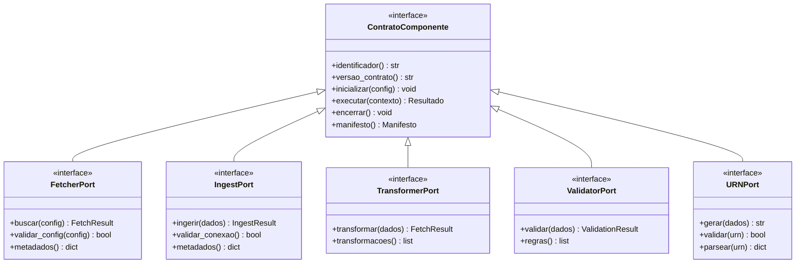
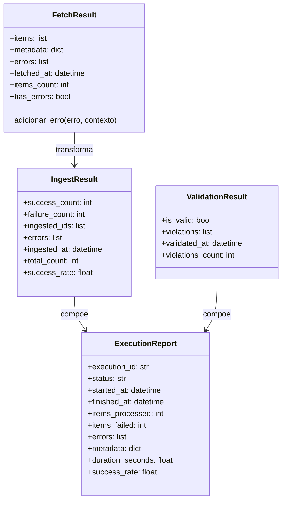
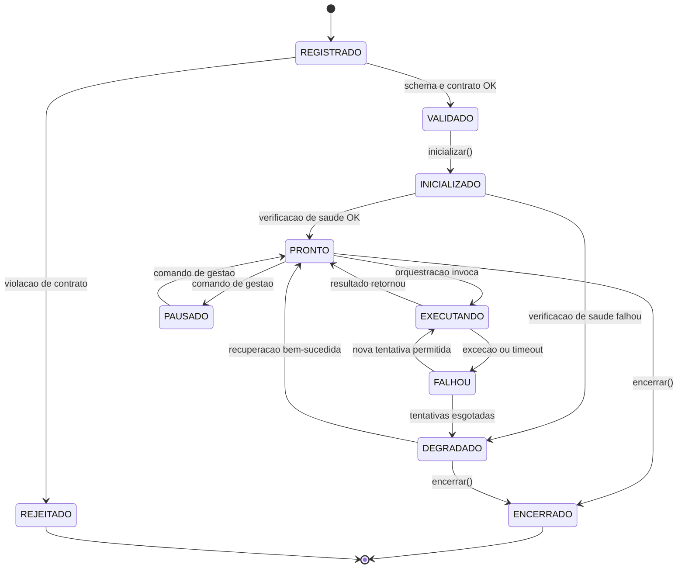
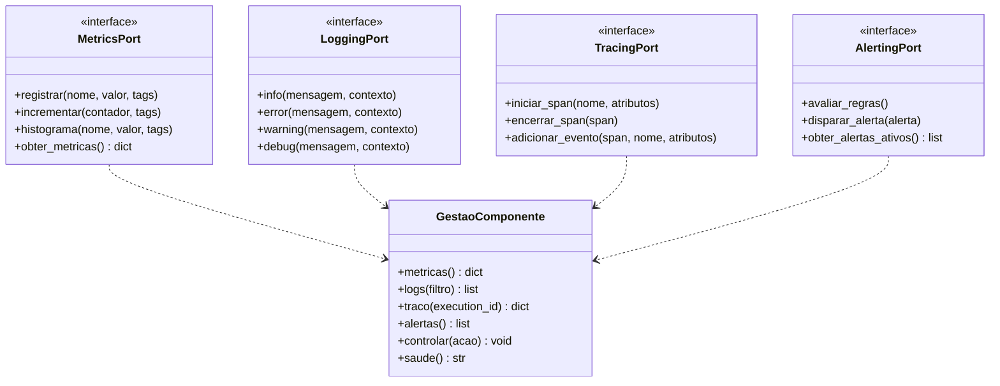
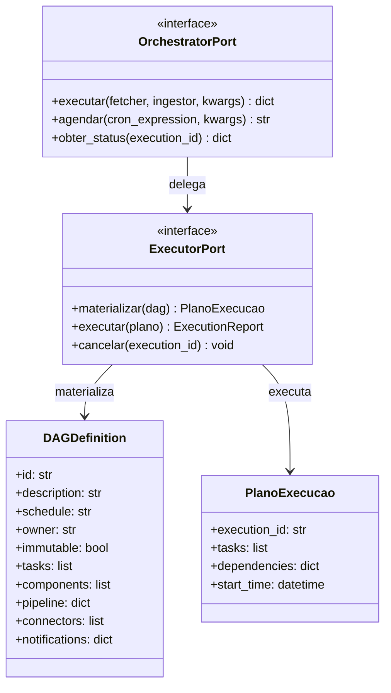
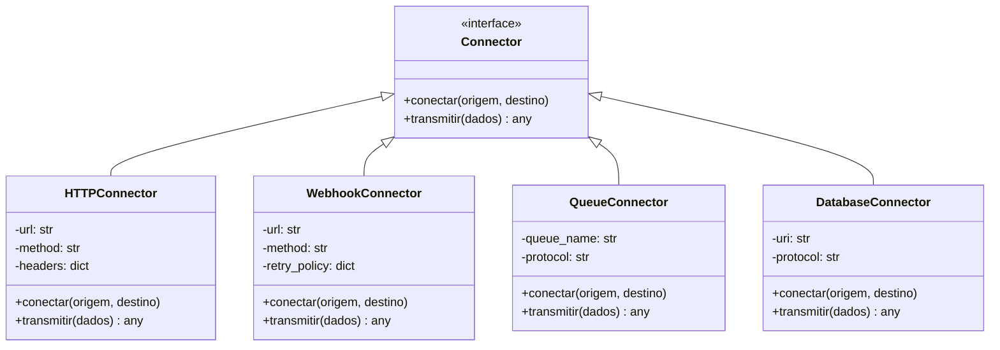

# Contratos e Interfaces do MCA Framework

| Campo | Valor |
|---|---|
| **Documento** | `docs/contracts.md` |
| **Versão** | 1.0 |
| **Data** | 2026-10-13 |
| **Status** | Referência técnica consolidada |
| **Dependência** | `docs/arquitetura_molde_fundamentacao.md` (v1); `docs/arquitetura_molde_v2_orquestracao_gestao.md` (v2); `docs/arquitetura_molde_v3_dags_separacao.md` (v3); `SPEC_SOLO_MCA.md` |
| **Escopo** | Definição formal de todos os contratos e interfaces do framework, incluindo portas de domínio, contratos de dados, contratos de componente, contratos de gestão, contratos de orquestração, contratos de conectores e contratos de configuração |
| **Fora de escopo** | Implementação concreta de componentes específicos; lógica de negócio COMEX |
| **Público** | Desenvolvedores de framework, desenvolvedores de componentes, desenvolvedores de composição, arquitetos, revisores |

---

## Sumário

1. [Introdução e propósito](#1-introdução-e-proposito)
2. [Taxonomia de contratos](#2-taxonomia-de-contratos)
3. [Contratos de domínio (Portas)](#3-contratos-de-dominio-portas)
4. [Contratos de dados](#4-contratos-de-dados)
5. [Contratos de componente](#5-contratos-de-componente)
6. [Contratos de gestão](#6-contratos-de-gestao)
7. [Contratos de orquestração](#7-contratos-de-orquestracao)
8. [Contratos de conectores](#8-contratos-de-conectores)
9. [Contratos de configuração](#9-contratos-de-configuracao)
10. [Contratos de infraestrutura](#10-contratos-de-infraestrutura)
11. [Critérios de conformidade](#11-criterios-de-conformidade)
12. [Referências bibliográficas](#12-referencias-bibliograficas)
13. [Matriz de traçabilidade](#13-matriz-de-tracabilidade)

---

## 1. Introdução e propósito

### 1.1. O que é um contrato

No contexto deste framework, um **contrato** é um acordo formal entre duas ou mais partes sobre o comportamento esperado de um elemento de software. Um contrato especifica:

- **Pré-condições**: o que deve ser verdade antes da invocação.
- **Pós-condições**: o que é garantido após a invocação bem-sucedida.
- **Invariantes**: condições mantidas ao longo da execução.
- **Falhas**: como violações são sinalizadas.

A fundamentação teórica dos contratos está em Meyer (1997) [R01], que formaliza o Design by Contract como a combinação de pré-condições, pós-condições e invariantes.

### 1.2. Por que contratos formais

O MCA Framework acomoda componentes heterogêneos de diferentes origens (Ro-DOU, APIs governamentais, LLMs, motores de grafo). Sem contratos formais, a composição seria frágil e a gestão impossível. Os contratos garantem:

- **Substituibilidade**: um componente pode ser trocado por outro que satisfaça o mesmo contrato.
- **Testabilidade**: contratos podem ser verificados independentemente da implementação.
- **Observabilidade**: a gestão pode coletar sinais ao redor de invocações sem conhecer a implementação interna.
- **Evolução independente**: o núcleo e os componentes evoluem separadamente.

### 1.3. Organização do documento

Este documento organiza os contratos em sete camadas, cada uma com responsabilidade distinta:

```mermaid
flowchart TB
    subgraph CAMADAS["Sete Camadas de Contratos"]
        C1["1. Contratos de Dominio<br/>(Portas)"]
        C2["2. Contratos de Dados<br/>(Payloads)"]
        C3["3. Contratos de Componente<br/>(Ciclo de Vida)"]
        C4["4. Contratos de Gestao<br/>(Observabilidade)"]
        C5["5. Contratos de Orquestracao<br/>(Coordenacao)"]
        C6["6. Contratos de Conectores<br/>(Comunicacao)"]
        C7["7. Contratos de Configuracao<br/>(Declaracao)"]
    end

    C1 --> C2
    C2 --> C3
    C3 --> C4
    C4 --> C5
    C5 --> C6
    C6 --> C7

    style CAMADAS fill:#F5F5F5,stroke:#616161,stroke-width:2px
    style C1 fill:#E8F5E9,stroke:#2E7D32
    style C2 fill:#E3F2FD,stroke:#1565C0
    style C3 fill:#FFF3E0,stroke:#E65100
    style C4 fill:#F3E5F5,stroke:#7B1FA2
    style C5 fill:#FFF8E1,stroke:#F57F17
    style C6 fill:#E0F2F1,stroke:#00695C
    style C7 fill:#FBE9E7,stroke:#BF360C
```



Cada camada é detalhada nas seções seguintes.

---

## 2. Taxonomia de contratos

### 2.1. Classificação por natureza

| Classe | Descrição | Exemplo |
|---|---|---|
| **Contrato de porta** | Interface abstrata que o domínio expõe ou consome | `FetcherPort`, `IngestPort` |
| **Contrato de dados** | Estrutura de payload trocada entre componentes | `FetchResult`, `IngestResult` |
| **Contrato de componente** | Ciclo de vida de um componente registrado | `inicializar`, `executar`, `encerrar` |
| **Contrato de gestão** | Sinais de observabilidade coletados pelo núcleo | `metricas`, `logs`, `traces` |
| **Contrato de orquestração** | Definição de topologia e fluxo | `DAGDefinition`, `OrchestratorPort` |
| **Contrato de conector** | Protocolo de comunicação entre componentes | `HTTPConnector`, `WebhookConnector` |
| **Contrato de configuração** | Schema de declaração YAML | `Core DAG schema`, `App DAG schema` |

### 2.2. Classificação por propriedade

| Propriedade | Descrição | Exemplo |
|---|---|---|
| **Imutável** | Não pode ser alterado após definição | Portas do domínio |
| **Mutável controlada** | Pode ser alterada mediante release | `Core DAGs` |
| **Mutável livre** | Pode ser alterada pelo DEV | `App DAGs`, componentes |
| **Injetável** | Valor definido em runtime | Configurações, segredos |

### 2.3. Classificação por escopo

| Escopo | Descrição | Exemplo |
|---|---|---|
| **Transversal** | Aplica-se a todos os componentes | Contrato de gestão |
| **Específico** | Aplica-se a um tipo de componente | `FetcherPort` |
| **Composição** | Aplica-se a uma composição específica | `App DAG` |

---

## 3. Contratos de domínio (Portas)

### 3.1. Visão geral

As portas são interfaces abstratas que definem os contratos do domínio. Elas seguem o padrão de Arquitetura Hexagonal (Ports & Adapters) estabelecido no repositório [E1].



### 3.2. FetcherPort

**Finalidade**: Contrato para fontes de dados (adapters de entrada/driving).

**Implementações esperadas**: `SenadoAdapter`, `NCMAdapter`, `RoDOUAdapter`, `CarfAdapter`.

```python
class FetcherPort(Protocol):
    """
    Contrato para fontes de dados.

    Pre-condicoes:
        - config e um dicionario valido para o fetcher especifico
        - validar_config(config) retorna True

    Pos-condicoes:
        - Retorna FetchResult com items, metadata e errors
        - items e uma lista de dicionarios com proveniencia completa
        - errors contem falhas nao fatais (quando aplicavel)

    Invariantes:
        - fetch nunca retorna items parcialmente marcados como integros
        - Falha de contrato levanta excecao tipada, nunca retorno silencioso
    """

    def buscar(self, config: dict) -> FetchResult:
        """
        Extrai dados da fonte externa.

        Args:
            config: Configuracao especifica do fetcher (URLs, filtros, etc.)

        Returns:
            FetchResult com os dados extraidos

        Raises:
            FetcherError: Se a extracao falhar de forma irrecuperavel
            ConfigurationError: Se a configuracao for invalida
        """
        ...

    def validar_config(self, config: dict) -> bool:
        """
        Valida se a configuracao e valida para este fetcher.

        Args:
            config: Configuracao a ser validada

        Returns:
            True se valida, False caso contrario
        """
        ...

    def metadados(self) -> dict:
        """
        Retorna metadados sobre o fetcher (versao, capacidades, etc.).

        Returns:
            Dicionario com metadados do fetcher
        """
        ...
```

**Exemplo de implementação**: `SenadoAdapter` (seção 3.2.1).

#### 3.2.1. Exemplo: SenadoAdapter

```python
class SenadoAdapter(FetcherPort):
    """Adapter para API do Senado Federal (Niveis 1-4)."""

    def __init__(self, config: dict):
        self.config = config
        self.base_url = "https://legis.senado.leg.br/dadosabertos"
        self.rate_limit_delay = 0.15  # 10 req/s

    def buscar(self, config: dict) -> FetchResult:
        """Busca normas na API do Senado."""
        normas = config.get("normas", [])
        items = []

        for tipo, numero, ano in normas:
            try:
                norma = self._buscar_norma(tipo, numero, ano)
                if norma:
                    items.append(norma)
            except Exception as e:
                # Registrar erro sem interromper o lote
                pass

        return FetchResult(
            items=items,
            metadata={"source": "senado", "total": len(items)}
        )

    def validar_config(self, config: dict) -> bool:
        """Valida configuracao."""
        return "normas" in config and isinstance(config["normas"], list)

    def metadados(self) -> dict:
        """Retorna metadados."""
        return {
            "name": "senado_adapter",
            "version": "1.0.0",
            "base_url": self.base_url,
        }
```

### 3.3. IngestPort

**Finalidade**: Contrato para destinos de dados (adapters de saída/driven).

**Implementações esperadas**: `Neo4jAdapter`, `PostgresAdapter`, `OpenSearchAdapter`.

```python
class IngestPort(Protocol):
    """
    Contrato para destinos de dados.

    Pre-condicoes:
        - dados e um FetchResult valido
        - validar_conexao() retorna True

    Pos-condicoes:
        - Retorna IngestResult com contadores de sucesso e falha
        - ingested_ids contem identificadores dos itens ingeridos
        - errors contem falhas individuais (quando aplicavel)

    Invariantes:
        - ingest nunca corrompe dados ja persistidos
        - Falha de contrato levanta excecao tipada
    """

    def ingerir(self, dados: FetchResult) -> IngestResult:
        """
        Ingesta dados no destino.

        Args:
            dados: Dados extraidos pelo fetcher

        Returns:
            IngestResult com estatisticas da ingestao

        Raises:
            IngestorError: Se a ingestao falhar de forma irrecuperavel
        """
        ...

    def validar_conexao(self) -> bool:
        """
        Valida se a conexao com o destino esta funcionando.

        Returns:
            True se conectavel, False caso contrario
        """
        ...

    def metadados(self) -> dict:
        """Retorna metadados sobre o ingestor."""
        ...
```

### 3.4. TransformerPort

**Finalidade**: Contrato para transformação de dados (processadores).

**Implementações esperadas**: `MatchEngineAdapter`, `LLMProcessorAdapter`, `NormalizerAdapter`.

```python
class TransformerPort(Protocol):
    """
    Contrato para transformacao de dados.

    Pre-condicoes:
        - dados e um FetchResult valido

    Pos-condicoes:
        - Retorna FetchResult com dados transformados
        - Metadados originais sao preservados

    Invariantes:
        - transform nunca remove proveniencia
        - Falha de contrato levanta excecao tipada
    """

    def transformar(self, dados: FetchResult) -> FetchResult:
        """
        Transforma dados extraidos.

        Args:
            dados: Dados de entrada

        Returns:
            FetchResult com dados transformados
        """
        ...

    def transformacoes(self) -> list:
        """Retorna lista de transformacoes aplicadas."""
        ...
```

### 3.5. ValidatorPort

**Finalidade**: Contrato para validação de invariantes de domínio.

**Implementações esperadas**: `InvariantsValidator`, `SchemaValidator`, `KelsenValidator`.

```python
class ValidatorPort(Protocol):
    """
    Contrato para validacao de invariantes de dominio.

    Pre-condicoes:
        - dados e uma lista de itens a serem validados

    Pos-condicoes:
        - Retorna ValidationResult indicando validade e violacoes
        - violacoes contem detalhes de cada regra violada

    Invariantes:
        - validate nunca modifica os dados de entrada
        - Falha de contrato levanta excecao tipada
    """

    def validar(self, dados: list) -> ValidationResult:
        """
        Valida dados contra regras de negocio.

        Args:
            dados: Dados a serem validados

        Returns:
            ValidationResult indicando se e valido e violacoes
        """
        ...

    def regras(self) -> list:
        """Retorna lista de regras que este validator aplica."""
        ...
```

### 3.6. URNPort

**Finalidade**: Contrato para geração e validação de URNs canônicos.

**Implementações esperadas**: `LexURNGenerator`, `CustomURNGenerator`.

```python
class URNPort(Protocol):
    """
    Contrato para geracao e validacao de URNs canonicos.

    Pre-condicoes:
        - dados contem campos necessarios para geracao do URN

    Pos-condicoes:
        - Retorna URN no formato urn:lex:br:...
        - URN e unico e deterministico para os mesmos dados

    Invariantes:
        - gerar sempre retorna o mesmo URN para os mesmos dados
        - validar retorna True apenas para URNs no formato correto
    """

    def gerar(self, dados: dict) -> str:
        """
        Gera URN canonico a partir de dados.

        Args:
            dados: Dados da norma/elemento

        Returns:
            URN canonico (ex: "urn:lex:br:federal:lei:2004-03-01;10865")
        """
        ...

    def validar(self, urn: str) -> bool:
        """Valida se um URN esta no formato correto."""
        ...

    def parsear(self, urn: str) -> dict:
        """Faz parse de um URN em seus componentes."""
        ...
```

---

## 4. Contratos de dados

### 4.1. Visão geral

Os contratos de dados definem as estruturas de payload trocadas entre componentes. Eles seguem o modelo LRMoo estabelecido em `SPEC_SOLO_MCA.md` [E2].



### 4.2. FetchResult

**Finalidade**: Contrato unificado de saída para todos os fetchers.

```python
@dataclass
class FetchResult:
    """
    Contrato unificado de saida para todos os fetchers.

    Invariantes:
        - items e sempre uma lista (pode ser vazia)
        - metadata contem proveniencia (source, timestamp, etc.)
        - errors contem falhas nao fatais
        - fetched_at e sempre definido

    Propriedades:
        - items_count: numero de itens extraidos
        - has_errors: True se houver erros
    """
    items: list
    metadata: dict = field(default_factory=dict)
    errors: list = field(default_factory=list)
    fetched_at: datetime = field(default_factory=datetime.utcnow)

    @property
    def items_count(self) -> int:
        """Numero de itens extraidos."""
        return len(self.items)

    @property
    def has_errors(self) -> bool:
        """True se houver erros."""
        return len(self.errors) > 0

    def adicionar_erro(self, erro: str, contexto: dict = None):
        """Adiciona um erro ao resultado."""
        self.errors.append({
            "error": erro,
            "context": contexto or {},
            "timestamp": datetime.utcnow().isoformat()
        })
```

**Exemplo de uso**:

```python
result = FetchResult(
    items=[
        {"urn": "urn:lex:br:federal:lei:2004-03-01;10865", "tipo": "LEI"},
        {"urn": "urn:lex:br:federal:lei:1996-09-13;87", "tipo": "LC"},
    ],
    metadata={"source": "senado", "total": 2},
    errors=[]
)

print(f"Extraidos {result.items_count} itens")
print(f"Tem erros: {result.has_errors}")
```

### 4.3. IngestResult

**Finalidade**: Contrato unificado de saída para todos os ingestors.

```python
@dataclass
class IngestResult:
    """
    Contrato unificado de saida para todos os ingestors.

    Invariantes:
        - success_count + failure_count = total_count
        - ingested_ids contem apenas IDs de sucesso
        - errors contem falhas individuais

    Propriedades:
        - total_count: total de itens processados
        - success_rate: taxa de sucesso em percentual
    """
    success_count: int = 0
    failure_count: int = 0
    ingested_ids: list = field(default_factory=list)
    errors: list = field(default_factory=list)
    ingested_at: datetime = field(default_factory=datetime.utcnow)

    @property
    def total_count(self) -> int:
        """Total de itens processados."""
        return self.success_count + self.failure_count

    @property
    def success_rate(self) -> float:
        """Taxa de sucesso em percentual."""
        if self.total_count == 0:
            return 0.0
        return (self.success_count / self.total_count) * 100
```

### 4.4. ValidationResult

**Finalidade**: Contrato para validação de invariantes de domínio.

```python
@dataclass
class ValidationResult:
    """
    Contrato para validacao de invariantes de dominio.

    Invariantes:
        - is_valid e True se e somente se violations esta vazio
        - violations contem detalhes de cada regra violada

    Propriedades:
        - violations_count: numero de violacoes
    """
    is_valid: bool
    violations: list = field(default_factory=list)
    validated_at: datetime = field(default_factory=datetime.utcnow)

    @property
    def violations_count(self) -> int:
        """Numero de violacoes."""
        return len(self.violations)
```

**Exemplo de violação**:

```python
result = ValidationResult(
    is_valid=False,
    violations=[
        {
            "rule": "H1",
            "description": "Nivel sem subnivel deve ter sub_nivel_h = -1",
            "item_urn": "urn:lex:br:federal:lei:2004-03-01;10865",
            "context": {"nivel_h": 3, "sub_nivel_h": 2}
        }
    ]
)
```

### 4.5. ExecutionReport

**Finalidade**: Relatório unificado de execução de pipeline.

```python
@dataclass
class ExecutionReport:
    """
    Relatorio unificado de execucao de pipeline.

    Invariantes:
        - execution_id e unico
        - status e um dos valores permitidos
        - duration_seconds e definido apenas se finished_at esta definido

    Propriedades:
        - duration_seconds: duracao em segundos
        - success_rate: taxa de sucesso em percentual
    """
    execution_id: str
    status: str  # RUNNING, SUCCESS, FAILED
    started_at: datetime
    finished_at: datetime = None
    items_processed: int = 0
    items_failed: int = 0
    errors: list = field(default_factory=list)
    metadata: dict = field(default_factory=dict)

    @property
    def duration_seconds(self) -> float:
        """Duracao em segundos."""
        if self.finished_at is None:
            return None
        return (self.finished_at - self.started_at).total_seconds()

    @property
    def success_rate(self) -> float:
        """Taxa de sucesso em percentual."""
        total = self.items_processed + self.items_failed
        if total == 0:
            return 0.0
        return (self.items_processed / total) * 100
```

---

## 5. Contratos de componente

### 5.1. Visão geral

Os contratos de componente definem o ciclo de vida de um componente registrado no framework. Eles materializam o axioma AX-02 do documento v1: "Todo componente registrado é gerido."



### 5.2. ContratoComponente

**Finalidade**: Contrato base para todos os componentes registrados.

```python
class ContratoComponente(Protocol):
    """
    Contrato base para todos os componentes registrados.

    Pre-condicoes:
        - config e um dicionario valido
        - manifesto retorna metadados completos

    Pos-condicoes:
        - inicializar prepara o componente para execucao
        - executar processa o contexto e retorna resultado
        - encerrar libera recursos

    Invariantes:
        - identificador e unico no registro
        - versao_contrato e estavel
        - encerrar pode ser chamado multipas vezes (idempotente)
    """

    def identificador(self) -> str:
        """Retorna identificador unico do componente."""
        ...

    def versao_contrato(self) -> str:
        """Retorna versao do contrato implementado."""
        ...

    def inicializar(self, config: dict) -> None:
        """
        Inicializa o componente.

        Args:
            config: Configuracao do componente

        Raises:
            ConfigurationError: Se a configuracao for invalida
            ConnectionError: Se a conexao falhar
        """
        ...

    def executar(self, contexto: dict) -> dict:
        """
        Executa a logica do componente.

        Args:
            contexto: Contexto de execucao (payload, metadata, etc.)

        Returns:
            Resultado da execucao

        Raises:
            ExecutionError: Se a execucao falhar
        """
        ...

    def encerrar(self) -> None:
        """
        Encerra o componente e libera recursos.

        Idempotente: pode ser chamado multiplas vezes.
        """
        ...

    def manifesto(self) -> dict:
        """
        Retorna manifesto do componente.

        Returns:
            Dicionario com metadados (nome, versao, dependencias, etc.)
        """
        ...
```

### 5.3. Gerenciavel

**Finalidade**: Contrato para componentes que expõem interface de gestão.

```python
class Gerenciavel(Protocol):
    """
    Contrato para componentes que expoe interface de gestao.

    Este contrato e implementado pelo InvolucroGestao, nao pelo componente.
    """

    def metricas(self) -> dict:
        """Retorna metricas do componente."""
        ...

    def logs(self, filtro: dict = None) -> list:
        """Retorna logs do componente."""
        ...

    def traco(self, execution_id: str) -> dict:
        """Retorna tracing de uma execucao."""
        ...

    def alertas(self) -> list:
        """Retorna alertas ativos."""
        ...

    def controlar(self, acao: str) -> None:
        """
        Executa comando de controle.

        Args:
            acao: start, stop, restart, pause, resume
        """
        ...

    def saude(self) -> str:
        """
        Retorna estado de saude.

        Returns:
            HEALTHY, DEGRADED, DOWN
        """
        ...
```

### 5.4. InvolucroGestao

**Finalidade**: Decorator que envolve um componente e coleta sinais de gestão.

```python
class InvolucroGestao:
    """
    Decorator que envolve um componente e coleta sinais de gestao.

    Este e o mecanismo que materializa a gestao nativa do framework.
    O componente nao sabe que esta sendo envolvido.
    """

    def __init__(
        self,
        interno: ContratoComponente,
        coletor: ColetorMetricas,
        logger: LoggerEstruturado,
        tracer: TracerDistribuido
    ):
        self.interno = interno
        self.coletor = coletor
        self.logger = logger
        self.tracer = tracer

    def executar(self, contexto: dict) -> dict:
        """
        Executa o componente com coleta de sinais.

        Fluxo:
            1. Abrir span de tracing
            2. Registrar tentativa de execucao
            3. Executar componente interno
            4. Registrar duracao, sucesso e logs
            5. Fechar span
            6. Retornar resultado com proveniencia
        """
        span = self.tracer.iniciar_span(f"component.{self.interno.identificador()}")
        self.coletor.incrementar("component.execution.attempt")

        inicio = time.time()
        try:
            resultado = self.interno.executar(contexto)
            duracao = time.time() - inicio

            self.coletor.registrar("component.execution.duration", duracao)
            self.coletor.incrementar("component.execution.success")
            self.logger.info(
                "Execucao bem-sucedida",
                component=self.interno.identificador(),
                duration=duracao
            )

            return resultado

        except Exception as e:
            duracao = time.time() - inicio
            self.coletor.registrar("component.execution.duration", duracao)
            self.coletor.incrementar("component.execution.failure")
            self.logger.error(
                "Execucao falhou",
                component=self.interno.identificador(),
                error=str(e)
            )
            raise

        finally:
            self.tracer.encerrar_span(span)

    def metricas(self) -> dict:
        """Delega para o coletor."""
        return self.coletor.obter_metricas()

    def logs(self, filtro: dict = None) -> list:
        """Delega para o logger."""
        return self.logger.obter_logs(filtro)

    def traco(self, execution_id: str) -> dict:
        """Delega para o tracer."""
        return self.tracer.obter_traco(execution_id)
```

---

## 6. Contratos de gestão

### 6.1. Visão geral

Os contratos de gestão definem as interfaces para coleta de sinais de observabilidade. Eles materializam a propriedade fundamental do documento v2: "A gestão de um componente não muda quando a ferramenta dentro dele muda."



### 6.2. MetricsPort

**Finalidade**: Contrato para coleta de métricas.

**Implementações esperadas**: `PrometheusMetrics`, `DataDogMetrics`, `InMemoryMetrics`.

```python
class MetricsPort(Protocol):
    """
    Contrato para coleta de metricas.

    Pre-condicoes:
        - nome e uma string valida
        - valor e um numero

    Pos-condicoes:
        - Metrica e registrada no backend
        - Tags sao associadas a metrica

    Invariantes:
        - registrar nunca falha silenciosamente
        - obter_metricas retorna todas as metricas coletadas
    """

    def registrar(self, nome: str, valor: float, tags: dict = None):
        """Registra uma metrica."""
        ...

    def incrementar(self, contador: str, tags: dict = None):
        """Incrementa um contador."""
        ...

    def histograma(self, nome: str, valor: float, tags: dict = None):
        """Registra valor em histograma."""
        ...

    def obter_metricas(self) -> dict:
        """Retorna todas as metricas coletadas."""
        ...
```

### 6.3. LoggingPort

**Finalidade**: Contrato para logging estruturado.

**Implementações esperadas**: `JSONLogger`, `CloudWatchLogger`, `ConsoleLogger`.

```python
class LoggingPort(Protocol):
    """
    Contrato para logging estruturado.

    Pre-condicoes:
        - mensagem e uma string
        - contexto e um dicionario (opcional)

    Pos-condicoes:
        - Log e registrado no backend
        - Formato e consistente (JSON, texto, etc.)

    Invariantes:
        - log nunca falha silenciosamente
        - Niveis sao respeitados (DEBUG, INFO, WARNING, ERROR, CRITICAL)
    """

    def info(self, mensagem: str, **contexto):
        """Log de informacao."""
        ...

    def error(self, mensagem: str, **contexto):
        """Log de erro."""
        ...

    def warning(self, mensagem: str, **contexto):
        """Log de aviso."""
        ...

    def debug(self, mensagem: str, **contexto):
        """Log de debug."""
        ...
```

### 6.4. TracingPort

**Finalidade**: Contrato para tracing distribuído.

**Implementações esperadas**: `OpenTelemetryTracer`, `JaegerTracer`.

```python
class TracingPort(Protocol):
    """
    Contrato para tracing distribuido.

    Pre-condicoes:
        - nome e uma string valida

    Pos-condicoes:
        - Span e criado e associado ao trace
        - Eventos sao registrados no span

    Invariantes:
        - spans sao sempre fechados (mesmo em caso de excecao)
        - traces sao correlacionados entre componentes
    """

    def iniciar_span(self, nome: str, **atributos) -> any:
        """Inicia um novo span."""
        ...

    def encerrar_span(self, span: any):
        """Finaliza um span."""
        ...

    def adicionar_evento(self, span: any, nome: str, **atributos):
        """Adiciona evento a um span."""
        ...
```

### 6.5. AlertingPort

**Finalidade**: Contrato para sistema de alertas.

```python
class AlertingPort(Protocol):
    """
    Contrato para sistema de alertas.

    Pre-condicoes:
        - regras estao definidas

    Pos-condicoes:
        - Alertas sao disparados quando regras sao violadas
        - Alertas ativos sao retornados

    Invariantes:
        - alertas nunca sao perdidos
        - severidade e respeitada (LOW, MEDIUM, HIGH, CRITICAL)
    """

    def avaliar_regras(self):
        """Avalia regras de alerta."""
        ...

    def disparar_alerta(self, alerta: dict):
        """Dispara um alerta."""
        ...

    def obter_alertas_ativos(self) -> list:
        """Retorna alertas ativos."""
        ...
```

---

## 7. Contratos de orquestração

### 7.1. Visão geral

Os contratos de orquestração definem como componentes são coordenados em um DAG. Eles materializam a distinção entre Gestão e Orquestração do documento v2.



### 7.2. OrchestratorPort

**Finalidade**: Contrato para orquestradores de pipeline.

**Implementações esperadas**: `PipelineOrchestrator`, `AirflowOrchestrator`, `SimpleOrchestrator`.

```python
class OrchestratorPort(Protocol):
    """
    Contrato para orquestradores de pipeline.

    Pre-condicoes:
        - fetcher e ingestor sao componentes validos
        - kwargs contem configuracoes adicionais

    Pos-condicoes:
        - Pipeline e executado completamente
        - Resultado contem estatisticas da execucao

    Invariantes:
        - executar nunca deixa componentes em estado inconsistente
        - agendar retorna identificador da agenda
    """

    def executar(
        self,
        fetcher: FetcherPort,
        ingestor: IngestPort,
        **kwargs
    ) -> dict:
        """
        Executa o pipeline completo.

        Args:
            fetcher: Adapter de extracao
            ingestor: Adapter de ingestao
            **kwargs: Configuracoes adicionais

        Returns:
            Dicionario com resultados da execucao
        """
        ...

    def agendar(self, cron_expression: str, **kwargs) -> str:
        """
        Agenda execucao periodica.

        Args:
            cron_expression: Expressao cron (ex: "0 8 * * *")

        Returns:
            ID da agenda criada
        """
        ...

    def obter_status(self, execution_id: str) -> dict:
        """Retorna status de uma execucao."""
        ...
```

### 7.3. ExecutorPort

**Finalidade**: Contrato para executores de DAG.

**Implementações esperadas**: `AirflowExecutor`, `n8nExecutor`, `EmbeddedExecutor`.

```python
class ExecutorPort(Protocol):
    """
    Contrato para executores de DAG.

    Pre-condicoes:
        - dag e uma DAGDefinition valida

    Pos-condicoes:
        - Plano de execucao e materializado
        - Execucao e iniciada

    Invariantes:
        - materializar nunca altera a DAG original
        - executar retorna ExecutionReport completo
    """

    def materializar(self, dag: DAGDefinition) -> dict:
        """
        Materializa um plano de execucao a partir da DAG.

        Args:
            dag: Definicao da DAG

        Returns:
            Plano de execucao
        """
        ...

    def executar(self, plano: dict) -> ExecutionReport:
        """
        Executa o plano.

        Args:
            plano: Plano de execucao materializado

        Returns:
            Relatorio de execucao
        """
        ...

    def cancelar(self, execution_id: str) -> void:
        """Cancela uma execucao em andamento."""
        ...
```

### 7.4. DAGDefinition

**Finalidade**: Estrutura de dados que representa uma DAG parseada de YAML.

```python
@dataclass
class DAGDefinition:
    """
    Estrutura de dados que representa uma DAG parseada de YAML.

    Invariantes:
        - id e unico no registro
        - immutable e True para Core DAGs, False para App DAGs
        - tasks contem lista de tarefas
        - components contem lista de componentes
        - pipeline define fluxo de execucao
        - connectors define comunicacao entre tarefas
    """
    id: str
    description: str
    schedule: str
    owner: str
    immutable: bool
    tasks: list
    components: list
    pipeline: dict
    connectors: list
    notifications: dict
```

---

## 8. Contratos de conectores

### 8.1. Visão geral

Os contratos de conectores definem como componentes se comunicam. Eles materializam a teoria de conectores de Medvidović e Taylor (2000) [R02].



### 8.2. Connector

**Finalidade**: Contrato base para conectores.

```python
class Connector(Protocol):
    """
    Contrato base para conectores.

    Pre-condicoes:
        - origem e destino sao componentes validos

    Pos-condicoes:
        - Conexao e estabelecida
        - Dados sao transmitidos

    Invariantes:
        - conectar nunca falha silenciosamente
        - transmitir retorna resposta (quando aplicavel)
    """

    def conectar(self, origem: any, destino: any) -> None:
        """Conecta dois componentes."""
        ...

    def transmitir(self, dados: any) -> any:
        """Transmite dados entre componentes."""
        ...
```

### 8.3. HTTPConnector

**Finalidade**: Conector para chamadas HTTP síncronas.

```python
class HTTPConnector(Connector):
    """Conector para chamadas HTTP sincronas."""

    def __init__(self, url: str, method: str = "POST", headers: dict = None):
        self.url = url
        self.method = method
        self.headers = headers or {}

    def conectar(self, origem: any, destino: any) -> None:
        """Estabelece conexao HTTP."""
        # Testar conectividade
        response = requests.head(self.url, timeout=5)
        response.raise_for_status()

    def transmitir(self, dados: any) -> any:
        """Transmite dados via HTTP."""
        response = requests.request(
            method=self.method,
            url=self.url,
            json=dados,
            headers=self.headers,
            timeout=30
        )
        response.raise_for_status()
        return response.json()
```

### 8.4. WebhookConnector

**Finalidade**: Conector para webhooks assíncronos.

```python
class WebhookConnector(Connector):
    """Conector para webhooks assincronos."""

    def __init__(
        self,
        url: str,
        method: str = "POST",
        retry_policy: dict = None
    ):
        self.url = url
        self.method = method
        self.retry_policy = retry_policy or {
            "max_attempts": 3,
            "backoff": "exponential",
            "initial_delay": 1
        }

    def conectar(self, origem: any, destino: any) -> None:
        """Estabelece conexao webhook."""
        # Webhooks nao exigem handshake inicial
        pass

    def transmitir(self, dados: any) -> any:
        """Transmite dados via webhook com retry."""
        attempt = 0
        delay = self.retry_policy["initial_delay"]

        while attempt < self.retry_policy["max_attempts"]:
            try:
                response = requests.request(
                    method=self.method,
                    url=self.url,
                    json=dados,
                    timeout=30
                )
                response.raise_for_status()
                return response.json()
            except Exception as e:
                attempt += 1
                if attempt < self.retry_policy["max_attempts"]:
                    time.sleep(delay)
                    if self.retry_policy["backoff"] == "exponential":
                        delay *= 2
                else:
                    raise
```

---

## 9. Contratos de configuração

### 9.1. Visão geral

Os contratos de configuração definem o schema de declaração YAML para Core DAGs e App DAGs. Eles materializam a separação do documento v3.

### 9.2. Schema de Core DAG

**Finalidade**: Schema obrigatório para Core DAGs.

```yaml
# Schema de Core DAG
dag:
  id: string  # Obrigatorio, unico no espaco de nomes core
  description: string  # Obrigatorio
  schedule: string  # Obrigatorio (cron expression) ou null
  owner: string  # Obrigatorio, deve ser "framework"
  immutable: boolean  # Obrigatorio, deve ser true

tasks:
  - id: string  # Obrigatorio
    type: string  # Obrigatorio (management.metrics.*, management.health.*, etc.)
    config: object  # Obrigatorio
    depends_on: list[string]  # Opcional

notifications:
  on_failure: list[object]  # Opcional
  on_success: list[object]  # Opcional
```

**Exemplo**:

```yaml
dag:
  id: core_metrics_collection
  description: "Coleta metricas padronizadas de todos os componentes"
  schedule: "*/1 * * * *"
  owner: framework
  immutable: true

tasks:
  - id: collect_component_metrics
    type: management.metrics.collect
    config:
      metrics_to_collect:
        - execution_count
        - success_rate
        - average_duration
      aggregation_window: 60
      storage_backend: prometheus

  - id: aggregate_metrics
    type: management.metrics.aggregate
    depends_on: [collect_component_metrics]
    config:
      aggregation_functions: [avg, sum, min, max]
      group_by: [component_id, metric_type]

notifications:
  on_failure:
    - type: log
      level: ERROR
```

### 9.3. Schema de App DAG

**Finalidade**: Schema obrigatório para App DAGs.

```yaml
# Schema de App DAG
dag:
  id: string  # Obrigatorio, unico no espaco de nomes app
  description: string  # Obrigatorio
  schedule: string  # Obrigatorio (cron expression) ou null
  owner: string  # Obrigatorio, deve ser "dev_team" ou similar
  immutable: boolean  # Obrigatorio, deve ser false (ou ausente)
  tags: list[string]  # Opcional

components:
  - id: string  # Obrigatorio
    type: string  # Obrigatorio (caminho do modulo Python)
    config: object  # Obrigatorio

pipeline:
  stages:
    - id: string  # Obrigatorio
      component: string  # Obrigatorio (referencia a components[].id)
      input: string  # Opcional
      output: string  # Opcional
      depends_on: list[string]  # Opcional
      parallel_with: list[string]  # Opcional

connectors:
  - source: string  # Obrigatorio
    target: string  # Obrigatorio
    type: string  # Obrigatorio (synchronous, asynchronous)
    protocol: string  # Obrigatorio (http, webhook, queue, bolt)
    config: object  # Obrigatorio

notifications:
  on_success: list[object]  # Opcional
  on_failure: list[object]  # Opcional
```

**Exemplo**:

```yaml
dag:
  id: rodou_solo_pipeline
  description: "Pipeline Ro-DOU para Solo MCA"
  schedule: "0 8 * * MON-FRI"
  owner: dev_team
  immutable: false
  tags: [solo_mca, comex, classificacao]

components:
  - id: rodou_fetcher
    type: ro_dou.hook.DOUHook
    config:
      dag_id: solo_mca_c2_classificacao
      sources: [INLABS]
      terms: ["NCM AND classificacao"]

  - id: llm_processor
    type: mca.llm.LLMProcessor
    config:
      provider: openai
      model: gpt-4

  - id: solo_ingestor
    type: mca.neo4j.Neo4jAdapter
    config:
      uri: bolt://neo4j:7687
      user: neo4j
      password: ${NEO4J_PASSWORD}

pipeline:
  stages:
    - id: fetch_dou
      component: rodou_fetcher
      output: raw_publications

    - id: process_with_llm
      component: llm_processor
      input: raw_publications
      output: enriched_publications
      depends_on: [fetch_dou]

    - id: ingest_to_solo
      component: solo_ingestor
      input: enriched_publications
      output: ingestion_result
      depends_on: [process_with_llm]

connectors:
  - source: fetch_dou
    target: process_with_llm
    type: synchronous
    protocol: http
    config:
      url: http://localhost:8000/process
      method: POST
      timeout_seconds: 30

notifications:
  on_success:
    - type: webhook
      url: https://n8n.example.com/webhook/solo-success
  on_failure:
    - type: alert
      channel: pipeline_alerts
      severity: HIGH
```

### 9.4. Manifesto de componente

**Finalidade**: Schema obrigatório para manifesto de componente.

```yaml
# Schema de manifesto de componente
component:
  id: string  # Obrigatorio
  type: string  # Obrigatorio (caminho do modulo Python)
  version: string  # Obrigatorio
  contract_version: string  # Obrigatorio
  description: string  # Obrigatorio

dependencies:
  required_interfaces: list[string]  # Opcional
  required_services: list[string]  # Opcional
  environment_variables: list[string]  # Opcional

metadata:
  author: string  # Opcional
  license: string  # Opcional
  repository: string  # Opcional
  documentation: string  # Opcional
```

**Exemplo**:

```yaml
component:
  id: senado_adapter
  type: mca.adapters.driving.senado.SenadoAdapter
  version: 1.0.0
  contract_version: 1.0.0
  description: "Adapter para API do Senado Federal (Niveis 1-4)"

dependencies:
  required_interfaces: [FetcherPort]
  required_services: []
  environment_variables: []

metadata:
  author: "InnovAI Ltda"
  license: "GPL-3.0"
  repository: "https://github.com/innovai-ltda/mca-plataforma"
  documentation: "docs/adapters/senado.md"
```

---

## 10. Contratos de infraestrutura

### 10.1. Visão geral

Os contratos de infraestrutura definem como o framework é implantado em diferentes ambientes. Eles materializam a integração com Docker Compose e Kubernetes do documento v3.

### 10.2. DeployManifest

**Finalidade**: Schema para manifesto de implantação.

```yaml
# Schema de deploy manifest
deployment:
  name: string  # Obrigatorio
  version: string  # Obrigatorio
  environment: string  # Obrigatorio (dev, staging, prod)

services:
  - name: string  # Obrigatorio
    image: string  # Obrigatorio
    ports: list[string]  # Opcional
    environment: dict  # Opcional
    volumes: list[string]  # Opcional
    depends_on: list[string]  # Opcional
    healthcheck: object  # Opcional

volumes:
  - name: string  # Obrigatorio
    driver: string  # Opcional (padrao: local)

networks:
  - name: string  # Obrigatorio
    driver: string  # Opcional (padrao: bridge)
```

**Exemplo**:

```yaml
deployment:
  name: mca-framework
  version: 1.0.0
  environment: production

services:
  - name: framework-core
    image: mca-framework:1.0.0
    ports: ["9090:9090", "8080:8080"]
    environment:
      FRAMEWORK_ENV: production
      METRICS_BACKEND: prometheus
    volumes:
      - ./framework/core/dags:/framework/core/dags:ro
    depends_on: [neo4j, postgres]

  - name: application
    image: mca-application:1.0.0
    environment:
      APP_ENV: production
      NEO4J_URI: bolt://neo4j:7687
    volumes:
      - ./config/compositions:/application/dags:rw
    depends_on: [framework-core, neo4j]

  - name: neo4j
    image: neo4j:5.20-community
    ports: ["7474:7474", "7687:7687"]
    environment:
      NEO4J_AUTH: neo4j/${NEO4J_PASSWORD}
    volumes:
      - neo4j_data:/data

volumes:
  - name: neo4j_data
    driver: local

networks:
  - name: mca-network
    driver: bridge
```

---

## 11. Critérios de conformidade

### 11.1. Critérios gerais

Um sistema só pode ser dito **conforme aos contratos do MCA Framework** se satisfizer todos os critérios abaixo.

| ID | Critério | Verificação |
|---|---|---|
| CC-01 | Todo componente implementa `ContratoComponente` | Análise estática de tipos |
| CC-02 | Todo fetcher implementa `FetcherPort` | Análise estática de tipos |
| CC-03 | Todo ingestor implementa `IngestPort` | Análise estática de tipos |
| CC-04 | Todo resultado carrega proveniência | Teste de contrato |
| CC-05 | Todo componente é envolvido por `InvolucroGestao` | Verificação de registro |
| CC-06 | Core DAGs têm `immutable: true` | Teste de carregamento |
| CC-07 | App DAGs têm `immutable: false` | Teste de carregamento |
| CC-08 | Espaços de nomes de Core e App DAGs são disjuntos | Teste de colisão |
| CC-09 | Falha de validação interrompe carregamento | Teste de falha explícita |
| CC-10 | `legacy/` nunca é importado em runtime | Análise estática de imports |

### 11.2. Critérios por camada

#### 11.2.1. Contratos de domínio

| ID | Critério | Verificação |
|---|---|---|
| CD-01 | Portas são independentes de adaptadores | Análise estática de imports |
| CD-02 | Entidades seguem modelo LRMoo | Revisão de código |
| CD-03 | Invariantes H1-H3, K1-K3, I1-I3 são validados | Testes unitários |

#### 11.2.2. Contratos de dados

| ID | Critério | Verificação |
|---|---|---|
| CD-01 | `FetchResult` sempre contém proveniência | Teste de contrato |
| CD-02 | `IngestResult` sempre contém contadores | Teste de contrato |
| CD-03 | `ValidationResult` sempre contém violações | Teste de contrato |

#### 11.2.3. Contratos de componente

| ID | Critério | Verificação |
|---|---|---|
| CC-01 | Ciclo de vida é completo (inicializar, executar, encerrar) | Teste de ciclo de vida |
| CC-02 | `encerrar` é idempotente | Teste de idempotência |
| CC-03 | Manifesto contém metadados completos | Teste de contrato |

#### 11.2.4. Contratos de gestão

| ID | Critério | Verificação |
|---|---|---|
| CG-01 | Métricas são coletadas automaticamente | Teste de observabilidade |
| CG-02 | Logs são estruturados | Teste de formato |
| CG-03 | Traces são correlacionados | Teste de correlação |
| CG-04 | Alertas são disparados quando políticas são violadas | Teste de política |

#### 11.2.5. Contratos de orquestração

| ID | Critério | Verificação |
|---|---|---|
| CO-01 | DAGs são acíclicas | Teste de validação topológica |
| CO-02 | Execuções são idempotentes | Teste de idempotência |
| CO-03 | Relatórios contêm proveniência completa | Teste de contrato |

#### 11.2.6. Contratos de conectores

| ID | Critério | Verificação |
|---|---|---|
| CC-01 | Conectores são substituíveis | Teste de substituição |
| CC-02 | Retry policy é respeitada | Teste de retry |
| CC-03 | Timeouts são respeitados | Teste de timeout |

#### 11.2.7. Contratos de configuração

| ID | Critério | Verificação |
|---|---|---|
| CF-01 | YAMLs seguem schema definido | Teste de validação |
| CF-02 | Variáveis de ambiente são injetadas | Teste de injeção |
| CF-03 | Segredos não residem em YAML versionado | Revisão de código |

---

## 12. Referências bibliográficas

### 12.1. Contratos e Design by Contract

**[R01]** MEYER, Bertrand. *Object-Oriented Software Construction*. 2. ed. Upper Saddle River: Prentice Hall, 1997. ISBN: 978-0-13-629155-3.
> Uso: fundamentação de Design by Contract; pré-condições, pós-condições e invariantes.

**[R02]** MEDVIDOVIĆ, Nenad; TAYLOR, Richard N. "A formal basis for architectural connectors." *ACM Transactions on Software Engineering and Methodology*, v. 9, n. 3, p. 264-304, 2000. DOI: [10.1145/357569.357574](https://doi.org/10.1145/357569.357574).
> Uso: conector como elemento arquitetural de primeira classe.

### 12.2. Arquitetura Hexagonal e Ports & Adapters

**[R03]** COCKBURN, Alistair. "Ports and Adapters Architecture." 2005. Disponível em: <https://alistair.cockburn.us/hexagonal-architecture/>. Consulta em: 2026.
> Uso: padrão de Arquitetura Hexagonal; portas e adaptadores.

**[R04]** EVANS, Eric. *Domain-Driven Design: Tackling Complexity in the Heart of Software*. Boston: Addison-Wesley, 2003. ISBN: 978-0-321-12521-7.
> Uso: isolamento de domínio; linguagem ubíqua; separação entre modelo e infraestrutura.

### 12.3. Component-Based Software Engineering

**[R05]** SZYPERSKI, Clemens; GRUNTZ, Dominik; MURER, Stephan. *Component Software: Beyond Object-Oriented Programming*. 2. ed. Harlow: Addison-Wesley / ACM Press, 2002. ISBN: 978-0-201-74572-2.
> Uso: definição formal de componente; interfaces fornecidas e requeridas; composição por terceiros.

### 12.4. Modelos de domínio

**[R06]** RIVA, Pat; LE BŒUF, Patrick; ŽUMER, Maja. *IFLA Library Reference Model: A Conceptual Model for Bibliographic Information*. IFLA Series on Bibliographic Control, v. 46. Berlin: De Gruyter Saur, 2017.
> Uso: distinção Work / Expression / Manifestation; base do LRMoo utilizado no Solo.

**[E1]** `solo_mca_rodou_01102026_1215.txt`. Snapshot de árvore e conteúdo do repositório via gitingest: estrutura `src/`, contratos de refatoração em `LEGACY_MAP.md`, regras de `legacy/`.
> **Papel neste documento**: fonte primária de evidência sobre a organização real do código e a adoção de Arquitetura Hexagonal.

**[E2]** `SPEC_SOLO_MCA.md`. Especificação do Solo MCA: ontologia LRMoo, invariantes H1-H3, K1-K3, I1-I3, meta-modelo, processo de abastecimento.
> **Papel neste documento**: fonte primária de evidência sobre o modelo de domínio e invariantes.

### 12.5. Observabilidade

**[R07]** BEYER, Betsy; JONES, Chris; PETOFF, Jennifer; MURPHY, N. R. *Site Reliability Engineering: How Google Runs Production Systems*. Sebastopol: O'Reilly, 2016. ISBN: 978-1-491-92276-2.
> Uso: monitoramento white-box; sinais observáveis; operação de sistemas distribuídos.

**[R08]** OPENTELEMETRY. *OpenTelemetry Specification*. Disponível em: <https://opentelemetry.io/docs/specs/otel/>. Consulta em: 2026.
> Uso: modelagem de métricas, traces e logs como sinais correlacionáveis.

### 12.6. Configuração e implantação

**[R09]** HUMBLE, Jez; FARLEY, David. *Continuous Delivery: Reliable Software Releases through Build, Test, and Deployment Automation*. Boston: Addison-Wesley, 2010. ISBN: 978-0-321-60191-9.
> Uso: configuração como código; versionamento, teste e revisão de DAGs.

**[R10]** MORRIS, Kief. *Infrastructure as Code: Managing Servers in the Cloud*. Sebastopol: O'Reilly, 2016. ISBN: 978-1-491-92424-7.
> Uso: infraestrutura declarativa; componentes imutáveis; repetibilidade de ambiente.

---

## 13. Matriz de traçabilidade

### 13.1. Contrato → documento de origem → seção

| Contrato | Documento de origem | Seção |
|---|---|---|
| `FetcherPort` | v1 (AX-01), v2 (Gestão) | 3.2 |
| `IngestPort` | v1 (AX-01), v2 (Gestão) | 3.3 |
| `TransformerPort` | v1 (AX-01) | 3.4 |
| `ValidatorPort` | v1 (AX-01), SPEC_SOLO_MCA (invariantes) | 3.5 |
| `URNPort` | v1 (AX-01), SPEC_SOLO_MCA (URNs) | 3.6 |
| `FetchResult` | v1 (AX-07) | 4.2 |
| `IngestResult` | v1 (AX-07) | 4.3 |
| `ValidationResult` | v1 (AX-08) | 4.4 |
| `ExecutionReport` | v1 (AX-07) | 4.5 |
| `ContratoComponente` | v1 (AX-02), v2 (Gestão) | 5.2 |
| `Gerenciavel` | v2 (Gestão) | 5.3 |
| `InvolucroGestao` | v2 (ADR-006) | 5.4 |
| `MetricsPort` | v2 (Gestão) | 6.2 |
| `LoggingPort` | v2 (Gestão) | 6.3 |
| `TracingPort` | v2 (Gestão) | 6.4 |
| `AlertingPort` | v2 (Gestão) | 6.5 |
| `OrchestratorPort` | v2 (Orquestração) | 7.2 |
| `ExecutorPort` | v2 (Orquestração) | 7.3 |
| `DAGDefinition` | v3 (Core DAGs × App DAGs) | 7.4 |
| `Connector` | v1 (R15), v2 (Orquestração) | 8.2 |
| `HTTPConnector` | v2 (Orquestração) | 8.3 |
| `WebhookConnector` | v2 (Orquestração) | 8.4 |
| Core DAG schema | v3 (AX-05, AX-06) | 9.2 |
| App DAG schema | v3 (AX-05, AX-06) | 9.3 |
| Manifesto de componente | v1 (AX-02) | 9.4 |
| `DeployManifest` | v3 (seção 8) | 10.2 |

### 13.2. Critério de conformidade → contrato → verificação

| Critério | Contrato | Verificação |
|---|---|---|
| CC-01 | `ContratoComponente` | Análise estática |
| CC-02 | `FetcherPort` | Análise estática |
| CC-03 | `IngestPort` | Análise estática |
| CC-04 | `FetchResult`, `IngestResult` | Teste de contrato |
| CC-05 | `InvolucroGestao` | Verificação de registro |
| CC-06 | Core DAG schema | Teste de carregamento |
| CC-07 | App DAG schema | Teste de carregamento |
| CC-08 | Core DAG schema, App DAG schema | Teste de colisão |
| CC-09 | Parser de DAGs | Teste de falha explícita |
| CC-10 | Regras de `legacy/` | Análise estática |

---

## Fechamento

Os contratos definidos neste documento são a espinha dorsal do MCA Framework. Eles garantem que:

1. **Componentes são substituíveis**: qualquer componente que satisfaça um contrato pode ser trocado por outro que satisfaça o mesmo contrato.
2. **Gestão é nativa**: o invólucro de gestão coleta sinais automaticamente, sem exigir código do DEV.
3. **Orquestração é delegada**: o DEV define topologias específicas, mas o framework garante execução coordenada.
4. **Configuração é declarativa**: Core DAGs e App DAGs são YAML versionáveis, com schemas rigorosos.
5. **Falhas são explícitas**: violações de contrato interrompem o carregamento ou a execução, nunca são ignoradas silenciosamente.

A propriedade que unifica todos os contratos é:

> **Todo elemento do framework tem um contrato explícito, verificável e testável. Nenhum elemento opera sem contrato.**

Toda decisão, critério de conformidade e exemplo deste documento deriva dessa propriedade.

---

*Documento de referência técnica. Os contratos aqui definidos são a base para implementação, teste e evolução do framework. Alterações exigem nova versão deste documento e revisão de todos os componentes afetados.*